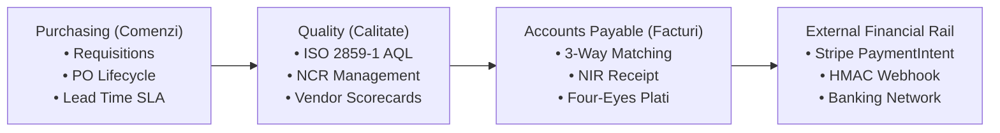

# 01. EXECUTIVE SUMMARY & ARB BRIEFING
**System:** Enterprise Procure-to-Pay (P2P) Supply Chain Modular Monolith  
**Namespace:** `ro.uaic.feaa.sdbis.supplychain`  
**Target Audience:** Enterprise Architecture Review Board (EARB), Chief Technology Officers, Technical Leads, University Evaluators, Security Auditors.  
**Baseline Release:** 1.0.0-PROD (GA) | Java 21 LTS | Spring Boot 3.3.5 | Spring Modulith 1.2.4

---

## 1. STRATEGIC PURPOSE & BUSINESS MANDATE

The Procure-to-Pay (P2P) platform is an enterprise-grade digital core orchestrating the end-to-end procurement lifecycle for industrial manufacturers and global distribution enterprises. It automates:
1. **Strategic Purchasing & Order Commitments:** Requisitioning, purchase order authoring, supplier confirmations, atomic multi-echelon order cancellation cascades, and algorithmic lead-time forecasting ($<300\text{ ms}$).
2. **Quality Assurance & Total Quality Management (TQM):** ISO 2859-1 (AQL) statistical lot sampling, dynamic vendor rating/classification, automated corrective action tracking via Non-Conformance Reports (NCR), and weighted monthly vendor scorecard computation ($40\%$ OTIF, $40\%$ Quality, $20\%$ Price).
3. **Accounts Payable & Financial Liquidity Control:** Automated 3-way matching ($PO \times NIR \times Invoice$) within configurable tolerance margins ($\pm 2\%$), goods receipt note (NIR) contabilization, Four-Eyes principle financial approval controls ($>10,000\text{ EUR}$), and digital bank transfers powered by Stripe SDK with cryptographically verified HMAC-SHA256 webhook reconciliation.

---

## 2. TECHNOLOGY RADAR & CORE STACK

| Dimension | Selected Technology | Version | Rationale & Architectural Governance |
| :--- | :--- | :--- | :--- |
| **Language Runtime** | Java OpenJDK LTS | 21.0.9 | Pattern matching, virtual threads readiness, records, sealed interfaces. |
| **Framework** | Spring Boot | 3.3.5 | Production-ready ecosystem, native metrics, declarative transactions. |
| **Modularity Engine** | Spring Modulith | 1.2.4 | Enforces bounded contexts, architectural fitness, explicit `api` contracts. |
| **Persistence Engine** | Hibernate ORM / JPA | 6.5.3.Final | Optimistic locking (`@Version`), proxy-safe equality, second-level cache ready. |
| **RDBMS** | PostgreSQL / H2 | 16.2 / 2.2 | ACID compliance, UUID support, table inheritance, rich domain `CHECK` rules. |
| **Schema Evolution** | Flyway Migration | 10.10.0 | Immutable SQL migrations V1 through V6 guaranteeing zero-drift schema history. |
| **Message Broker** | RabbitMQ / Spring AMQP | 3.12 / 3.1.7 | Topic exchanges, durable queues, Dead-Letter Exchange (DLX) routing. |
| **Event Reliability** | Transactional Outbox / Inbox | Custom JPA | Zero message loss, at-least-once external dispatch, exactly-once inbox ingestion. |
| **Payment Rail** | Stripe Java SDK | 26.1.0 | `PaymentIntent` API, HMAC-SHA256 signature verification, replay tolerance. |
| **Architecture Testing** | TNG ArchUnit | 1.3.0 | Automated fitness functions guaranteeing layer isolation and zero cycle leakage. |

---

## 3. ARCHITECTURAL PILLARS & GOVERNANCE

```mermaid
graph TD
    subgraph P1["Pillar 1: Modular Monolith & Clean Boundaries"]
        M1["comenzi (Orders)"]
        M2["calitate (Quality)"]
        M3["facturi (Invoices/Payments)"]
        M4["shared (Kernel)"]
        M1 -.->|Events & Summary DTOs| M4
        M2 -.->|Events & Summary DTOs| M4
        M3 -.->|Events & Summary DTOs| M4
    end

    subgraph P2["Pillar 2: Transactional Integrity & Outbox"]
        TX["Local RDBMS Transaction"] --> DB["Domain Tables"]
        TX --> OUT["shared_outbox"]
        OUT --> DISP["OutboxDispatcherService"]
        DISP --> RMQ["RabbitMQ Exchange"]
    end

    subgraph P3["Pillar 3: Bank Grade Security & Payment"]
        STR["Stripe Sandbox / Prod"] -->|Webhook Callback| WH["/api/ordine-plata/webhook-banca"]
        WH --> SIG["HMAC-SHA256 Signature Check"]
        SIG --> TOL["300s Timestamp Tolerance Window"]
        TOL --> IDEM["Idempotent Payment Order Finalization"]
    end
```

1. **Clean Domain-Driven Architecture:** Domain models are framework-independent and preserve business invariants via rich behavior methods (`anuleaza()`, `reconciliaza()`, `inregistreazaExecutie()`).
2. **Spring Modulith Structural Safety:** Inter-module dependencies are restricted to dedicated `@NamedInterface("api")` sub-packages. Internal packages (`domain`, `application`, `infrastructure`, `presentation`) are strictly isolated.
3. **Defense-in-Depth Relational Database Schema:** Relational constraints, check expressions (`chk_furnizor_cod_fiscal_len`, `chk_furnizor_iban_fmt`, `chk_comenzi_linii_cantitate`), and polling indexes guarantee data integrity at the lowest layer.
4. **Resilient Event Messaging:** Asynchronous inter-module event notifications and external integrations leverage a Transactional Outbox and an Idempotent Inbox to eliminate distributed two-phase commits (2PC) while preventing dual-write anomalies.

---

## 4. EXECUTIVE ARB METRICS & AUDIT SIGN-OFF

The system successfully passed an exhaustive Enterprise Architecture Review Board remediation cycle:

- **Automated Verification:** **96 tests executed, 0 failures, 0 errors, 0 skipped** across Unit, Integration, BDD Gherkin, and ArchUnit test suites.
- **Microservice Readiness:** Bounded contexts communicate purely via identifiers (`IdComanda`, `IdFurnizor`), immutable Public Summary DTOs, and asynchronous Domain Events, enabling straightforward microservice decomposition when scale demands.
- **Final ARB Readiness Status:** **GREEN (Unconditionally Certified for Production Deployment).**

