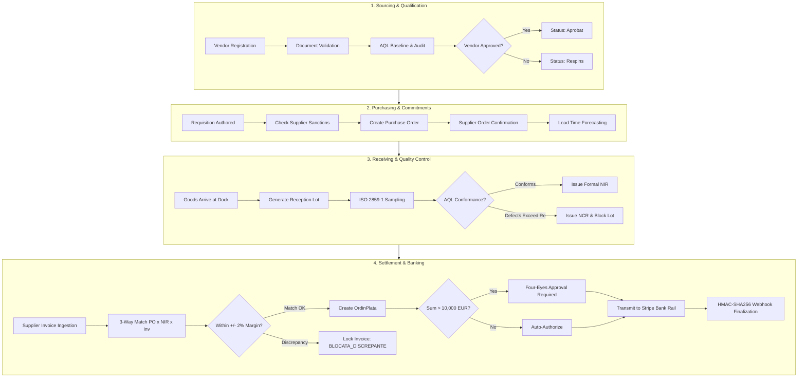
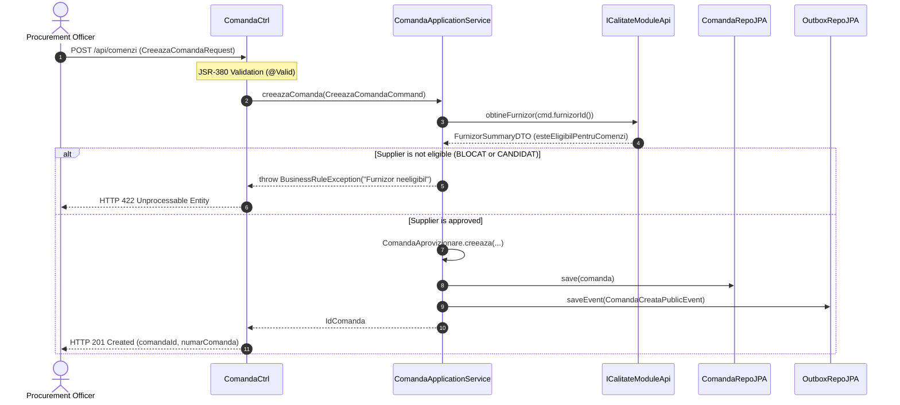
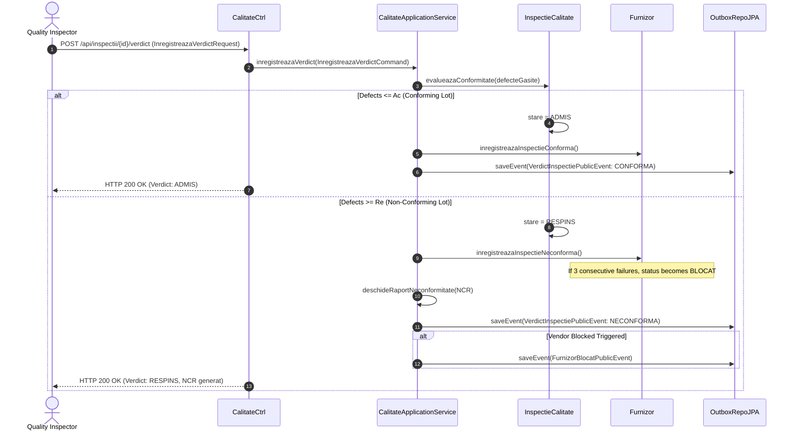
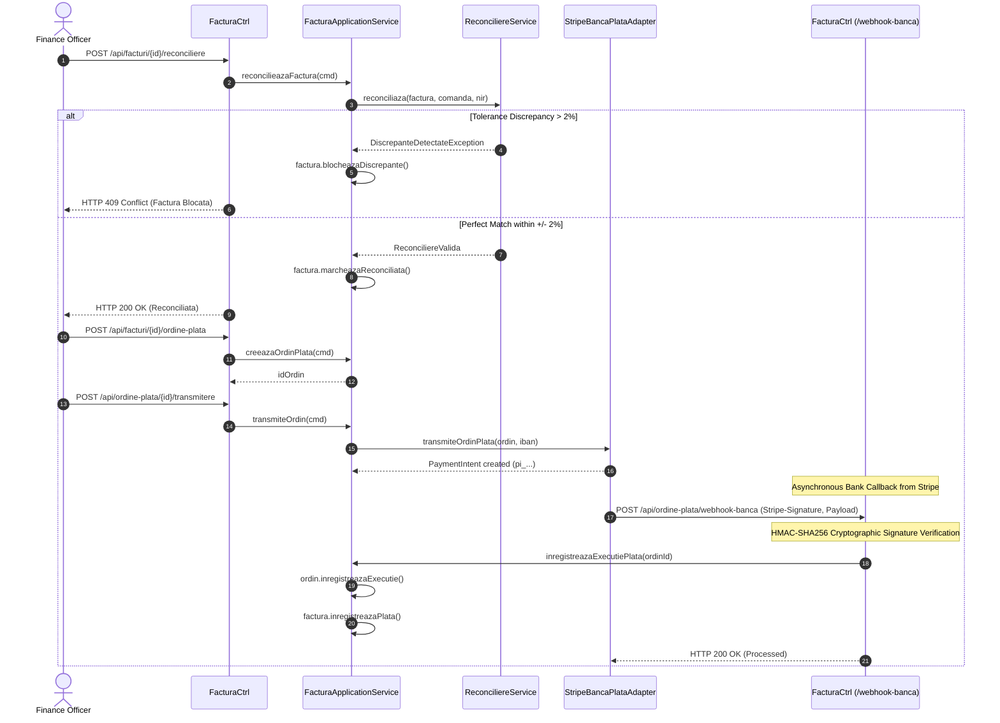

# 03. BUSINESS ANALYSIS & CORE BUSINESS PROCESSES
**System:** Enterprise Procure-to-Pay (P2P) Supply Chain Modular Monolith  
**Namespace:** `ro.uaic.feaa.sdbis.supplychain`

---

## 1. STRATEGIC BUSINESS DOMAIN & VALUE STREAM

In modern enterprise manufacturing and distribution, procurement risk directly impacts liquidity and operational continuity. The Procure-to-Pay (P2P) value stream transforms procurement from a fragmented manual administrative flow into an automated, risk-governed digital pipeline.

---

## 2. BUSINESS RULES & REGULATORY GOVERNANCE MATRIX

| Rule ID | Domain Concept | Business Rule Specification | Technical Enforcement Mechanism |
| :--- | :--- | :--- | :--- |
| **BR-PO-01** | Supplier Eligibility | Purchase orders can only be issued to suppliers in status `Aprobat` or `Conditionat`. Candidates or blocked suppliers must be rejected. | `ComandaApplicationService` queries `ICalitateModuleApi.esteEligibilPentruComenzi()`; returns HTTP 422 if false. |
| **BR-PO-02** | Line Uniqueness | An order cannot contain duplicate line items for the same `CodMaterial`. Quantities must be consolidated. | Aggregate invariant in `ComandaAprovizionare.adaugaLinie()`. |
| **BR-PO-03** | Cascade Cancellation | Cancelling an order automatically marks all associated pending shipments and uninspected lots as `ANULAT`. | Synchronous domain mutation in `ComandaAprovizionare.anuleazaComanda()`. |
| **BR-SQ-01** | Sanction Defense | A supplier with 3 consecutive non-conforming lots must be automatically transitioned to `BLOCAT`. | `Furnizor.inregistreazaInspectieNeconforma()`. |
| **BR-SQ-02** | Weighted Scorecard | Monthly evaluation calculates: $\text{Score} = 0.40 \cdot \text{OTIF} + 0.40 \cdot \text{Quality} + 0.20 \cdot \text{Price}$. | Domain Service `CalculScorecardService.calculeaza()`. |
| **BR-SQ-03** | AQL Invariants | For ISO 2859-1 sampling, the rejection threshold $Re$ must strictly equal acceptance threshold $Ac + 1$. | Enforced in domain constructor of `InspectieCalitate` and Flyway `chk_inspectii_aql`. |
| **BR-IP-01** | 3-Way Matching | Quantities and unit prices across Purchase Order, Goods Receipt (NIR), and Invoice must match within $\pm 2\%$. | `ReconciliereService.reconciliaza()`; sets `BLOCATA_DISCREPANTE` if invalid. |
| **BR-IP-02** | Four-Eyes Control | For payment orders $>10,000\text{ EUR}$, the approving officer must differ from the creator (`creatDe \ne aprobatorId`). | Aggregate guard clause in `OrdinPlata.aproba()`. |
| **BR-IP-08** | Sanction Lockout | Invoices belonging to a supplier marked as `BLOCAT` are barred from payment order generation or bank dispatch. | Checked via `FurnizoriBlocatiRepo.esteBlocat(furnizorId)`. |

---

## 3. CORE BUSINESS PROCESS SEQUENCE FLOWS

### Process A: Purchase Order Creation & Validation Flow

---

### Process B: ISO 2859-1 Quality Inspection & NCR Escalation Flow

---

### Process C: 3-Way Match Reconciliation & Payment Settlement Flow

