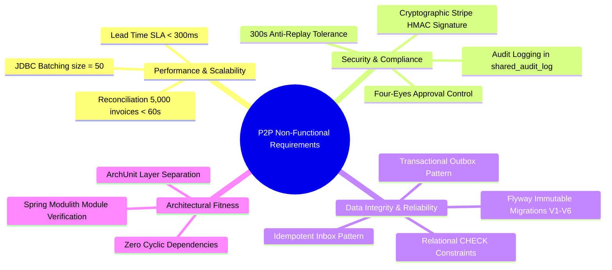

# 04. REQUIREMENTS SPECIFICATION & USE CASE CATALOG
**System:** Enterprise Procure-to-Pay (P2P) Supply Chain Modular Monolith  
**Namespace:** `ro.uaic.feaa.sdbis.supplychain`

---

## 1. FUNCTIONAL REQUIREMENTS MATRIX

### Category: Purchasing & Purchase Order Management (PO)
| ID | Requirement Statement | Module | Enforcement Component | Verification Test |
| :--- | :--- | :--- | :--- | :--- |
| **FR-PO-01** | System shall create purchase orders with unique order numbers, destination warehouse, requested delivery dates, and line items. | `comenzi` | `ComandaCtrl.creeazaComanda`, `CreeazaComandaRequest` | `ComandaCtrlRestTest.testCreeazaComandaSucces` |
| **FR-PO-02** | System shall verify supplier qualification status before authorizing purchase order persistence. | `comenzi` | `ComandaApplicationService` querying `ICalitateModuleApi` | `CreeazaComandaUnitTest.testFurnizorNeeligibil` |
| **FR-PO-03** | System shall record vendor confirmation with promised delivery dates, calculating deviation from requested date. | `comenzi` | `ComandaAprovizionare.confirmaComanda` | `WorkflowRulesTest.testConfirmareComanda` |
| **FR-PO-04** | System shall execute atomic cascade cancellation: cancelling an order marks all unreceived lots as cancelled. | `comenzi` | `ComandaAprovizionare.anuleazaComanda` | `CascadeCancellationIntegrationTest` |
| **FR-PO-05** | System shall forecast delivery lead times using linear regression over historical lot deliveries in $<300\text{ ms}$. | `comenzi` | `EstimareLeadTimeService` | `PerformanceAndSlaTest.testLeadTimeEstimationSLA` |

### Category: Quality Assurance & Vendor Evaluation (QA)
| ID | Requirement Statement | Module | Enforcement Component | Verification Test |
| :--- | :--- | :--- | :--- | :--- |
| **FR-QA-01** | System shall register candidate suppliers with fiscal code, corporate name, IBAN, and email channels. | `calitate` | `CalitateCtrl.inregistreazaFurnizor`, `InregistreazaFurnizorRequest` | `CalitateCtrlRestTest.testInregistreazaFurnizor` |
| **FR-QA-02** | System shall qualify candidate suppliers based on audit findings, transitioning state to `Calificat` or `Respins`. | `calitate` | `CalitateApplicationService.calificaFurnizor` | `CalitateCtrlRestTest` |
| **FR-QA-03** | System shall execute ISO 2859-1 (AQL) lot sampling, checking sample size and defect counts against $Ac$ and $Re$. | `calitate` | `InspectieCalitate.evalueazaConformitate` | `ValidationRulesTest.testAqlSamplingCalculation` |
| **FR-QA-04** | System shall automatically generate a Non-Conformance Report (NCR) when inspection verdict is `RESPINS`. | `calitate` | `CalitateApplicationService.inregistreazaVerdict` | `WorkflowRulesTest.testGenerareNCRAutomata` |
| **FR-QA-05** | System shall compute weighted monthly scorecards: $40\%$ OTIF, $40\%$ Quality, $20\%$ Price compliance. | `calitate` | `CalculScorecardService.calculeaza` | `ComputationRulesTest.testCalculScorecardLunar` |
| **FR-QA-06** | System shall automatically block any vendor reaching 3 consecutive non-compliant delivery lots. | `calitate` | `Furnizor.inregistreazaInspectieNeconforma` | `WorkflowRulesTest.testBlocareAutomataFurnizor` |

### Category: Invoicing, 3-Way Match & Payments (AP)
| ID | Requirement Statement | Module | Enforcement Component | Verification Test |
| :--- | :--- | :--- | :--- | :--- |
| **FR-AP-01** | System shall record supplier invoices in dual JSON/XML formats with tax rates, line items, and due dates. | `facturi` | `FacturaCtrl.inregistreazaFactura`, Content Negotiation | `ApacheHttpClientContentNegotiationTest` |
| **FR-AP-02** | System shall automatically generate an idempotent Goods Receipt Note (NIR) upon lot reception. | `facturi` | `FacturaEventListener.onComandaReceptionata` | `PaymentWorkflowIntegrationTest.testIdempotentNIR` |
| **FR-AP-03** | System shall perform 3-way reconciliation ($PO \times NIR \times Invoice$) within a $\pm 2\%$ tolerance window. | `facturi` | `ReconciliereService.reconciliaza` | `PerformanceAndSlaTest.testBatchReconciliationSLA` |
| **FR-AP-04** | System shall create payment orders (`OrdinPlata`) linked to approved, reconciled invoices. | `facturi` | `FacturaApplicationService.creeazaOrdinPlata` | `PaymentWorkflowIntegrationTest` |
| **FR-AP-05** | System shall enforce Four-Eyes approval for payment orders $>10,000\text{ EUR}$, requiring distinct approver. | `facturi` | `OrdinPlata.aproba` | `ControlFinanciarUnitTest.testFourEyesPrinciple` |
| **FR-AP-06** | System shall transmit payments via Stripe SDK and verify incoming webhooks using cryptographic HMAC-SHA256. | `facturi` | `FacturaCtrl.webhookBanca`, `StripeBancaPlataAdapter` | `FacturaCtrlRestTest.testWebhookBancaSemnaturaValida` |

---

## 2. NON-FUNCTIONAL REQUIREMENTS SPECIFICATION

---

## 3. USE CASE INVENTORY & CATALOG

### Use Case UC-01: Author Purchase Order
- **Primary Actor:** Procurement Officer.
- **Preconditions:** Authenticated user holding `ROLE_CUMPARATOR`; supplier exists in database.
- **Main Success Scenario:**
  1. Procurement officer submits `CreeazaComandaRequest` via `POST /api/comenzi`.
  2. Presentation layer executes JSR-380 validation; fails with HTTP 400 if fields are invalid.
  3. Application service invokes `ICalitateModuleApi.obtineFurnizor(furnizorId)`.
  4. System confirms supplier status is `Aprobat` or `Conditionat`.
  5. `ComandaAprovizionare` aggregate root is constructed; total value is calculated.
  6. Order is persisted to `comenzi_aprovizionare` and `comenzi_linii`.
  7. `ComandaCreataPublicEvent` is written to `shared_outbox` in the same ACID transaction.
  8. Returns HTTP 201 Created with generated `comandaId`.
- **Exception Scenarios:**
  - *Supplier Blocked or Candidate:* Returns HTTP 422 Unprocessable Entity (`Furnizor neeligibil`).
  - *Duplicate material codes in lines:* Throws validation error; request aborted.

### Use Case UC-02: Quality Inspection Verdict Registration
- **Primary Actor:** Certified Quality Inspector.
- **Preconditions:** Inspector assigned to inspection; lot received at dock.
- **Main Success Scenario:**
  1. Inspector submits defect count via `POST /api/inspectii/{id}/verdict`.
  2. System compares defect count against acceptance threshold $Ac$ and rejection threshold $Re$.
  3. If defects $\le Ac$, inspection status transitions to `ADMIS`.
  4. Lot transitions to `ACCEPTAT`; public event `VerdictInspectiePublicEvent(conforma=true)` is saved to outbox.
  5. Returns HTTP 200 OK.
- **Exception Scenario (Non-conformance):**
  - If defects $\ge Re$, inspection status transitions to `RESPINS`.
  - Non-Conformance Report (`RaportNeconformitate`) is automatically initialized with root-cause analysis deadline.
  - Public event `VerdictInspectiePublicEvent(conforma=false)` is published.
  - Supplier's consecutive non-conformance counter is incremented; if count reaches 3, supplier status switches to `BLOCAT`.

### Use Case UC-03: Three-Way Invoice Matching & Reconciliation
- **Primary Actor:** Accounts Payable Officer / Scheduled Reconciliation Job.
- **Preconditions:** Purchase order exists; Goods Receipt Note (NIR) exists for delivered lots.
- **Main Success Scenario:**
  1. Officer triggers reconciliation via `POST /api/facturi/{id}/reconciliere`.
  2. `ReconciliereService` loads invoice, associated purchase order, and reception note (`NIR`).
  3. Mathematical check: $|\text{Invoice Amount} - \text{NIR Amount}| \le 0.02 \times \text{PO Amount}$.
  4. If quantities and prices match within $\pm 2\%$, invoice transitions to `RECONCILIATA`.
  5. Returns HTTP 200 OK (`status: SUCCESS`).
- **Exception Scenario:**
  - If discrepancy exceeds $2\%$ or NIR is missing, invoice transitions to `BLOCATA_DISCREPANTE`.
  - Returns HTTP 409 Conflict with detailed error message.

