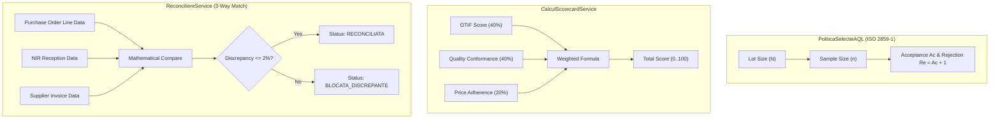

# 05. DOMAIN MODEL SPECIFICATION & AGGREGATE TAXONOMY
**System:** Enterprise Procure-to-Pay (P2P) Supply Chain Modular Monolith  
**Namespace:** `ro.uaic.feaa.sdbis.supplychain`

---

## 1. COMPREHENSIVE DOMAIN CLASS DIAGRAM

```mermaid
classDiagram
    direction TB

    namespace SharedKernel {
        class ValoareMonetara {
            <<Value Object>>
            +BigDecimal suma
            +Moneda moneda
            +adauga(ValoareMonetara) ValoareMonetara
            +scade(ValoareMonetara) ValoareMonetara
        }
        class Moneda {
            <<Value Object>>
            +String codIso
            +RON() Moneda
            +EUR() Moneda
            +USD() Moneda
        }
        class Cantitate {
            <<Value Object>>
            +BigDecimal valoare
            +String unitateMasura
        }
        class CodMaterial {
            <<Value Object>>
            +String cod
        }
        class IdComanda {
            <<Value Object>>
            +UUID value
        }
        class IdFurnizor {
            <<Value Object>>
            +UUID value
        }
        class IdLot {
            <<Value Object>>
            +UUID value
        }
    }

    namespace BoundedContext_Comenzi {
        class ComandaAprovizionare {
            <<Aggregate Root>>
            -IdComanda id
            -String numarComanda
            -IdFurnizor furnizorId
            -UUID cumparatorId
            -LocalDate dataComanda
            -LocalDate dataLivrareCeruta
            -LocalDate dataLivrarePromisa
            -StareComanda stare
            -List~LinieComanda~ linii
            -List~Lot~ loturi
            +adaugaLinie(LinieComanda) void
            +confirmaComanda(LocalDate) void
            +anuleazaComanda() void
            +inregistreazaReceptie(IdLot, Cantitate) void
        }
        class LinieComanda {
            <<Entity>>
            -Long id
            -CodMaterial material
            -Cantitate cantitate
            -PretUnitar pretUnitar
            +calculeazaSubtotal() ValoareMonetara
        }
        class Lot {
            <<Entity>>
            -IdLot idLot
            -String codLot
            -Cantitate cantitatePlanificata
            -Cantitate cantitatePrimita
            -StareLot stareLot
            +marcheazaReceptionat(Cantitate) void
            +anuleaza() void
        }
    }

    namespace BoundedContext_Calitate {
        class Furnizor {
            <<Aggregate Root>>
            -IdFurnizor id
            -String codFiscal
            -String denumire
            -StareFurnizor stare
            -int inspectiiNeconformeConsecutive
            -ConditiiContractuale conditii
            -List~PretNegociat~ preturiNegociate
            +califica(String decizie) void
            +inregistreazaInspectieConforma() void
            +inregistreazaInspectieNeconforma() void
            +blocheaza(String motiv) void
        }
        class InspectieCalitate {
            <<Aggregate Root>>
            -UUID id
            -IdLot lotId
            -IdComanda comandaId
            -UUID inspectorId
            -int marimeEsantion
            -int numarAcceptare
            -int numarRespingere
            -StareInspectie stare
            +evalueazaConformitate(int defecte) VerdictInspectie
        }
        class RaportNeconformitate {
            <<Aggregate Root>>
            -UUID id
            -UUID inspectieId
            -StareNCR stare
            -String cauzaRadacina
            -ActiuneCorectiva actiune
            +analizeazaCauza(String) void
            +stabilesteActiune(ActiuneCorectiva) void
            +inchide() void
        }
        class ScorecardLunar {
            <<Aggregate Root>>
            -UUID id
            -IdFurnizor furnizorId
            -Perioada perioada
            -BigDecimal scorOTIF
            -BigDecimal scorCalitate
            -BigDecimal scorPret
            -BigDecimal scorFinal
            +esteReabilitat() boolean
        }
    }

    namespace BoundedContext_Facturi {
        class FacturaFurnizor {
            <<Aggregate Root>>
            -UUID idFactura
            -String serie
            -String numar
            -IdComanda comandaId
            -IdFurnizor furnizorId
            -LocalDate dataEmitere
            -LocalDate dataScadenta
            -ValoareMonetara totalPlata
            -ValoareMonetara sumaPlatita
            -StareFactura stareFactura
            -List~LinieFactura~ linii
            +marcheazaReconciliata() void
            +blocheazaDiscrepante() void
            +inregistreazaPlata(Suma) void
        }
        class NIR {
            <<Aggregate Root>>
            -UUID idNIR
            -String numarNIR
            -IdComanda comandaId
            -LocalDate dataReceptie
            -List~LinieNIR~ linii
            +contabilizeaza() void
            +storneaza(String motiv) void
        }
        class OrdinPlata {
            <<Aggregate Root>>
            -UUID idOrdin
            -UUID facturaId
            -Suma suma
            -UUID creatDe
            -UUID aprobatDe
            -StareOrdinPlata stareOrdin
            +aproba(UUID aprobator) void
            +transmiteLaBanca() void
            +inregistreazaExecutie() PlataExecutataEvent
            +respingeDeBanca(String motiv) void
        }
    }

    ComandaAprovizionare *-- LinieComanda
    ComandaAprovizionare *-- Lot
    FacturaFurnizor *-- LinieFactura
    NIR *-- LinieNIR
    Furnizor o-- IdFurnizor
    ComandaAprovizionare o-- IdComanda
    ComandaAprovizionare o-- IdFurnizor
    FacturaFurnizor o-- IdComanda
    FacturaFurnizor o-- IdFurnizor
    InspectieCalitate o-- IdLot
    InspectieCalitate o-- IdComanda
```

---

## 2. AGGREGATE BOUNDARY TAXONOMY & INVARIANTS

### Aggregate 1: `ComandaAprovizionare` (Module: `comenzi`)
- **Root Entity:** `ComandaAprovizionare.java`
- **Internal Entities:** `LinieComanda`, `Lot`.
- **Primary Value Objects:** `IdComanda`, `Cantitate`, `PretUnitar`, `CodMaterial`.
- **Invariants:**
  1. *Total Order Value Invariant:* Order total is dynamically calculated as $\sum (\text{Linie.cantitate} \times \text{Linie.pretUnitar})$.
  2. *Line Item Uniqueness:* No two lines can have identical `CodMaterial`.
  3. *Cascade Cancellation Guarantee:* Calling `anuleazaComanda()` transitions the order to `ANULATA` and synchronously cascades the `ANULAT` state to all pending lots.

### Aggregate 2: `Furnizor` (Module: `calitate`)
- **Root Entity:** `Furnizor.java`
- **Embedded Structures:** `ConditiiContractuale` (payment terms, default currency).
- **Associated Collection:** `List<PretNegociat>` (negotiated material prices).
- **Invariants:**
  1. *Sanction Invariant:* Three consecutive non-conforming inspection verdicts automatically transitions status to `BLOCAT`.
  2. *Fiscal Code Uniqueness:* Guaranteed across the enterprise via database unique constraint.

### Aggregate 3: `InspectieCalitate` (Module: `calitate`)
- **Root Entity:** `InspectieCalitate.java`
- **Invariants:**
  1. *AQL Mathematical Consistency:* Rejection count $Re$ must strictly equal $Ac + 1$.
  2. *Immutable Lot Association:* Once bound to `IdLot`, an inspection cannot be rebound to another lot.

### Aggregate 4: `FacturaFurnizor` (Module: `facturi`)
- **Root Entity:** `FacturaFurnizor.java`
- **Internal Entities:** `LinieFactura`.
- **Invariants:**
  1. *Financial Balance Invariant:* $\text{Total Plata} = \text{Valoare Fara TVA} + \text{Valoare TVA}$.
  2. *Payment Bounds:* Total paid amount (`sumaPlatita`) can never exceed total payable amount (`valoareTotala`).
  3. *Reconciliation Prerequisite:* A payment order cannot be created for an invoice unless the invoice is in status `RECONCILIATA` or `PARTIAL_PLATITA`.

### Aggregate 5: `OrdinPlata` (Module: `facturi`)
- **Root Entity:** `OrdinPlata.java`
- **Invariants:**
  1. *Four-Eyes Approval Control:* If payment amount exceeds $10,000\text{ EUR}$, `aprobatorId` must not equal `creatDe`.
  2. *State Progression Constraint:* An order can only transition to `TransmisLaBanca` if it is in status `Aprobat` (or auto-approved in `Creat` for amounts $\le 10,000\text{ EUR}$).

---

## 3. DOMAIN POLICIES & CALCULATION SERVICES

