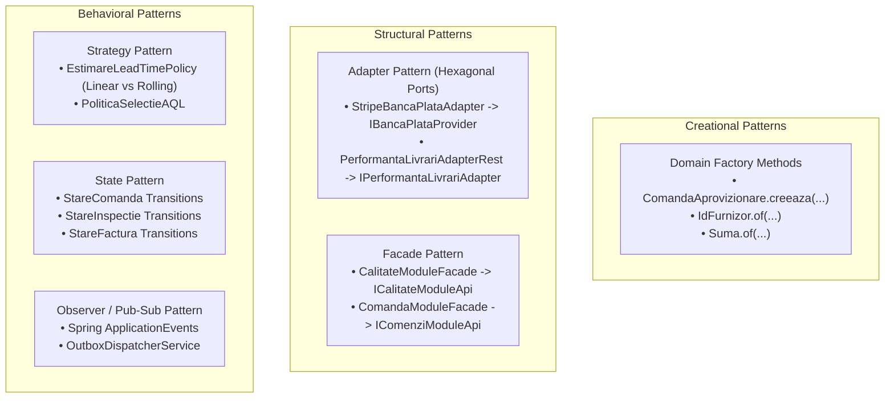
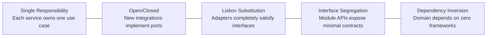

# 06. OBJECT-ORIENTED ANALYSIS & DESIGN (OOAD) ANALYSIS
**System:** Enterprise Procure-to-Pay (P2P) Supply Chain Modular Monolith  
**Namespace:** `ro.uaic.feaa.sdbis.supplychain`

---

## 1. DESIGN PATTERNS ARCHITECTURAL CATALOG

The system implements classic Gang-of-Four (GoF) and Enterprise Integration Patterns (EIP) to maintain low coupling and high cohesion across bounded contexts.

---

## 2. PATTERN IMPLEMENTATION SPECIFICATIONS

### 1. Hexagonal Adapter Pattern (`IBancaPlataProvider` & `StripeBancaPlataAdapter`)
- **Port Interface:** `ro.uaic.feaa.sdbis.supplychain.facturi.domain.IBancaPlataProvider`
- **Adapter Class:** [StripeBancaPlataAdapter.java](file:///c:/Users/bmugu/Desktop/app/src/main/java/ro/uaic/feaa/sdbis/supplychain/facturi/infrastructure/StripeBancaPlataAdapter.java)
- **Role:** Shields the core billing domain from Stripe SDK dependencies. The domain depends solely on `IBancaPlataProvider.transmiteOrdinPlata(OrdinPlata ordin, String iban)`. The infrastructure adapter translates this call into Stripe's `PaymentIntentCreateParams`, injects metadata (`idOrdin`, `facturaId`), and logs the audit event.

### 2. Strategy Pattern (`PoliticaSelectieAQL` & `IEstimareLeadTimeService`)
- **Classes:** `PoliticaSelectieAQL.java`, `EstimareLeadTimeService.java`
- **Role:** Permits dynamic selection of evaluation algorithms without modifying client code:
  - `PoliticaSelectieAQL` calculates ISO 2859-1 sampling sizes ($n$, $Ac$, $Re$) dynamically based on lot batch size ($N$).
  - Lead time estimation dynamically switches between historical linear regression and moving average based on sample volume.

### 3. State Pattern (Domain Lifecycle Engines)
- **Aggregates:** `ComandaAprovizionare`, `InspectieCalitate`, `FacturaFurnizor`, `OrdinPlata`.
- **Role:** Encapsulates state-specific transition rules directly in domain aggregates:
  - An order in `DRAFT` cannot transition to `RECEPTIONATA` without passing through `TRANSVERSAL_TRIMISA` and formal goods inspection.
  - An invoice in `BLOCATA_DISCREPANTE` cannot be paid until reconciled or manually contested.

---

## 3. SOLID PRINCIPLES COMPLIANCE AUDIT

### 1. Single Responsibility Principle (SRP)
- **Verification:** Command handlers (`CreeazaComandaCommand`, `InregistreazaFacturaCommand`) and Application Services separate mutation orchestration from query projections (`ComandaQueryService`, `FacturaQueryService`, `CalitateQueryService`).
- **Domain Aggregates:** `ComandaAprovizionare` manages order lifecycle; it does not calculate tax rates or issue accounting entries.

### 2. Open/Closed Principle (OCP)
- **Verification:** Event messaging is open to extension without modifying existing publisher classes. Adding a new notification channel (e.g., SMS, webhook) involves registering a new listener on `ComandaCreataPublicEvent` without touching the `comenzi` aggregate.

### 3. Liskov Substitution Principle (LSP)
- **Verification:** `StripeBancaPlataAdapter` adheres fully to `IBancaPlataProvider`. In test profiles, mock implementations can replace Stripe without violating invariants or requiring runtime branching.

### 4. Interface Segregation Principle (ISP)
- **Verification:** Public module contracts (`ICalitateModuleApi`, `IComenziModuleApi`, `IFacturiModuleApi`) expose focused read-only methods and public event records, avoiding monolithic bloated interfaces.

### 5. Dependency Inversion Principle (DIP)
- **Verification:** The domain layer defines repository ports (`ComandaRepo`, `FurnizorRepo`, `FacturaRepo`). Infrastructure packages provide Spring Data JPA implementations (`ComandaRepoJPA`, `FurnizorRepoJPA`), ensuring the core model depends on no external frameworks.

