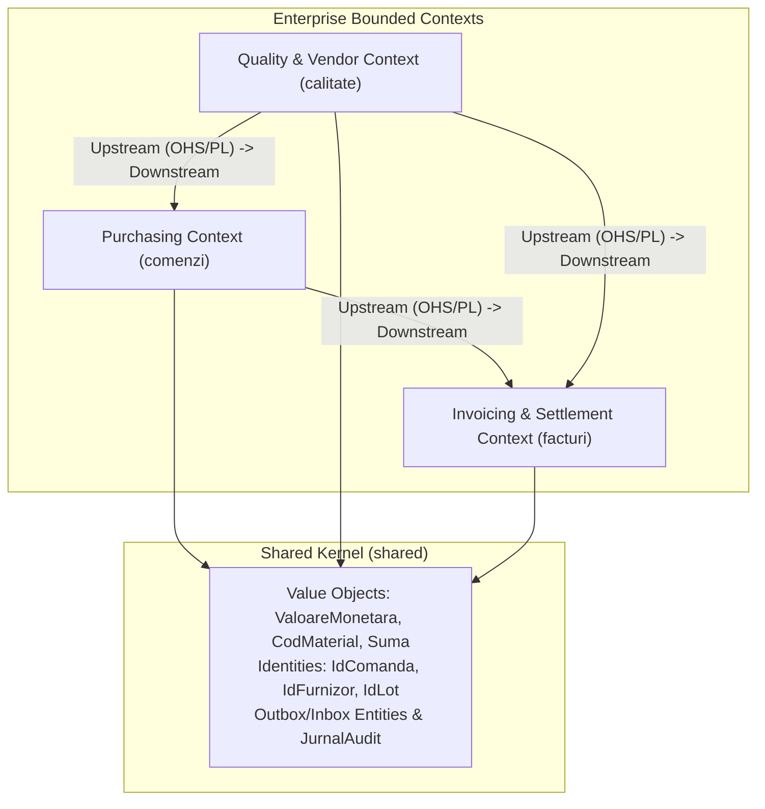
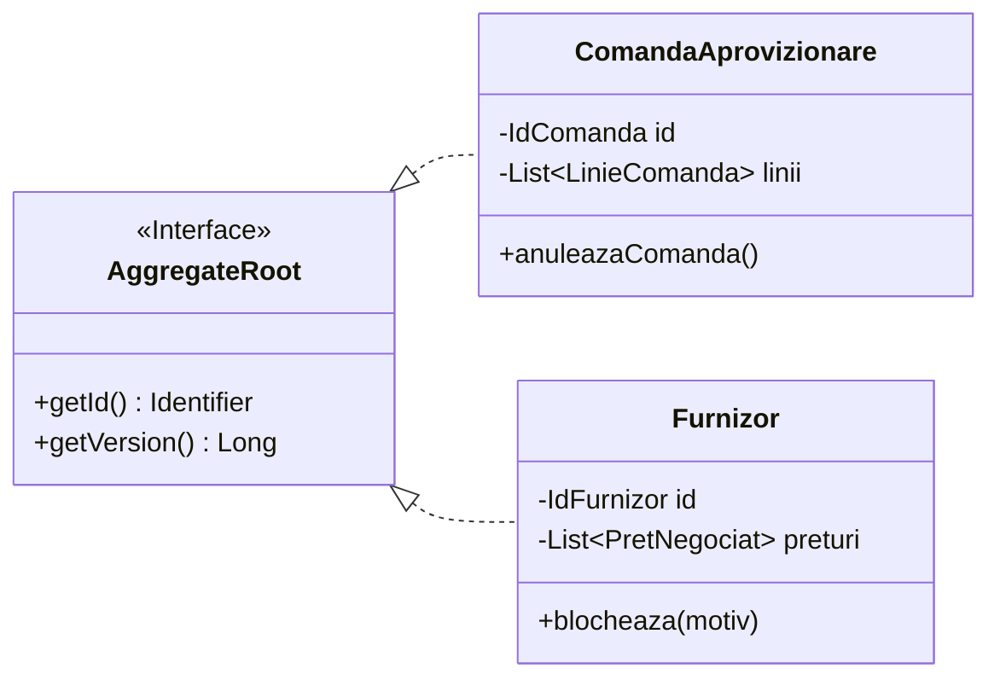

# 08. DOMAIN-DRIVEN DESIGN (DDD) STRATEGIC & TACTICAL ANALYSIS
**System:** Enterprise Procure-to-Pay (P2P) Supply Chain Modular Monolith  
**Namespace:** `ro.uaic.feaa.sdbis.supplychain`

---

## 1. STRATEGIC DDD: CONTEXT MAPPING

The enterprise supply chain domain is decomposed into three distinct Bounded Contexts and one Shared Kernel:

### Context Relationships Breakdown:
1. **Calitate $\rightarrow$ Comenzi (Customer-Supplier / Published Language):**
   - `calitate` is the upstream supplier of vendor eligibility state.
   - `comenzi` consumes `ICalitateModuleApi` using the published contract `FurnizorSummaryDTO`.
2. **Comenzi $\rightarrow$ Facturi (Customer-Supplier / Published Language):**
   - `comenzi` produces purchase order commitments and reception lot events (`ComandaReceptionataPublicEvent`).
   - `facturi` listens to these events to initialize Goods Receipt Notes (`NIR`) and perform 3-way matching.
3. **Calitate $\rightarrow$ Facturi (Upstream / ACL):**
   - Supplier blocking events (`FurnizorBlocatPublicEvent`) trigger automated payment suspension in `facturi` via [FurnizorBlocatFactura.java](file:///c:/Users/bmugu/Desktop/app/src/main/java/ro/uaic/feaa/sdbis/supplychain/facturi/infrastructure/FurnizorBlocatFactura.java).

---

## 2. UBIQUITOUS LANGUAGE DICTIONARY

| Romanian Domain Term | English Equivalent | Ubiquitous Definition & Invariants |
| :--- | :--- | :--- |
| **Comanda Aprovizionare** | Purchase Order (PO) | Commercial commitment issued to an approved supplier for specified materials, quantities, prices, and delivery deadlines. |
| **Furnizor** | Vendor / Supplier | External business entity supplying raw materials or goods. States: `Candidat`, `Calificat`, `Aprobat`, `Conditionat`, `Blocat`. |
| **Inspectie Calitate (AQL)** | Acceptance Quality Limit | Statistical sampling inspection governed by ISO 2859-1 standards evaluating lot defect counts against acceptance ($Ac$) and rejection ($Re$) thresholds. |
| **Raport Neconformitate (NCR)** | Non-Conformance Report | Formal quality incident document opened when an inspection verdict is `RESPINS`, tracking root cause analysis and corrective actions. |
| **Scorecard Lunar** | Monthly Vendor Scorecard | Weighted evaluation: $\text{Score} = 0.40 \cdot \text{OTIF} + 0.40 \cdot \text{Quality} + 0.20 \cdot \text{Price adherence}$. |
| **Nota de Receptie (NIR)** | Goods Receipt Note | Official warehouse reception document recording verified delivered quantities against purchase orders. |
| **Reconciliere (3-Way Match)** | Three-Way Matching | Algorithmic reconciliation ensuring unit prices and quantities match across PO, NIR, and Invoice within a $\pm 2\%$ margin. |
| **Ordin de Plata** | Payment Order | Financial disbursement authorization linked to a reconciled invoice, requiring Four-Eyes approval for sums $>10,000\text{ EUR}$. |

---

## 3. TACTICAL DDD PATTERNS IMPLEMENTATION

### A. Value Objects (Zero Identity, Immutability, Self-Validation)
- **Examples:** `ValoareMonetara`, `PretUnitar`, `Cantitate`, `CodMaterial`, `Perioada`, `Moneda`.
- **Implementation Rules:**
  - Implemented as Java records or immutable `@Embeddable` classes.
  - No public setters; instances are recreated upon mathematical operations (`valoare.adauga(altaValoare)`).
  - Encapsulate business invariants in constructors (e.g., `Moneda` rejects invalid ISO-4217 currency strings).

### B. Entities & Aggregate Roots
- **Rules Enforced in Codebase:**
  1. Outside modules reference Aggregate Roots strictly by ID (`IdComanda`, `IdFurnizor`, `UUID`), never through direct object memory pointers.
  2. Child entities (`LinieComanda`, `LinieFactura`, `LinieNIR`) are private to their root and are accessed solely through root methods (`comanda.adaugaLinie(...)`).
  3. All collection getters return unmodifiable copies (`Collections.unmodifiableList(...)`), preventing unauthorized external graph mutations.

