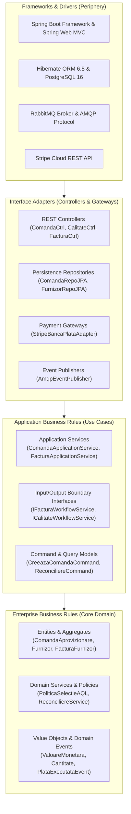

# 09. CLEAN ARCHITECTURE & HEXAGONAL PORTS SPECIFICATION
**System:** Enterprise Procure-to-Pay (P2P) Supply Chain Modular Monolith  
**Namespace:** `ro.uaic.feaa.sdbis.supplychain`

---

## 1. THE CONCENTRIC ONION ARCHITECTURE

The repository adheres strictly to Robert C. Martin's Clean Architecture principles. Dependencies point inward: inner layers define business concepts and interfaces; outer layers provide concrete implementations.

---

## 2. LAYER RESPONSIBILITY & DEPENDENCY RULES

### Layer 1: Core Domain (`*.domain`)
- **Dependencies:** Completely framework-independent. Contains zero imports of `org.springframework.*`, `jakarta.persistence.*`, or `com.stripe.*`.
- **Contents:** Domain entities, aggregate roots, value objects, domain exceptions, domain events, domain service policies.
- **Rule:** Business invariants are protected exclusively through entity methods. Anemic domain models are forbidden.

### Layer 2: Application Use Cases (`*.application`)
- **Dependencies:** Depends exclusively on the Domain layer and Shared Kernel.
- **Contents:** Application services (`*ApplicationService`), Command records (`*Command`), Query services (`*QueryService`), Data Transfer Objects (`*DTO`).
- **Rule:** Coordinates transaction boundaries via `@Transactional`, orchestrates domain aggregates, saves changes to repository ports, and emits domain events to the outbox.

### Layer 3: Infrastructure Adapters (`*.infrastructure`)
- **Dependencies:** Implements interfaces declared by Domain or Application layers. Depends on frameworks (Spring Data JPA, Hibernate, RabbitMQ, Stripe).
- **Contents:** Repository implementations (`*RepoJPA`), external API adapters (`StripeBancaPlataAdapter`), Flyway migrations, database converters.
- **Rule:** No domain logic resides here; this layer is purely technical translation.

### Layer 4: Presentation (`*.presentation`)
- **Dependencies:** Calls Application Services via input DTOs.
- **Contents:** REST controllers (`*Ctrl`), Request DTOs (`*Request`), Response wrappers.
- **Rule:** Performs input sanitation, JSR-380 validation (`@Valid`), content negotiation (JSON/XML), and translates exceptions into HTTP response codes via `GlobalExceptionHandler`.

---

## 3. PORTS & ADAPTERS (HEXAGONAL) INVENTORY

| Hexagonal Port Interface | Direction | Module | Infrastructure Adapter Implementation | Technology Stack |
| :--- | :--- | :--- | :--- | :--- |
| `IBancaPlataProvider` | Outbound | `facturi` | [StripeBancaPlataAdapter.java](file:///c:/Users/bmugu/Desktop/app/src/main/java/ro/uaic/feaa/sdbis/supplychain/facturi/infrastructure/StripeBancaPlataAdapter.java) | Stripe Java SDK (PaymentIntent) |
| `IJurnalAudit` | Outbound | `shared` | [JurnalAuditService.java](file:///c:/Users/bmugu/Desktop/app/src/main/java/ro/uaic/feaa/sdbis/supplychain/securitate/JurnalAuditService.java) | PostgreSQL (`shared_audit_log`) |
| `OutboxRepo` | Outbound | `shared` | [OutboxRepoJPA.java](file:///c:/Users/bmugu/Desktop/app/src/main/java/ro/uaic/feaa/sdbis/supplychain/shared/OutboxRepoJPA.java) | Spring Data JPA / Jackson JSON |
| `InboxRepo` | Outbound | `shared` | [InboxRepoJPA.java](file:///c:/Users/bmugu/Desktop/app/src/main/java/ro/uaic/feaa/sdbis/supplychain/shared/InboxRepoJPA.java) | Spring Data JPA |
| `ComandaRepo` | Outbound | `comenzi` | `ComandaRepoJPA.java` | Spring Data JPA / Hibernate |
| `FurnizorRepo` | Outbound | `calitate` | `FurnizorRepoJPA.java` | Spring Data JPA / Hibernate |
| `FacturaRepo` | Outbound | `facturi` | `FacturaRepoJPA.java` | Spring Data JPA / Hibernate |
| `ICalitateModuleApi` | Inbound | `calitate` | `CalitateModuleFacade.java` | Spring Modulith `@NamedInterface` |
| `IComenziModuleApi` | Inbound | `comenzi` | `ComandaModuleFacade.java` | Spring Modulith `@NamedInterface` |
| `IFacturiModuleApi` | Inbound | `facturi` | `FacturaModuleFacade.java` | Spring Modulith `@NamedInterface` |

