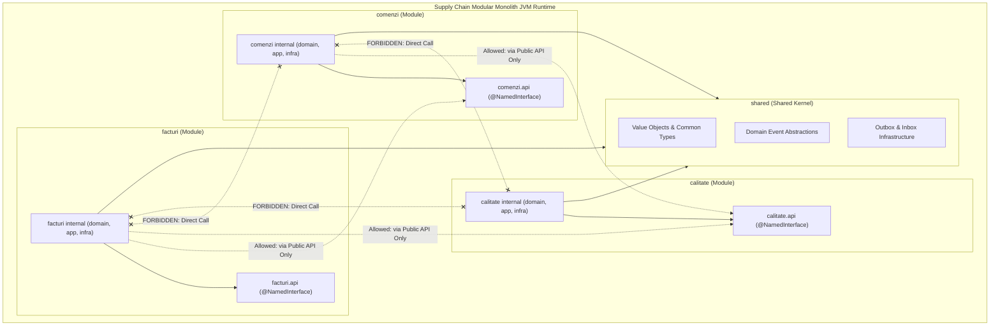

# 10. MODULAR MONOLITH ARCHITECTURE & BOUNDARY DISCIPLINE
**System:** Enterprise Procure-to-Pay (P2P) Supply Chain Modular Monolith  
**Namespace:** `ro.uaic.feaa.sdbis.supplychain`

---

## 1. MODULAR MONOLITH VALUE PROPOSITION

A Modular Monolith combines the architectural discipline of Microservices (isolated bounded contexts, strict API contracts, asynchronous event communication) with the operational simplicity of a Monolith (single deployment artifact, zero network latency between calls, atomic refactoring, unified ACID transactions when needed).

---

## 2. MODULE INTERACTION MATRIX & COMMUNICATION RULES

| Source Module | Target Module | Interaction Mechanism | Allowed Data Types | Direct Internal Call Permitted? |
| :--- | :--- | :--- | :--- | :--- |
| `comenzi` | `calitate` | Synchronous via `ICalitateModuleApi` | `FurnizorSummaryDTO`, `UUID` | **NO (Compile/ArchUnit Blocked)** |
| `comenzi` | `calitate` | Asynchronous via `ComandaReceptionataPublicEvent` | Primitive values, `IdLot`, `IdComanda` | **NO (Dispatched via Outbox)** |
| `calitate` | `comenzi` | Asynchronous via `VerdictInspectiePublicEvent` | Verdict string, boolean flag, `IdLot` | **NO (Dispatched via Outbox)** |
| `facturi` | `comenzi` | Synchronous via `IComenziModuleApi` | `ComandaSummaryDTO`, `LinieComandaDTO` | **NO (Compile/ArchUnit Blocked)** |
| `facturi` | `calitate` | Asynchronous via `FurnizorBlocatPublicEvent` | Supplier ID, reason string | **NO (Dispatched via Outbox)** |
| All Modules | `shared` | Direct package import | Value Objects, Event Interfaces, Repos | **YES (Open Shared Kernel)** |

---

## 3. STRICT BOUNDARY RULES

1. **The `api` Package is the Only Door:**
   - Every module exposes an `api` package annotated with `@NamedInterface("api")`.
   - Any class outside a module attempting to import from `*.domain.*`, `*.application.*`, or `*.infrastructure.*` triggers immediate ArchUnit test failure and Spring Modulith verification abort.
2. **Identifier-Only Foreign Keys:**
   - Entities never maintain JPA foreign object references across modules (e.g., `ComandaAprovizionare` has `IdFurnizor furnizorId;`, NOT `@ManyToOne Furnizor furnizor;`).
   - This eliminates Hibernate cross-context cascade hazards and ensures microservice readiness.
3. **Immutable Projection Records:**
   - Inter-module queries return Java records (`ComandaSummaryDTO`, `FurnizorSummaryDTO`, `FacturaSummaryDTO`), shielding internal JPA entities from external modification or lazy loading outside transaction boundaries.

