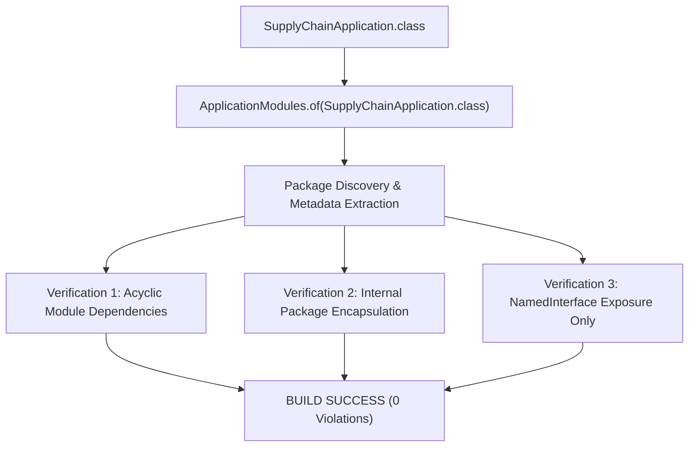

# 11. SPRING MODULITH IMPLEMENTATION & VERIFICATION
**System:** Enterprise Procure-to-Pay (P2P) Supply Chain Modular Monolith  
**Namespace:** `ro.uaic.feaa.sdbis.supplychain`

---

## 1. SPRING MODULITH CONFIGURATION & METAMODEL

The application leverages **Spring Modulith 1.2.4** to inspect, enforce, and document modular boundaries at build and test time.



### Module Package Structure:
```
ro.uaic.feaa.sdbis.supplychain
├── calitate
│   ├── package-info.java            <-- @org.springframework.modulith.NamedInterface("api")
│   ├── api                          <-- EXPORTED PUBLIC CONTRACTS
│   ├── application                  <-- INTERNAL ENCAPSULATED
│   ├── domain                       <-- INTERNAL ENCAPSULATED
│   ├── infrastructure               <-- INTERNAL ENCAPSULATED
│   └── presentation                 <-- INTERNAL ENCAPSULATED
├── comenzi
│   ├── package-info.java            <-- @org.springframework.modulith.NamedInterface("api")
│   ├── api                          <-- EXPORTED PUBLIC CONTRACTS
│   └── ...                          <-- INTERNAL ENCAPSULATED
├── facturi
│   ├── package-info.java            <-- @org.springframework.modulith.NamedInterface("api")
│   ├── api                          <-- EXPORTED PUBLIC CONTRACTS
│   └── ...                          <-- INTERNAL ENCAPSULATED
└── shared                           <-- OPEN SHARED KERNEL
```

---

## 2. PACKAGE-INFO INTERFACE DECLARATIONS

Every business module root declares its exported surface using `package-info.java`. For example, in `calitate/package-info.java`:

```java
@org.springframework.modulith.ApplicationModule(
    allowedDependencies = {"shared", "comenzi::*"}
)
package ro.uaic.feaa.sdbis.supplychain.calitate;
```

And in `calitate/api/package-info.java`:
```java
@org.springframework.modulith.NamedInterface("api")
package ro.uaic.feaa.sdbis.supplychain.calitate.api;
```

### Dependency Rules Enforced:
1. `comenzi` depends only on `shared` and `calitate::*`.
2. `facturi` depends only on `shared`, `comenzi::*`, and `calitate::*`.
3. `calitate` depends only on `shared` and `comenzi::*`.
4. No circular references exist between modules.

---

## 3. VERIFICATION TEST HARNESS

In [SpringModulithTest.java](file:///c:/Users/bmugu/Desktop/app/src/test/java/ro/uaic/feaa/sdbis/supplychain/SpringModulithTest.java):

```java
@SpringBootTest
public class SpringModulithTest {

    static final ApplicationModules modules = ApplicationModules.of(SupplyChainApplication.class);

    @Test
    void verifyModularMonolith() {
        modules.verify();
    }

    @Test
    void writeDocumentationSnippets() {
        new Documenter(modules)
            .writeModulesAsPlantUml()
            .writeIndividualModulesAsPlantUml();
    }
}
```

- When `modules.verify()` executes, it analyzes all bytecode dependencies. If any class in `facturi` imports an internal class from `comenzi.domain` or `calitate.domain`, the test throws `org.springframework.modulith.core.Violations` and halts the build.
- The test runs cleanly in CI/CD, guaranteeing architectural enforcement.

