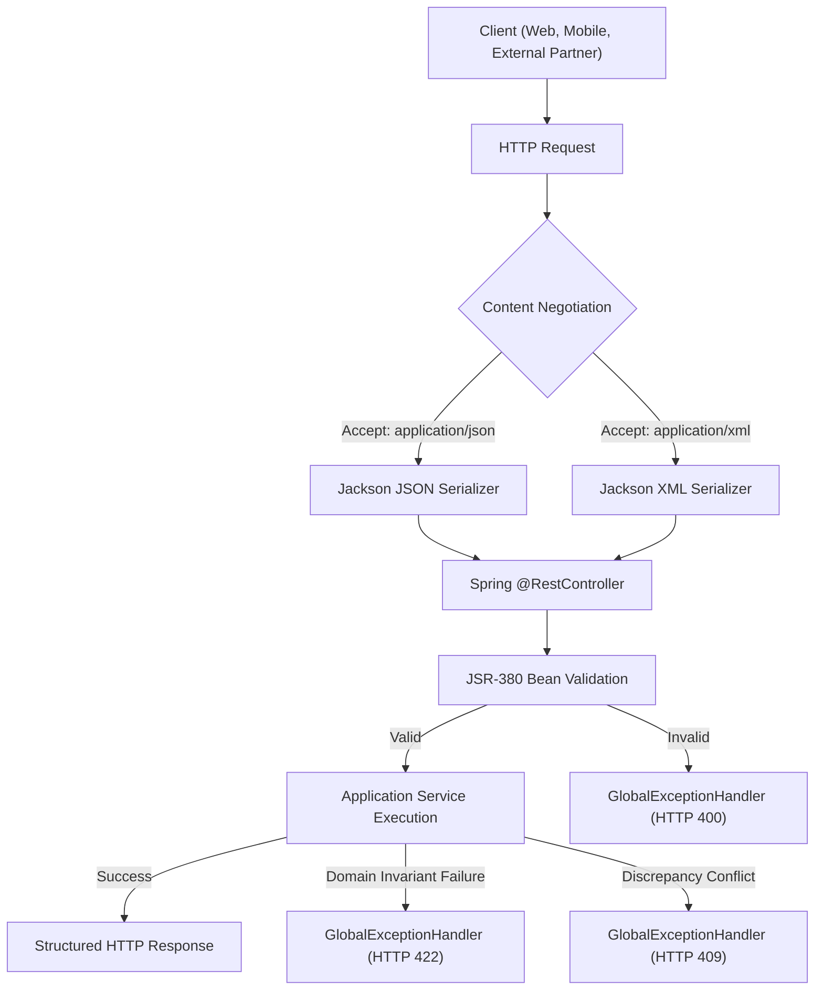

# 12. REST API ARCHITECTURE & PROTOCOL DESIGN
**System:** Enterprise Procure-to-Pay (P2P) Supply Chain Modular Monolith  
**Namespace:** `ro.uaic.feaa.sdbis.supplychain`

---

## 1. REST API ARCHITECTURAL GUIDELINES

The presentation layer exposes RESTful APIs adhering to Richardson Maturity Model (Level 2/3), enterprise content negotiation, and RFC-7807 compliant error structures.



---

## 2. DUAL CONTENT NEGOTIATION (JSON & XML)

In compliance with enterprise procurement requirements (EDI/XML integration), key endpoints support dual representations:
- **Default Media Type:** `application/json`
- **Enterprise XML Media Type:** `application/xml` or via query override `?format=xml`
- **Implementation:** Enabled via `jackson-dataformat-xml` and annotations (`@JacksonXmlRootElement`).
- **Verified In:** `ApacheHttpClientContentNegotiationTest.java`.

---

## 3. UNIFIED ERROR RESPONSE PROTOCOL

All API errors return a standard JSON/XML payload managed by [GlobalExceptionHandler.java](file:///c:/Users/bmugu/Desktop/app/src/main/java/ro/uaic/feaa/sdbis/supplychain/infrastructure/configuration/GlobalExceptionHandler.java):

```json
{
  "timestamp": "2026-10-29T12:00:00Z",
  "status": 400,
  "error": "Validation Failed",
  "message": "Date de intrare invalide",
  "fieldErrors": {
    "numarComanda": "Numarul comenzii este obligatoriu",
    "cantitate": "Cantitatea trebuie sa fie strict pozitiva"
  }
}
```

### HTTP Status Code Mapping:
| HTTP Status Code | Standard Meaning | Domain Exception Trigger | Example Endpoint |
| :--- | :--- | :--- | :--- |
| **200 OK** | Successful mutation or query | Use case processed successfully | `POST /api/inspectii/{id}/verdict` |
| **201 Created** | Entity created successfully | Resource ID generated | `POST /api/comenzi`, `POST /api/facturi` |
| **204 No Content** | Successful deletion | Aggregate removed | `DELETE /api/comenzi/{id}` |
| **400 Bad Request** | Syntax or validation failure | `MethodArgumentNotValidException`, `BindException`, `SignatureVerificationException` | Missing Stripe signature, blank fields |
| **401 / 403** | Authentication / RBAC failure | `SecurityException`, missing bearer token | Accessing finance endpoint without role |
| **404 Not Found** | Resource missing | `NoSuchElementException`, `EntityNotFoundException` | Querying nonexistent order or invoice |
| **409 Conflict** | State or concurrency conflict | `IllegalStateException`, `OptimisticLockException` | 3-way match reconciliation failure |
| **422 Unprocessable**| Domain invariant broken | `DomainValidationException`, `BusinessRuleException` | Ineligible candidate supplier on PO |
| **500 Server Error** | Unexpected runtime crash | Unchecked exceptions | Logged with correlation ID |

