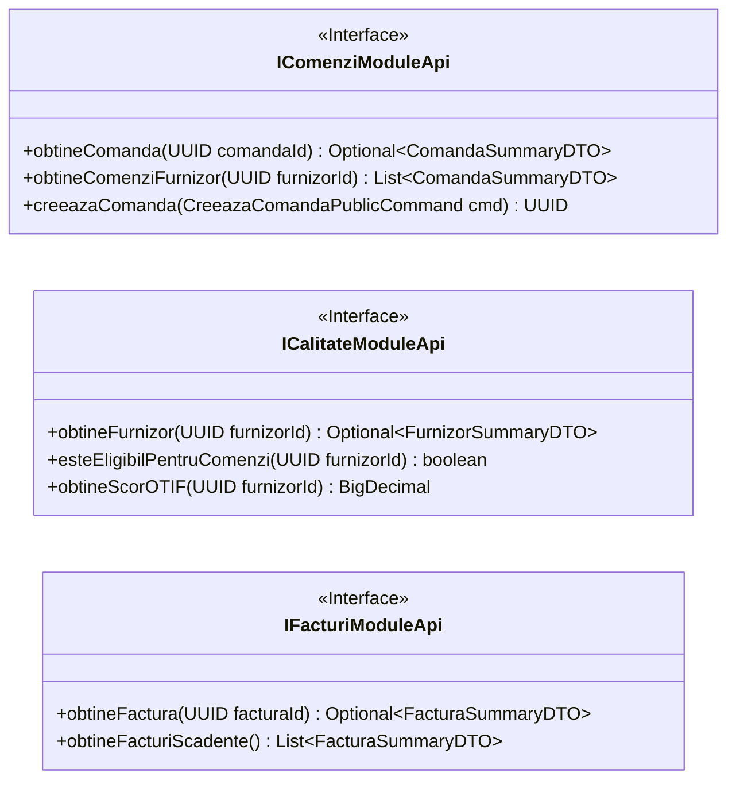

# 14. MODULE API CONTRACTS & INTER-CONTEXT INTEGRATION
**System:** Enterprise Procure-to-Pay (P2P) Supply Chain Modular Monolith  
**Namespace:** `ro.uaic.feaa.sdbis.supplychain`

---

## 1. PUBLIC CONTRACT PHILOSOPHY

To eliminate cyclic references and prevent domain entity leakage between modules, all inter-module communication is restricted to exported contracts located in `*.api` packages. These contracts fall into three categories:
1. **Module APIs (Facades):** Synchronous, read-only query interfaces.
2. **Public Summary DTOs:** Immutable projection records carrying sanitized data across boundaries.
3. **Public Domain Events:** Asynchronous notifications carrying state change announcements.



---

## 2. SYNCHRONOUS MODULE CONTRACTS

### A. `ICalitateModuleApi` (Exposed by `calitate`)
- **Location:** [ICalitateModuleApi.java](file:///c:/Users/bmugu/Desktop/app/src/main/java/ro/uaic/feaa/sdbis/supplychain/calitate/api/ICalitateModuleApi.java)
- **Implementation:** `CalitateModuleFacade.java`
- **Consumer:** `comenzi` (during purchase order creation to check supplier eligibility `BR-PO-01`).
- **Signature:**
  ```java
  public interface ICalitateModuleApi {
      Optional<FurnizorSummaryDTO> obtineFurnizor(UUID furnizorId);
      boolean esteEligibilPentruComenzi(UUID furnizorId);
      BigDecimal obtineScorOTIF(UUID furnizorId);
  }
  ```

### B. `IComenziModuleApi` (Exposed by `comenzi`)
- **Location:** [IComenziModuleApi.java](file:///c:/Users/bmugu/Desktop/app/src/main/java/ro/uaic/feaa/sdbis/supplychain/comenzi/api/IComenziModuleApi.java)
- **Implementation:** `ComandaModuleFacade.java`
- **Consumer:** `facturi` (during 3-way match reconciliation to compare order prices against invoice lines).

### C. `IFacturiModuleApi` (Exposed by `facturi`)
- **Location:** [IFacturiModuleApi.java](file:///c:/Users/bmugu/Desktop/app/src/main/java/ro/uaic/feaa/sdbis/supplychain/facturi/api/IFacturiModuleApi.java)
- **Implementation:** `FacturaModuleFacade.java`
- **Consumer:** `shared`, scheduled reporting, monitoring dashboards.

---

## 3. ASYNCHRONOUS PUBLIC DOMAIN EVENTS

| Event Record Name | Originating Module | Listening Modules | Payload Content | Business Trigger |
| :--- | :--- | :--- | :--- | :--- |
| `ComandaCreataPublicEvent` | `comenzi` | `notificari`, Outbox | `eventId, occurredOn, comandaId, furnizorId` | PO successfully persisted. |
| `ComandaReceptionataPublicEvent`| `comenzi` | `facturi`, `calitate` | `comandaId, lotId, cantitatePrimita, unitateMasura` | Warehouse dock receipt logged. Triggers NIR creation. |
| `ComandaAnulataPublicEvent` | `comenzi` | `facturi`, `notificari` | `comandaId, motiv` | PO cascade cancellation executed. |
| `VerdictInspectiePublicEvent` | `calitate` | `comenzi`, `facturi` | `inspectieId, lotId, comandaId, verdict, conforma` | Quality inspection completed. |
| `FurnizorBlocatPublicEvent` | `calitate` | `comenzi`, `facturi` | `furnizorId, motiv` | Vendor reached 3 failed lots. Blocks payments. |
| `PlataExecutataPublicEvent` | `facturi` | `notificari`, Outbox | `idOrdin, facturaId, suma, moneda` | Stripe webhook confirmed bank transfer. |

---

## 4. PUBLIC COMMAND RECORDS

In compliance with self-validating boundary rules, cross-module mutations use strongly-typed command records:

### `CreeazaComandaPublicCommand.java`
```java
public record CreeazaComandaPublicCommand(
    @NotNull UUID furnizorId,
    @NotNull UUID gestionarId,
    @NotNull @FutureOrPresent LocalDate dataLivrareEstimata,
    @NotBlank @Size(min = 2, max = 100) String depozitDestinatie,
    @NotEmpty List<@Valid @NotNull LinieComandaDTO> linii
) implements Serializable {}
```

