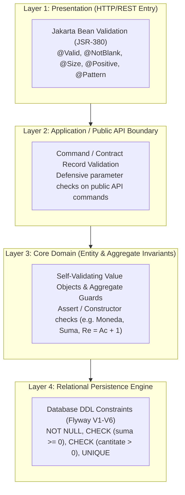

# 15. VALIDATION ARCHITECTURE & DEFENSE-IN-DEPTH STRATEGY
**System:** Enterprise Procure-to-Pay (P2P) Supply Chain Modular Monolith  
**Namespace:** `ro.uaic.feaa.sdbis.supplychain`

---

## 1. MULTI-TIER DEFENSE-IN-DEPTH VALIDATION MODEL

The architecture enforces validation across four distinct boundary layers, guaranteeing that invalid data is rejected at the earliest possible stage while maintaining relational integrity even under direct SQL interaction.



---

## 2. DEFENSE-IN-DEPTH VALIDATION MATRIX

| Validation Target | Layer 1: JSR-380 Annotation | Layer 2: Command Contract | Layer 3: Domain Invariant Guard | Layer 4: Relational Database CHECK |
| :--- | :--- | :--- | :--- | :--- |
| **Order Line Quantity** | `@Positive` | `@NotNull @Positive cantitate` | `Assert.isTrue(valoare.compareTo(BigDecimal.ZERO) > 0)` | `ALTER TABLE comenzi_linii ADD CONSTRAINT chk_comenzi_linii_cantitate CHECK (cantitate > 0)` |
| **Unit Price** | `@PositiveOrZero` | `@NotNull @PositiveOrZero pret` | `PretUnitar.of(...)` validates non-negative | `ALTER TABLE comenzi_linii ADD CONSTRAINT chk_comenzi_linii_pret CHECK (pret_unitar >= 0)` |
| **Currency Code** | `@Pattern(regexp = "EUR|RON|USD")` | `@Pattern(regexp = "EUR|RON|USD")` | `Moneda.of(...)` enforces ISO-4217 standard | `ALTER TABLE comenzi_linii ADD CONSTRAINT chk_comenzi_linii_moneda_len CHECK (length(moneda) = 3)` |
| **Vendor Fiscal Code** | `@NotBlank @Size(min=2, max=30)` | `@NotBlank @Size(min=2, max=30)` | `CodFiscal` object length check | `ALTER TABLE calitate_furnizori ADD CONSTRAINT chk_furnizor_cod_fiscal_len CHECK (length(cod_fiscal) >= 2)` |
| **IBAN Format** | `@Pattern(regexp = "^[A-Z]{2}[0-9]{2}...")` | `@Pattern(...)` | `new Iban(str)` regex syntax guard | `ALTER TABLE calitate_furnizori ADD CONSTRAINT chk_furnizor_iban_fmt CHECK (iban_valoare IS NULL OR length >= 10)` |
| **Invoice Total Amount** | `@PositiveOrZero` | `@PositiveOrZero totalDePlata` | Total must equal $\text{Base} + \text{TVA}$ | `ALTER TABLE facturi_furnizori ADD CONSTRAINT chk_facturi_valoare_totala CHECK (valoare_totala >= 0)` |
| **Inspection AQL Ratio**| `@PositiveOrZero int defecte`| Input validation | Rejection count $Re$ must strictly equal $Ac + 1$ | `ALTER TABLE calitate_inspectii ADD CONSTRAINT chk_inspectii_aql CHECK (numar_respingere = numar_acceptare + 1)` |
| **Four-Eyes Approval** | Checked via Request DTO | Method parameter validation | `Assert.isTrue(creatDe != aprobatorId)` | Enforced in Java aggregate before state transition |

---

## 3. EXCEPTION HANDLING & VALIDATION ERROR RESOLUTION

In [GlobalExceptionHandler.java](file:///src/main/java/ro/uaic/feaa/sdbis/supplychain/infrastructure/configuration/GlobalExceptionHandler.java), validation exceptions are intercepted and translated into structured client responses:

```java
@ExceptionHandler(MethodArgumentNotValidException.class)
public ResponseEntity<Map<String, Object>> handleMethodArgumentNotValid(MethodArgumentNotValidException ex) {
    Map<String, Object> body = new LinkedHashMap<>();
    body.put("timestamp", Instant.now());
    body.put("status", HttpStatus.BAD_REQUEST.value());
    body.put("error", "Validation Failed");

    Map<String, String> fieldErrors = new HashMap<>();
    for (FieldError fieldError : ex.getBindingResult().getFieldErrors()) {
        fieldErrors.put(fieldError.getField(), fieldError.getDefaultMessage());
    }
    body.put("fieldErrors", fieldErrors);
    return ResponseEntity.status(HttpStatus.BAD_REQUEST).body(body);
}
```

- When validation fails on `@RequestBody` or `@ModelAttribute`, clients receive an informative map of failed fields without exposing internal stack traces.
- `SignatureVerificationException` is intercepted, logged as an alert in the audit log, and returns HTTP 400 Bad Request with message `Semnatura Stripe invalida`.
