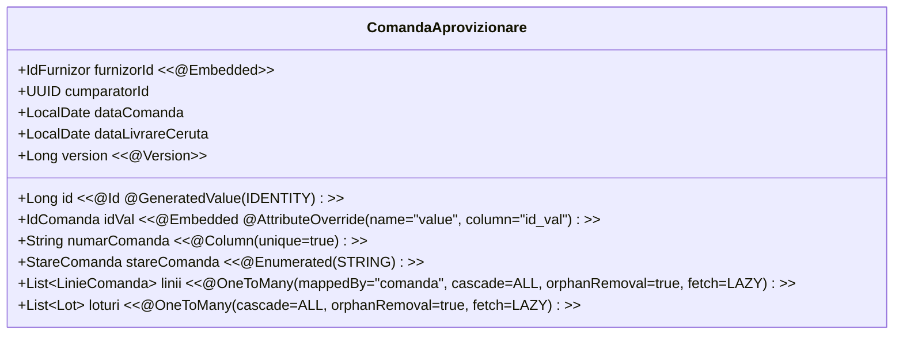

# 16. JPA & HIBERNATE ORM PERSISTENCE ARCHITECTURE
**System:** Enterprise Procure-to-Pay (P2P) Supply Chain Modular Monolith  
**Namespace:** `ro.uaic.feaa.sdbis.supplychain`

---

## 1. ORM ENGINE CONFIGURATION & BEHAVIOR

The persistence layer is powered by **Hibernate ORM 6.5.3.Final** and **Spring Data JPA 3.3.5** running over **PostgreSQL 16**.

### Key Runtime Settings (`application-postgres.properties`):
```properties
spring.jpa.hibernate.ddl-auto=validate
spring.jpa.open-in-view=false
spring.jpa.properties.hibernate.dialect=org.hibernate.dialect.PostgreSQLDialect
spring.jpa.properties.hibernate.jdbc.batch_size=50
spring.jpa.properties.hibernate.order_inserts=true
spring.jpa.properties.hibernate.order_updates=true
spring.jpa.properties.hibernate.default_batch_fetch_size=25
```

- `ddl-auto=validate`: Prevents runtime schema mutation. Any discrepancy between JPA annotations and Flyway migrations halts startup.
- `open-in-view=false`: Closes Hibernate sessions immediately upon service exit, preventing accidental lazy query execution during presentation serialization.
- `batch_size=50`: Groups SQL statement execution, minimizing network roundtrips.

---

## 2. ENTITY MAPPING & ATTRIBUTE OVERRIDES

### Aggregate Root: `ComandaAprovizionare`


### Value Object Converter Suite:
Domain IDs and currency representations use custom JPA `@Converter(autoApply = true)` implementations:
1. [CurrencyConverter.java](file:///c:/Users/bmugu/Desktop/app/src/main/java/ro/uaic/feaa/sdbis/supplychain/shared/persistence/converters/CurrencyConverter.java): Maps `java.util.Currency` directly to ISO-4217 `VARCHAR(3)` columns.
2. [IdComandaConverter.java](file:///c:/Users/bmugu/Desktop/app/src/main/java/ro/uaic/feaa/sdbis/supplychain/shared/persistence/converters/IdComandaConverter.java): Maps `IdComanda` to PostgreSQL native `UUID`.
3. [IdFurnizorConverter.java](file:///c:/Users/bmugu/Desktop/app/src/main/java/ro/uaic/feaa/sdbis/supplychain/shared/persistence/converters/IdFurnizorConverter.java): Maps `IdFurnizor` to `UUID`.
4. [IdLotConverter.java](file:///c:/Users/bmugu/Desktop/app/src/main/java/ro/uaic/feaa/sdbis/supplychain/shared/persistence/converters/IdLotConverter.java): Maps `IdLot` to `UUID`.
5. [CodMaterialConverter.java](file:///c:/Users/bmugu/Desktop/app/src/main/java/ro/uaic/feaa/sdbis/supplychain/shared/persistence/converters/CodMaterialConverter.java): Maps `CodMaterial` to `VARCHAR(50)`.

---

## 3. PROXY-SAFE EQUALITY & IDENTITY CONTRACTS

To ensure correctness across Hibernate bytecode enhancement, lazy-loading proxies, and entity detach/merge lifecycles, all entities implement a proxy-safe equality contract:

```java
@Override
public boolean equals(Object o) {
    if (this == o) return true;
    if (!(o instanceof ComandaAprovizionare that)) return false;
    return getId() != null && Objects.equals(getId(), that.getId());
}

@Override
public int hashCode() {
    return getClass().hashCode();
}
```

### Rationale:
- `getClass().hashCode()` returns a consistent hash across an entity's entire lifecycle (before and after surrogate key assignment), preventing hash-collision corruption in `HashSet` or `HashMap`.
- `getId()` handles uninitialized Hibernate proxies safely without triggering immediate eager loads of large object trees.

---

## 4. CONCURRENCY CONTROL VIA OPTIMISTIC LOCKING

Every Aggregate Root contains an explicit version field:
```java
@Version
@Column(name = "version", nullable = false)
private Long version;
```

- When two concurrent transactions attempt to update the same order (e.g., supplier confirmation arriving simultaneously with a buyer modification), the transaction whose version check fails throws `OptimisticLockException` / `ObjectOptimisticLockingFailureException`.
- `GlobalExceptionHandler` intercepts this exception and translates it into HTTP 409 Conflict, ensuring that updates are never lost.

