# 17. DATABASE ARCHITECTURE & RELATIONAL SCHEMA DICTIONARY
**System:** Enterprise Procure-to-Pay (P2P) Supply Chain Modular Monolith  
**Namespace:** `ro.uaic.feaa.sdbis.supplychain`

---

## 1. COMPREHENSIVE ENTITY-RELATIONSHIP DIAGRAM (ERD)

```mermaid
erDiagram
    comenzi_aprovizionare ||--o{ comenzi_linii : "has lines"
    comenzi_aprovizionare ||--o{ comenzi_loturi : "has lots"
    comenzi_aprovizionare ||--o{ comenzi_expedieri : "has shipments"

    calitate_furnizori ||--o{ calitate_furnizori_emailuri : "emails"
    calitate_furnizori ||--o{ calitate_furnizori_categorii : "categories"
    calitate_furnizori ||--o{ furnizor_preturi_negociate : "prices"
    calitate_furnizori ||--o{ calitate_scorecards : "scorecards"

    calitate_inspectori ||--o{ calitate_inspectori_certificari : "certs"
    calitate_inspectori ||--o{ calitate_inspectori_disponibilitate : "availability"
    calitate_inspectii ||--o| calitate_ncr : "triggers ncr"

    facturi_furnizori ||--o{ facturi_linii : "has lines"
    facturi_furnizori ||--o{ facturi_ordine_plata : "settled by"
    facturi_nir ||--o{ facturi_nir_linii : "has lines"

    comenzi_aprovizionare {
        uuid id_val PK
        varchar numar_comanda UK
        uuid furnizor_id
        uuid cumparator_id
        date data_comanda
        date data_livrare_ceruta
        date data_livrare_promisa
        varchar depozit
        varchar stare_comanda
        bigint version
    }

    comenzi_linii {
        uuid comanda_id FK
        varchar cod_material
        numeric cantitate
        varchar unitate_masura
        numeric pret_unitar
        varchar moneda
    }

    calitate_furnizori {
        uuid id_val PK
        varchar cod_fiscal UK
        varchar denumire
        varchar strada
        varchar localitate
        varchar iban_valoare
        int termen_plata_zile
        varchar moneda
        varchar stare_furnizor
        int inspectii_neconforme_consecutive
        bigint version
    }

    calitate_scorecards {
        uuid id PK
        uuid furnizor_id FK
        date data_inceput
        date data_finalizare
        numeric otif
        numeric rata_respingere
        numeric conformitate_pret
        numeric scor
    }

    facturi_furnizori {
        uuid id_factura PK
        varchar serie
        varchar numar
        date data_emitere
        date data_scadenta
        uuid comanda_id
        uuid furnizor_id
        numeric valoare_fara_tva
        numeric valoare_tva
        numeric valoare_totala
        numeric suma_platita
        varchar moneda
        varchar stare_factura
        bigint version
    }

    facturi_ordine_plata {
        uuid id_ordin PK
        uuid factura_id FK
        numeric suma
        varchar moneda
        uuid creat_de
        uuid aprobat_de
        varchar stare_ordin
        bigint version
    }

    shared_outbox {
        uuid id PK
        varchar event_type
        text payload
        timestamp timestamp
        boolean published
    }

    shared_inbox {
        uuid id PK
        uuid event_id
        varchar consumer
        timestamp processed_at
    }
```

---

## 2. RELATIONAL DATA DICTIONARY

### Table: `comenzi_aprovizionare`
| Column Name | Data Type | Nullable | Constraints & Defaults | Business Definition |
| :--- | :--- | :--- | :--- | :--- |
| `id_val` | `UUID` | No | `PRIMARY KEY` | Domain aggregate identity. |
| `numar_comanda` | `VARCHAR(100)` | No | `UNIQUE` | Enterprise purchase order document number. |
| `furnizor_id` | `UUID` | No | Indexed | Foreign aggregate reference to supplier. |
| `cumparator_id` | `UUID` | No | - | Purchasing agent identification. |
| `data_comanda` | `DATE` | No | - | Date PO was authored. |
| `data_livrare_ceruta` | `DATE` | No | `CHECK (>= data_comanda)` | Delivery deadline requested by buyer. |
| `depozit` | `VARCHAR(255)` | No | - | Destination warehouse. |
| `stare_comanda` | `VARCHAR(50)` | No | Indexed | State: `Solicitat`, `Confirmat`, `InTranzit`, `Receptionat`, `Anulat`. |
| `version` | `BIGINT` | No | Default `0` | Optimistic locking counter. |

### Table: `calitate_furnizori`
| Column Name | Data Type | Nullable | Constraints & Defaults | Business Definition |
| :--- | :--- | :--- | :--- | :--- |
| `id_val` | `UUID` | No | `PRIMARY KEY` | Supplier identifier. |
| `cod_fiscal` | `VARCHAR(50)` | No | `UNIQUE`, `CHECK (length >= 2)` | Enterprise tax registration code (CUI/CIF). |
| `denumire` | `VARCHAR(255)` | No | - | Legal corporate entity name. |
| `iban_valoare` | `VARCHAR(50)` | Yes | `CHECK (length >= 10)` | Bank settlement IBAN. |
| `stare_furnizor` | `VARCHAR(50)` | No | - | `Candidat`, `Calificat`, `Aprobat`, `Conditionat`, `Blocat`. |
| `inspectii_neconforme_consecutive` | `INT` | No | Default `0` | Count of continuous quality lot failures. |
| `version` | `BIGINT` | No | Default `0` | Optimistic concurrency version. |

### Table: `facturi_ordine_plata`
| Column Name | Data Type | Nullable | Constraints & Defaults | Business Definition |
| :--- | :--- | :--- | :--- | :--- |
| `id_ordin` | `UUID` | No | `PRIMARY KEY` | Payment order transaction identifier. |
| `factura_id` | `UUID` | No | `REFERENCES facturi_furnizori` | Settled invoice reference. |
| `suma` | `NUMERIC(18, 4)` | No | `CHECK (suma > 0)` | Payment amount. |
| `moneda` | `VARCHAR(3)` | No | `CHECK (length = 3)` | ISO-4217 currency. |
| `creat_de` | `UUID` | No | - | User authoring payment order. |
| `aprobat_de` | `UUID` | Yes | - | Four-Eyes approving officer. |
| `stare_ordin` | `VARCHAR(50)` | No | Indexed | `Creat`, `Aprobat`, `TransmisLaBanca`, `Executat`, `RespinsDeBanca`, `Anulat`. |

---

## 3. PERFORMANCE INDEXING ARCHITECTURE

Configured in [V5__performance_indexes_and_constraints.sql](file:///c:/Users/bmugu/Desktop/app/src/main/resources/db/migration/V5__performance_indexes_and_constraints.sql):
1. **Outbox Polling Index:** `CREATE INDEX idx_outbox_polling ON shared_outbox(published, timestamp);`
   - Accelerates scheduled background workers querying `WHERE published = false ORDER BY timestamp`.
2. **Foreign Key Performance Indexes:** `idx_comenzi_linii_comanda`, `idx_facturi_linii_factura`, `idx_calitate_scorecards_furnizor`.
   - Eliminates table-scan locks during child item cascade deletions and joins.
3. **Audit Log Chronological Index:** `CREATE INDEX idx_audit_log_timestamp ON shared_audit_log(timestamp);`
   - Enables fast compliance querying and SIEM log exports.

