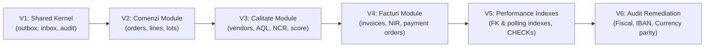

# 18. FLYWAY DATABASE MIGRATION ARCHITECTURE
**System:** Enterprise Procure-to-Pay (P2P) Supply Chain Modular Monolith  
**Namespace:** `ro.uaic.feaa.sdbis.supplychain`

---

## 1. MIGRATION GOVERNANCE & VERSIONING LIFECYCLE

The database schema is managed as code via **Flyway 10.10.0**. Schema mutations are strictly versioned, immutable, and applied sequentially during application bootstrapping. Direct manual DDL changes in production are strictly forbidden.

---

## 2. DETAILED MIGRATION INVENTORY

### Migration V1: `V1__shared_kernel_outbox_inbox.sql`
- **Scope:** Initializes cross-cutting technical tables.
- **Key Tables:**
  - `shared_outbox`: Implements Transactional Outbox pattern (`id UUID`, `event_type VARCHAR`, `payload TEXT`, `published BOOLEAN`).
  - `shared_inbox`: Implements Idempotent Consumer pattern (`event_id UUID`, `consumer VARCHAR`, `processed_at TIMESTAMP`).
  - `shared_audit_log`: Compliance audit trail (`timestamp TIMESTAMP`, `actor VARCHAR`, `action VARCHAR`, `details TEXT`).

### Migration V2: `V2__comenzi_module.sql`
- **Scope:** Purchasing sub-domain tables.
- **Key Tables:** `comenzi_aprovizionare`, `comenzi_linii`, `comenzi_loturi`, `comenzi_expedieri`.
- **Integrity:** Enforces foreign keys and unique constraints (`numar_comanda`).

### Migration V3: `V3__calitate_module.sql`
- **Scope:** Vendor management and quality assurance tables.
- **Key Tables:** `calitate_furnizori`, `calitate_scorecards`, `calitate_inspectii`, `calitate_ncr`, `calitate_inspectori`, `furnizor_preturi_negociate`.

### Migration V4: `V4__facturi_module.sql`
- **Scope:** Invoicing, goods reception, and payment settlement tables.
- **Key Tables:** `facturi_furnizori`, `facturi_linii`, `facturi_nir`, `facturi_nir_linii`, `facturi_ordine_plata`, `facturi_furnizori_blocati`.

### Migration V5: `V5__performance_indexes_and_constraints.sql`
- **Scope:** Relational performance optimization and domain invariants.
- **Key Additions:**
  - Composite polling index: `idx_outbox_polling ON shared_outbox(published, timestamp)`.
  - Foreign key index suite covering all parent-child associations.
  - Domain constraints: `chk_comenzi_linii_cantitate`, `chk_comenzi_linii_pret`, `chk_scorecards_scor`, `chk_inspectii_aql`.

### Migration V6: `V6__audit_remediation_constraints.sql`
- **Scope:** EARB Audit remediation hardening.
- **Key Additions:**
  - `chk_furnizor_cod_fiscal_len`: `CHECK (length(cod_fiscal) >= 2)`.
  - `chk_furnizor_iban_fmt`: `CHECK (iban_valoare IS NULL OR length(iban_valoare) >= 10)`.
  - `chk_comenzi_linii_moneda_len`, `chk_facturi_moneda_len`, `chk_ordine_plata_moneda_len`: `CHECK (length(moneda) = 3)`.
  - Non-negative invoice base and tax constraints.

---

## 3. PRODUCTION MIGRATION SAFETY RULES

1. **Immutable Scripts:** Once a migration script is merged, its checksum is frozen in Flyway's `flyway_schema_history`. Editing an applied script triggers validation failure on startup.
2. **Backward-Compatible DDL:** Column additions must provide defaults or allow nulls to support rolling zero-downtime deployments.
3. **Automated Baseline Verification:** Configured via `spring.flyway.baseline-on-migrate=true` and `spring.flyway.validate-on-migrate=true`.

