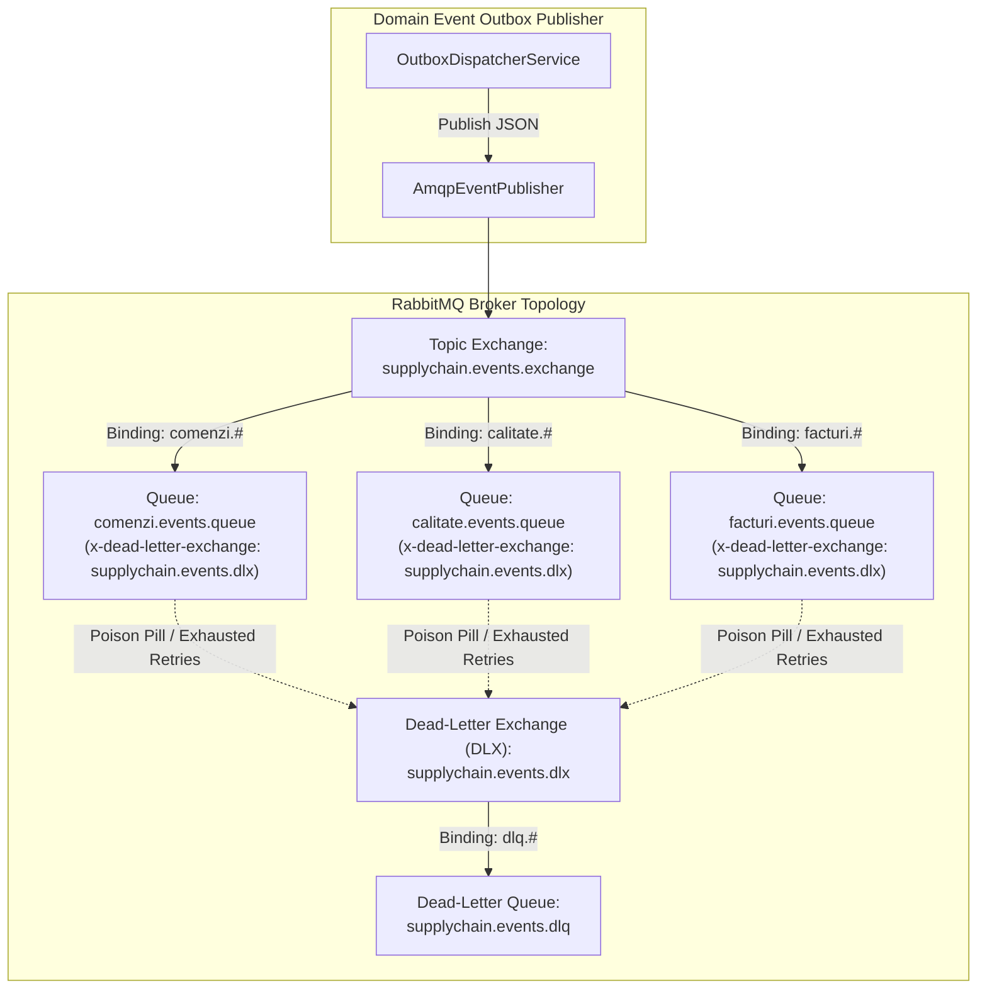

# 19. ENTERPRISE RABBITMQ MESSAGING & DLQ TOPOLOGY
**System:** Enterprise Procure-to-Pay (P2P) Supply Chain Modular Monolith  
**Namespace:** `ro.uaic.feaa.sdbis.supplychain`

---

## 1. AMQP TOPIC TOPOLOGY & ROUTING ARCHITECTURE

Asynchronous integration and event distribution across enterprise subsystems is powered by **RabbitMQ 3.12** and **Spring AMQP 3.1.7** (ADR-004).



---

## 2. TOPIC EXCHANGE & QUEUE CONFIGURATION

Declared in [RabbitMqConfig.java](file:///c:/Users/bmugu/Desktop/app/src/main/java/ro/uaic/feaa/sdbis/supplychain/shared/messaging/RabbitMqConfig.java):

```java
@Configuration
public class RabbitMqConfig {

    public static final String EXCHANGE_NAME = "supplychain.events.exchange";
    public static final String EXCHANGE_DLX = "supplychain.events.dlx";

    public static final String QUEUE_COMENZI = "comenzi.events.queue";
    public static final String QUEUE_CALITATE = "calitate.events.queue";
    public static final String QUEUE_FACTURI = "facturi.events.queue";
    public static final String QUEUE_DLQ = "supplychain.events.dlq";

    public static final String ROUTING_COMENZI = "comenzi.#";
    public static final String ROUTING_CALITATE = "calitate.#";
    public static final String ROUTING_FACTURI = "facturi.#";
    public static final String ROUTING_DLQ = "dlq.#";

    @Bean
    public TopicExchange supplyChainExchange() {
        return ExchangeBuilder.topicExchange(EXCHANGE_NAME).durable(true).build();
    }

    @Bean
    public TopicExchange deadLetterExchange() {
        return ExchangeBuilder.topicExchange(EXCHANGE_DLX).durable(true).build();
    }

    @Bean
    public Queue deadLetterQueue() {
        return QueueBuilder.durable(QUEUE_DLQ).build();
    }

    @Bean
    public Queue comenziQueue() {
        return QueueBuilder.durable(QUEUE_COMENZI)
                .withArgument("x-dead-letter-exchange", EXCHANGE_DLX)
                .withArgument("x-dead-letter-routing-key", "dlq.comenzi")
                .build();
    }
    // ...
}
```

---

## 3. DEAD-LETTER QUEUE (DLQ) FAULT TOLERANCE STRATEGY

1. **Poison Pill Mitigation:** If an unexpected payload causes an unrecoverable exception in a message consumer, Spring AMQP's retry interceptor exhausts its delivery attempts (default: 3 retries with exponential backoff).
2. **Dead-Letter Redirection:** Upon retry exhaustion, RabbitMQ routes the failed message to `supplychain.events.dlx`, which stores it in `supplychain.events.dlq`.
3. **Observability & Alerting:** The DLQ is monitored via Prometheus and RabbitMQ Management API. Operations teams can inspect failed messages, diagnose root causes, and replay them via management scripts.

---

## 4. EVENT ROUTING CATALOG

| Routing Key | Event Type | Target Queue | Business Event Trigger |
| :--- | :--- | :--- | :--- |
| `comenzi.creata` | `ComandaCreataPublicEvent` | `comenzi.events.queue` | Purchase order approved & authored. |
| `comenzi.receptionata` | `ComandaReceptionataPublicEvent` | `facturi.events.queue` | Lots received at dock; triggers NIR generation. |
| `comenzi.anulata` | `ComandaAnulataPublicEvent` | `facturi.events.queue` | Cascade cancellation executed. |
| `calitate.verdict` | `VerdictInspectiePublicEvent` | `comenzi.events.queue` | AQL inspection result recorded. |
| `calitate.blocat` | `FurnizorBlocatPublicEvent` | `facturi.events.queue` | Vendor sanctioned; suspends outstanding payments. |
| `facturi.plata` | `PlataExecutataPublicEvent` | `facturi.events.queue` | Stripe payment confirmed by bank. |

