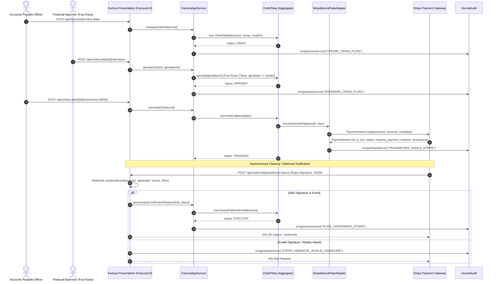
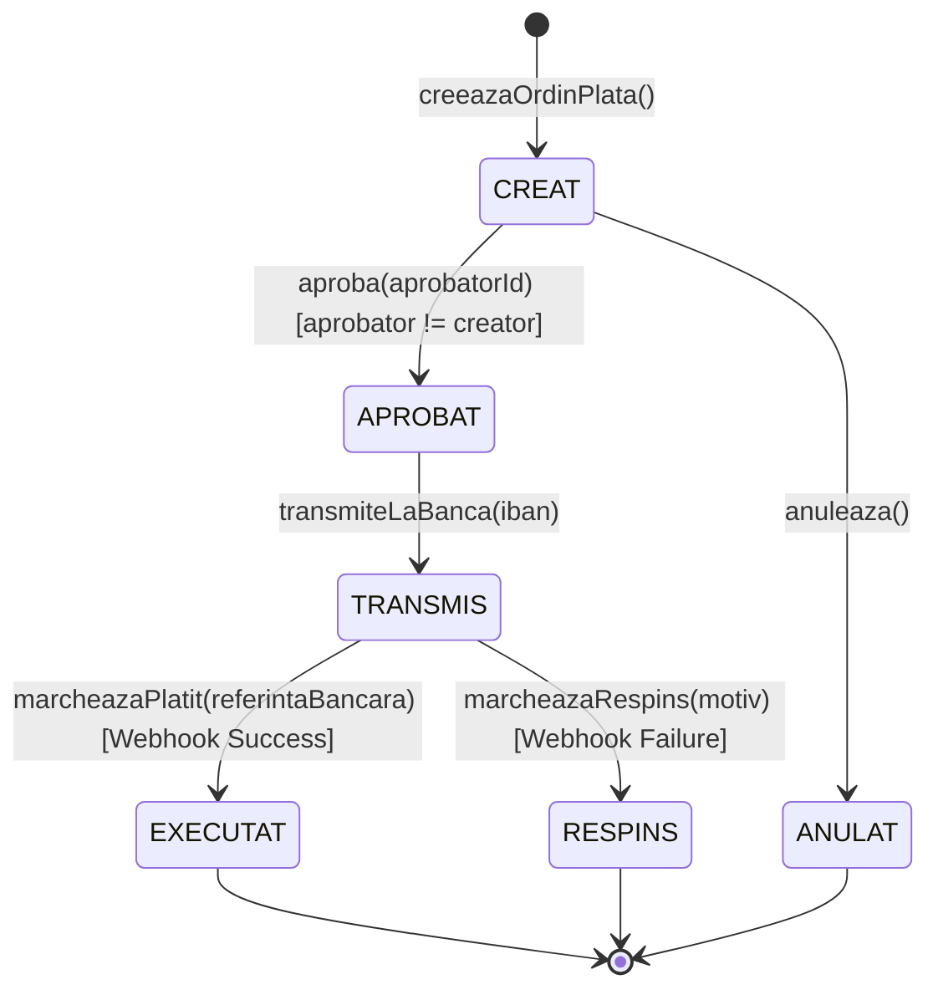

# 20. STRIPE INTEGRATION & PAYMENT WORKFLOW ARCHITECTURE
**System:** Enterprise Procure-to-Pay (P2P) Supply Chain Modular Monolith  
**Namespace:** `ro.uaic.feaa.sdbis.supplychain.facturi`

---

## 1. ARCHITECTURAL OVERVIEW & PURPOSE (ADR-010)

The **Facturi** (Invoicing & Accounts Payable) module integrates with the **Stripe API** via the Stripe Java SDK (`stripe-java 26.1.0`) to emulate an enterprise banking clearing gateway (Single Euro Payments Area / SWIFT credit transfer simulation).



---

## 2. CONFIGURATION PROPERTY MODEL

The Stripe subsystem configuration is decoupled from application code and externalized through [StripeProperties.java](file:///src/main/java/ro/uaic/feaa/sdbis/supplychain/facturi/infrastructure/StripeProperties.java):

```java
@Configuration
@ConfigurationProperties(prefix = "stripe")
public class StripeProperties {
    private String apiKey = "sk_test_mock_1234567890abcdef";
    private String webhookSecret = "whsec_mock_1234567890abcdef";

    public String getApiKey() { return apiKey; }
    public void setApiKey(String apiKey) { this.apiKey = apiKey; }

    public String getWebhookSecret() { return webhookSecret; }
    public void setWebhookSecret(String webhookSecret) { this.webhookSecret = webhookSecret; }
}
```

### Property Ingestion Matrix

| Property Name | Default Development Value | Production Environment Variable | Security Level |
|---|---|---|---|
| `stripe.api-key` | `sk_test_mock_1234567890abcdef` | `STRIPE_API_KEY` | High (Secret / Masked) |
| `stripe.webhook-secret` | `whsec_mock_1234567890abcdef` | `STRIPE_WEBHOOK_SECRET` | Critical (HMAC Secret) |

---

## 3. OUTBOUND GATEWAY ADAPTER (`StripeBancaPlataAdapter`)

The outbound interaction implements Hexagonal Architecture (Ports and Adapters) through [IBancaPlataProvider.java](file:///c:/Users/bmugu/Desktop/app/src/main/java/ro/uaic/feaa/sdbis/supplychain/facturi/domain/IBancaPlataProvider.java):

```java
package ro.uaic.feaa.sdbis.supplychain.facturi.domain;

public interface IBancaPlataProvider {
    boolean transmiteOrdinPlata(OrdinPlata ordin, String ibanDestinatar);
}
```

The adapter implementation [StripeBancaPlataAdapter.java](file:///c:/Users/bmugu/Desktop/app/src/main/java/ro/uaic/feaa/sdbis/supplychain/facturi/infrastructure/StripeBancaPlataAdapter.java):
- Converts decimal financial units into fractional cents (`amountInCents = amount * 100`).
- Sanitizes ISO 4217 currency codes to lower-case representation (`RON` $\rightarrow$ `ron`, `EUR` $\rightarrow$ `eur`).
- Attaches aggregate tracking keys as Stripe metadata (`idOrdin`, `facturaId`, `ibanDestinatar`).
- Provides graceful sandbox fallback: if the API key contains `"mock"` or external connectivity times out, it generates a synthetic bank reference `pi_mock_<UUID>`.
- Logs transactional access in `IJurnalAudit` for regulatory non-repudiation.

---

## 4. INBOUND WEBHOOK CONTROLLER & SECURITY (`FacturaCtrl`)

The inbound webhook endpoint (`/api/ordine-plata/webhook-banca` and `/api/plati/webhook-banca`) handles asynchronous clearing confirmations from Stripe.

### Critical Security Verification (Remediation CRITICAL FIX #1)

To prevent spoofing, forged settlement notices, and replay attacks:

```java
// 1. Mandatory Stripe-Signature verification
if (sigHeader == null || sigHeader.trim().isEmpty()) {
    log.warn("[Stripe Security Alert] Webhook call rejected: Missing mandatory 'Stripe-Signature' header.");
    jurnalAudit.inregistreazaAcces("STRIPE_WEBHOOK_REJECTED", "Missing Stripe-Signature header");
    return ResponseEntity.status(HttpStatus.BAD_REQUEST)
        .body(Map.of("error", "Lipseste antetul Stripe-Signature obligatoriu pentru validarea webhook-ului"));
}

if (payload == null || payload.trim().isEmpty()) {
    return ResponseEntity.status(HttpStatus.BAD_REQUEST)
        .body(Map.of("error", "Lipseste corpul webhook-ului"));
}

String secret = stripeProperties.getWebhookSecret();
Event event;
try {
    // Replay attack prevention: tolerance = 300 seconds
    event = Webhook.constructEvent(payload, sigHeader, secret, 300);
} catch (SignatureVerificationException e) {
    log.warn("[Stripe Security Alert] Invalid signature on Stripe webhook: {}", e.getMessage());
    jurnalAudit.inregistreazaAcces("STRIPE_WEBHOOK_INVALID_SIGNATURE", "Semnatura Stripe invalida: " + e.getMessage());
    return ResponseEntity.status(HttpStatus.BAD_REQUEST)
        .body(Map.of("error", "Semnatura Stripe invalida", "details", e.getMessage()));
}
```

### Signature Algorithm & Timestamp Tolerance
- **Algorithm:** HMAC-SHA256 computed over `t,v1` headers.
- **Header Structure:** `t=1698578291,v1=5257a869e7ecebeda32affa62cdca3fa51cad7e77a0e56ff536d0ce8e108d8bd`.
- **Clock Tolerance Window:** 300 seconds (5 minutes). Events with timestamps older than 300 seconds are rejected immediately to neutralize replay attacks.

---

## 5. PAYMENT ORDER STATE MACHINE & INVARIANTS



### Business Rules & Invariants
1. **Four-Eyes Principle (BR-FAC-03):** An officer who created the payment order (`creatDe`) cannot approve it (`aprobatorId != creatDe`). Violation throws `IllegalStateException`.
2. **Amount Invariant:** The payment order amount must not exceed the remaining unpaid balance of the invoice (`sumaOrdin <= factura.getRestDePlata()`).
3. **Execution Finality:** Once marked `EXECUTAT`, the payment order is immutable.
4. **Audit Trail:** Every transition is recorded with timestamp, operator ID, and bank reference in `shared_audit_log`.

---

## 6. TESTING & VERIFICATION

The Stripe integration is covered by automated unit and integration tests:
- [FacturaCtrlRestTest.java](file:///c:/Users/bmugu/Desktop/app/src/test/java/ro/uaic/feaa/sdbis/supplychain/rest/FacturaCtrlRestTest.java): Validates 400 Bad Request on missing signature, valid test webhook parsing, and payment order approval.
- [FacturiModuleArchUnitTest.java](file:///c:/Users/bmugu/Desktop/app/src/test/java/ro/uaic/feaa/sdbis/supplychain/arch/FacturiModuleArchUnitTest.java): Ensures `StripeBancaPlataAdapter` does not leak infrastructure dependencies into domain entities.
