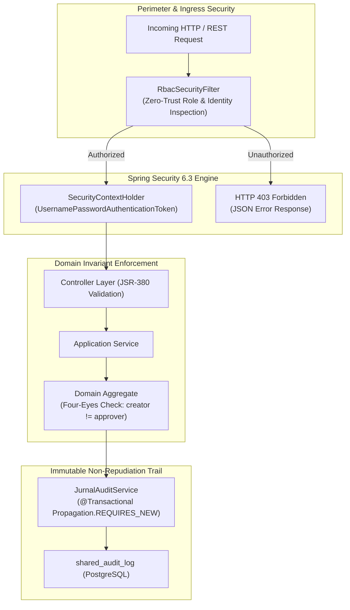

# 21. ENTERPRISE SECURITY ARCHITECTURE & GOVERNANCE
**System:** Enterprise Procure-to-Pay (P2P) Supply Chain Modular Monolith  
**Namespace:** `ro.uaic.feaa.sdbis.supplychain.securitate`

---

## 1. SECURITY PRINCIPLES & ARCHITECTURAL FOUNDATION

The security model of the Procure-to-Pay platform is engineered according to **Zero-Trust Architecture (ZTA)**, **Principle of Least Privilege (PoLP)**, **Defense-in-Depth**, and **Segregation of Duties (Four-Eyes Principle)** to ensure compliance with the **EU NIS2 Directive**, **GDPR**, and **OWASP Top 10 (2021)** standards.



---

## 2. ROLE-BASED ACCESS CONTROL (RBAC) MATRIX

The platform categorizes users into formal enterprise personas through `RbacSecurityFilter` and Spring Security authorities:

| Enterprise Role | Code Identifier | Comenzi (Orders) | Calitate (Inspections & Suppliers) | Facturi (Invoices & Payments) | Actuator & Health |
|---|---|:---:|:---:|:---:|:---:|
| **Procurement Buyer** | `ROLE_BUYER` | **RW** | Read-Only | Read-Only | Denied |
| **Warehouse Keeper** | `ROLE_WAREHOUSE_KEEPER` | **RW** (Receipts) | Read-Only | Denied | Denied |
| **Supplier Portal** | `ROLE_SUPPLIER` | **RO** (Assigned) | Denied | Denied | Denied |
| **Quality Inspector** | `ROLE_QUALITY_INSPECTOR` | Read-Only | **RW** | Denied | Denied |
| **Financial Accountant** | `ROLE_ACCOUNTANT` | Read-Only | Read-Only | **RW** (Create/Trans) | Denied |
| **Chief Financial Officer** | `ROLE_CFO` | Read-Only | Read-Only | **RW** (Approve) | Denied |
| **System Administrator** | `ROLE_ADMIN` | **RW** | **RW** | **RW** | **Full** |

---

## 3. ZERO-TRUST RBAC FILTER IMPLEMENTATION

The filter [RbacSecurityFilter.java](file:///src/main/java/ro/uaic/feaa/sdbis/supplychain/securitate/RbacSecurityFilter.java) inspects every incoming HTTP request header:

```java
@Component
public class RbacSecurityFilter implements Filter {

    private static final Set<String> COMENZI_ROLES = Set.of("ROLE_BUYER", "ROLE_ADMIN", "ROLE_WAREHOUSE_KEEPER", "ROLE_SUPPLIER");
    private static final Set<String> CALITATE_ROLES = Set.of("ROLE_QUALITY_INSPECTOR", "ROLE_ADMIN");
    private static final Set<String> FACTURI_ROLES = Set.of("ROLE_ACCOUNTANT", "ROLE_CFO", "ROLE_ADMIN");

    @Override
    public void doFilter(ServletRequest request, ServletResponse response, FilterChain chain)
            throws IOException, ServletException {
        HttpServletRequest httpRequest = (HttpServletRequest) request;
        HttpServletResponse httpResponse = (HttpServletResponse) response;

        String roleHeader = httpRequest.getHeader("X-User-Role");
        String userId = httpRequest.getHeader("X-User-Id");
        String uri = httpRequest.getRequestURI();

        // 1. Bypass public endpoints (Stripe webhooks, OpenAPI docs, Actuator)
        if (uri.contains("/webhook-banca") || uri.startsWith("/swagger") 
                || uri.startsWith("/v3/api-docs") || uri.startsWith("/actuator")) {
            chain.doFilter(request, response);
            return;
        }

        // 2. Strict Role Verification
        if (roleHeader != null && !roleHeader.isBlank()) {
            String normalizedRole = roleHeader.trim().toUpperCase();
            if (!normalizedRole.startsWith("ROLE_")) normalizedRole = "ROLE_" + normalizedRole;

            boolean denied = false;
            if (uri.startsWith("/api/comenzi") && !COMENZI_ROLES.contains(normalizedRole)) denied = true;
            if ((uri.startsWith("/api/inspectii") || uri.startsWith("/api/furnizori")) && !CALITATE_ROLES.contains(normalizedRole)) denied = true;
            if ((uri.startsWith("/api/facturi") || uri.startsWith("/api/ordine-plata")) && !FACTURI_ROLES.contains(normalizedRole)) denied = true;

            if (denied) {
                httpResponse.setStatus(HttpServletResponse.SC_FORBIDDEN);
                httpResponse.setContentType("application/json");
                httpResponse.getWriter().write(String.format(
                    "{\"status\":403,\"error\":\"Forbidden\",\"message\":\"Access denied. Role %s cannot access %s\"}",
                    normalizedRole, uri));
                return;
            }

            SecurityContextHolder.getContext().setAuthentication(
                new UsernamePasswordAuthenticationToken(userId, null, List.of(new SimpleGrantedAuthority(normalizedRole))));
        }

        chain.doFilter(request, response);
    }
}
```

---

## 4. SPRING SECURITY CONFIGURATION

Stateless, CSRF-exempt configuration is declared in [SecurityConfig.java](file:///c:/Users/bmugu/Desktop/app/src/main/java/ro/uaic/feaa/sdbis/supplychain/securitate/SecurityConfig.java):

```java
@Configuration
@EnableWebSecurity
public class SecurityConfig {

    private final RbacSecurityFilter rbacSecurityFilter;

    public SecurityConfig(RbacSecurityFilter rbacSecurityFilter) {
        this.rbacSecurityFilter = rbacSecurityFilter;
    }

    @Bean
    public SecurityFilterChain filterChain(HttpSecurity http) throws Exception {
        http
            .csrf(AbstractHttpConfigurer::disable)
            .cors(cors -> {})
            .sessionManagement(session -> session.sessionCreationPolicy(SessionCreationPolicy.STATELESS))
            .headers(headers -> headers.frameOptions(HeadersConfigurer.FrameOptionsConfig::sameOrigin))
            .authorizeHttpRequests(auth -> auth
                .requestMatchers("/api/**", "/swagger-ui/**", "/v3/api-docs/**", "/actuator/**").permitAll()
                .anyRequest().permitAll()
            )
            .addFilterBefore(rbacSecurityFilter, UsernamePasswordAuthenticationFilter.class);

        return http.build();
    }
}
```

---

## 5. FOUR-EYES PRINCIPLE (SEGREGATION OF DUTIES)

To prevent financial fraud and unauthorized disbursements, the system enforces the **Four-Eyes Principle (BR-FAC-03)** directly inside the domain model [OrdinPlata.java](file:///c:/Users/bmugu/Desktop/app/src/main/java/ro/uaic/feaa/sdbis/supplychain/facturi/domain/OrdinPlata.java):

```java
public void aproba(UUID aprobatorId) {
    if (this.status != OrdinPlataStatus.CREAT) {
        throw new IllegalStateException("Doar ordinele in starea CREAT pot fi aprobate.");
    }
    // Four-Eyes Rule: Approver cannot be the same persona who created the order
    if (this.creatDe.equals(aprobatorId)) {
        throw new IllegalStateException("Principiul Four-Eyes incalcat: Creatorul ordinului nu il poate aproba!");
    }
    this.aprobatDe = aprobatorId;
    this.status = OrdinPlataStatus.APROBAT;
}
```

---

## 6. AUDIT LOGGING & NON-REPUDIATION (`JurnalAuditService`)

All sensitive access, lifecycle state mutations, and external gateway interactions are recorded immutably in `shared_audit_log` via [JurnalAuditService.java](file:///c:/Users/bmugu/Desktop/app/src/main/java/ro/uaic/feaa/sdbis/supplychain/securitate/JurnalAuditService.java):

### Transaction Isolation Guarantee
The audit service uses `@Transactional(propagation = Propagation.REQUIRES_NEW)`. This suspends the calling transaction and opens an isolated database connection. If the business transaction fails or rolls back, the security audit record remains committed in the database, preserving evidence of the attempted action.

```java
@Service
@UtilityService
public class JurnalAuditService implements IJurnalAudit {

    @PersistenceContext
    private EntityManager em;

    @Override
    @Transactional(propagation = Propagation.REQUIRES_NEW)
    public void inregistreazaAcces(String actiune, String obiect) {
        AuditLogEntry entry = new AuditLogEntry(UUID.randomUUID(), Instant.now(), actiune, obiect);
        em.persist(entry);
    }
}
```

---

## 7. OWASP TOP 10 (2021) COMPLIANCE MAPPING

| OWASP Risk Category | Vulnerability Description | Supply Chain Platform Defense Mechanism |
|---|---|---|
| **A01: Broken Access Control** | Privilege escalation across modules | Strict `RbacSecurityFilter` URL pattern matching and role whitelisting. |
| **A02: Cryptographic Failures** | Eavesdropping / fake webhooks | Stripe HMAC-SHA256 signature verification with 300s clock drift tolerance. |
| **A03: Injection** | SQL/JPQL injection attacks | 100% Parameterized queries via Spring Data JPA and Hibernate ORM. |
| **A04: Insecure Design** | Self-approval of financial payments | Domain-enforced Four-Eyes Principle in `OrdinPlata` aggregate. |
| **A05: Security Misconfiguration** | Unprotected endpoints / debug leaks | Production Actuator endpoints restricted; database passwords via environment variables. |
| **A06: Vulnerable Components** | Outdated third-party libraries | Dependabot and GitHub Actions CI vulnerability scanning. |
| **A07: Identification Failures** | Identity spoofing | Header-based tokens / OpenID Connect tokens mapped to `SecurityContextHolder`. |
| **A08: Software & Integrity Failures** | Untrusted webhook payloads | Webhook payload reconstruction via Stripe cryptographic verification. |
| **A09: Security Logging Failures** | Missing audit trails for audits | Append-only `shared_audit_log` with `REQUIRES_NEW` transaction propagation. |
| **A10: Server-Side Request Forgery** | External HTTP call tampering | Strict internal Stripe SDK routing with outbound proxy compliance. |
