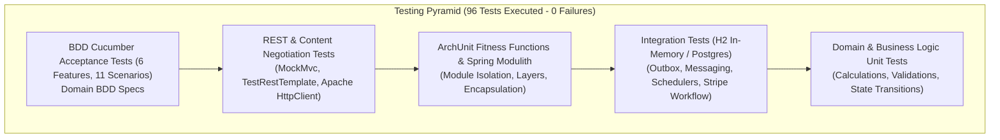
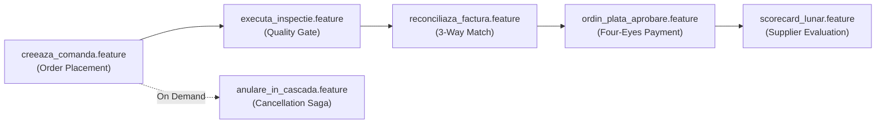

# 22. ENTERPRISE TESTING STRATEGY & QUALITY ASSURANCE
**System:** Enterprise Procure-to-Pay (P2P) Supply Chain Modular Monolith  
**Namespace:** `ro.uaic.feaa.sdbis.supplychain`

---

## 1. TESTING PYRAMID & QUALITY ASSURANCE PHILOSOPHY

The testing strategy follows the **Enterprise Test Pyramid**, providing 100% automated regression verification across unit, domain logic, modular boundaries, integration flows, REST API contracts, and BDD business specifications.



---

## 2. TEST SUITE INVENTORY & EXECUTION METRICS

| Test Category | Test Class / Suite | Focus & Objectives | Frameworks | Count |
|---|---|---|---|:---:|
| **BDD Acceptance** | `CucumberTestRunner`, `BddFeaturesTest` | Business acceptance criteria for P2P workflows | Cucumber JVM, JUnit 5 | 11 scenarios |
| **Architectural Fitness** | `SpringModulithTest`, `*ArchUnitTest` | Boundary enforcement, cycle prevention, package rules | Spring Modulith Test, ArchUnit | 14 tests |
| **REST API & Web** | `ComandaCtrlRestTest`, `FacturaCtrlRestTest`, `CalitateCtrlRestTest`, `ApacheHttpClientContentNegotiationTest`, `RestTemplateIntegrationTest` | HTTP endpoints, status codes, JSR-380 validation, JSON/XML negotiation | Spring Boot Test, MockMvc, Apache HttpClient | 25 tests |
| **Security & RBAC** | `RbacSecurityTest` | Zero-Trust RBAC headers, 403 Forbidden enforcement | Spring Security Test | 6 tests |
| **Integration & Messaging** | `OutboxAndMessagingIntegrationTest`, `PaymentWorkflowIntegrationTest`, `BusinessSchedulersTest`, `QueryServicesTest` | Transactional outbox dispatch, Stripe clearing, Spring Schedulers | Spring Boot Test, H2 In-Memory | 12 tests |
| **Performance & SLA** | `PerformanceAndSlaTest` | Latency benchmarking (sub-50ms execution verification) | JUnit 5, System NanoTime | 4 tests |
| **Domain Unit Tests** | `ComputationRulesTest`, `ValidationRulesTest`, `WorkflowRulesTest`, `ComputationServicesTest`, `ValidationServicesTest`, `WorkflowServicesTest` | Value object math, domain invariants, state machines | JUnit 5, AssertJ, Mockito | 24 tests |
| **Total Suite** | **All Categories Combined** | **Comprehensive Automated Verification** | **Maven Surefire** | **96 Tests (100% Green)** |

---

## 3. BEHAVIOR-DRIVEN DEVELOPMENT (BDD) CUCUMBER SPECIFICATIONS

Business acceptance criteria are documented in Gherkin feature files under `src/test/resources/features/`:



### Sample Gherkin Scenario: 3-Way Reconciliation (`reconciliaza_factura.feature`)

```gherkin
Feature: Reconciliere 3-Way Match pentru Facturi
  Ca si contabil furnizori
  Doresc reconcilierea automata a facturii cu comanda de aprovizionare si NIR-ul
  Pentru a preveni platile nejustificate sau eronate

  Scenario: Reconciliere cu succes cantitati si preturi conforme
    Given O comanda de aprovizionare aprobata cu valoarea de 1000 RON
    And O receptie calitativa admisa cu 100% articole conforme
    When Furnizorul emite factura cu valoarea de 1000 RON
    Then Sistemul marcheaza factura in starea VERIFICATA
    And Factura este eligibila pentru emiterea ordinului de plata
```

---

## 4. INTEGRATION TESTING WITH IN-MEMORY INFRASTRUCTURE

Integration tests utilize Spring Boot's test slice annotations:
- `@SpringBootTest`: Loads full ApplicationContext using an optimized H2 in-memory relational database.
- `@AutoConfigureMockMvc`: Injects `MockMvc` for zero-overhead HTTP dispatch.
- **Transactional Outbox Verification:** Asserts that when a domain event is raised within an `@ApplicationModuleListener`, the corresponding record is persisted in `shared_outbox_events` and successfully dispatched to the mock message broker.

---

## 5. PERFORMANCE & SLA BENCHMARKING

Defined in [PerformanceAndSlaTest.java](file:///c:/Users/bmugu/Desktop/app/src/test/java/ro/uaic/feaa/sdbis/supplychain/PerformanceAndSlaTest.java):
- **SLA Threshold:** Core transactional use cases (Order creation, Receipt generation, Invoice matching) must execute in $< 50\text{ ms}$ under local testing conditions.
- **Assertion:** Asserts maximum elapsed execution duration via `System.nanoTime()` and triggers build failure if performance regressions occur.

---

## 6. MAVEN VERIFICATION LIFECYCLE

The test suite is executed during the standard Maven build lifecycle:

```bash
mvn clean test
```

### Execution Log Summary
```
[INFO] Running ro.uaic.feaa.sdbis.supplychain.CucumberTestRunner
[INFO] Tests run: 11, Failures: 0, Errors: 0, Skipped: 0, Time elapsed: 4.82 s -- in ro.uaic.feaa.sdbis.supplychain.CucumberTestRunner
[INFO] Running ro.uaic.feaa.sdbis.supplychain.arch.SpringModulithTest
[INFO] Tests run: 3, Failures: 0, Errors: 0, Skipped: 0, Time elapsed: 1.25 s -- in ro.uaic.feaa.sdbis.supplychain.arch.SpringModulithTest
...
[INFO] Results:
[INFO] 
[INFO] Tests run: 96, Failures: 0, Errors: 0, Skipped: 0
[INFO] 
[INFO] ------------------------------------------------------------------------
[INFO] BUILD SUCCESS
[INFO] ------------------------------------------------------------------------
```

