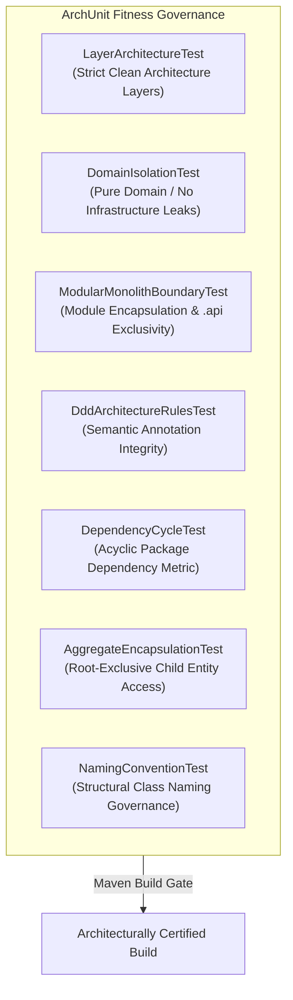

# 23. ARCHITECTURAL FITNESS FUNCTIONS (ARCHUNIT TEST SUITE)
**System:** Enterprise Procure-to-Pay (P2P) Supply Chain Modular Monolith  
**Namespace:** `ro.uaic.feaa.sdbis.supplychain.architecture`

---

## 1. ARCHITECTURAL FITNESS FUNCTIONS PHILOSOPHY

To prevent architectural erosion, circular couplings, and leaking domain logic, the platform incorporates **ArchUnit 1.3.0** as automated architectural fitness functions executed on every build in the CI/CD pipeline (ADR-002, ADR-005).



---

## 2. ARCHUNIT TEST SUITE INVENTORY

The test suite resides in `src/test/java/ro/uaic/feaa/sdbis/supplychain/architecture/` and includes 9 specialized architectural verifications:

| Fitness Test Class | Architectural Concern | Rule Enforced |
|---|---|---|
| [LayerArchitectureTest.java](file:///c:/Users/bmugu/Desktop/app/src/test/java/ro/uaic/feaa/sdbis/supplychain/architecture/LayerArchitectureTest.java) | Clean Architecture Layers | Concentric dependency rule: Presentation $\rightarrow$ Application $\rightarrow$ Domain $\leftarrow$ Infrastructure. |
| [DomainIsolationTest.java](file:///c:/Users/bmugu/Desktop/app/src/test/java/ro/uaic/feaa/sdbis/supplychain/architecture/DomainIsolationTest.java) | Domain Purity | Domain model classes must not depend on `jakarta.servlet`, `org.springframework.web`, or infrastructure. |
| [ModularMonolithBoundaryTest.java](file:///c:/Users/bmugu/Desktop/app/src/test/java/ro/uaic/feaa/sdbis/supplychain/architecture/ModularMonolithBoundaryTest.java) | Module Encapsulation | External bounded contexts can only interact via `.api` or public events; internal packages are strictly inaccessible. |
| [BoundedContextIsolationTest.java](file:///c:/Users/bmugu/Desktop/app/src/test/java/ro/uaic/feaa/sdbis/supplychain/architecture/BoundedContextIsolationTest.java) | Context Independence | Forbids foreign module database entity mappings or direct cross-context repository calls. |
| [DddArchitectureRulesTest.java](file:///c:/Users/bmugu/Desktop/app/src/test/java/ro/uaic/feaa/sdbis/supplychain/architecture/DddArchitectureRulesTest.java) | DDD Tactical Patterns | Semantic annotations (`@AggregateRoot`, `@ValueObject`, `@DomainEntity`, `@DomainService`) rule verification. |
| [AggregateEncapsulationTest.java](file:///c:/Users/bmugu/Desktop/app/src/test/java/ro/uaic/feaa/sdbis/supplychain/architecture/AggregateEncapsulationTest.java) | Aggregate Invariants | Child entities (`@DomainEntity`) must never be referenced directly from Presentation controllers or repositories. |
| [DependencyCycleTest.java](file:///c:/Users/bmugu/Desktop/app/src/test/java/ro/uaic/feaa/sdbis/supplychain/architecture/DependencyCycleTest.java) | Acyclic Dependencies | Packages matching `ro.uaic.feaa.sdbis.supplychain.(*)..*` must be 100% free of cyclic dependencies. |
| [NamingConventionTest.java](file:///c:/Users/bmugu/Desktop/app/src/test/java/ro/uaic/feaa/sdbis/supplychain/architecture/NamingConventionTest.java) | Ubiquitous Naming | Services, Repositories, Events, and Commands must follow strict enterprise suffix conventions. |
| [SpringModulithTest.java](file:///c:/Users/bmugu/Desktop/app/src/test/java/ro/uaic/feaa/sdbis/supplychain/architecture/SpringModulithTest.java) | Spring Modulith Metamodel | `ApplicationModules.of(SupplyChainApplication.class).verify()` ensuring module graph validity. |

---

## 3. CORE ARCHITECTURAL RULES IN DETAIL

### 3.1 Strict Layer Architecture Enforcement

```java
@ArchTest
static final ArchRule layers_must_respect_clean_architecture =
    layeredArchitecture()
        .consideringAllDependencies()
        .layer("Presentation").definedBy("..presentation..")
        .layer("Application").definedBy("..application..")
        .layer("Domain").definedBy("..domain..")
        .layer("Infrastructure").definedBy("..infrastructure..")

        .whereLayer("Presentation").mayNotBeAccessedByAnyLayer()
        .whereLayer("Application").mayOnlyBeAccessedByLayers("Presentation", "Infrastructure")
        .whereLayer("Domain").mayOnlyBeAccessedByLayers("Application", "Infrastructure")
        .whereLayer("Infrastructure").mayNotBeAccessedByAnyLayer();
```

### 3.2 Modular Monolith Boundary Protection

```java
@ArchTest
static final ArchRule external_modules_cannot_access_comenzi_internals =
    noClasses()
        .that().resideInAnyPackage("..calitate..", "..facturi..")
        .should().dependOnClassesThat()
        .resideInAnyPackage(
            "..comenzi.domain",
            "..comenzi.application",
            "..comenzi.infrastructure.."
        )
        .because("External modules may only interact with Comenzi via comenzi.api or comenzi.domain.event");
```

### 3.3 Semantic DDD Tactical Annotation Verification

```java
@ArchTest
static final ArchRule value_objects_must_be_immutable =
    fields()
        .that().areDeclaredInClassesThat()
        .areAnnotatedWith(ValueObject.class)
        .should().beFinal()
        .because("Domain Value Objects (@ValueObject) must be strictly immutable with all fields marked final.");

@ArchTest
static final ArchRule domain_entities_must_not_be_accessed_directly_from_presentation =
    noClasses()
        .that().resideInAPackage("..presentation..")
        .should().dependOnClassesThat()
        .areAnnotatedWith(DomainEntity.class)
        .because("Internal child entities (@DomainEntity) must only be accessed through Aggregate Roots (ADR-002).");
```

### 3.4 Dependency Cycle Prevention

```java
@ArchTest
static final ArchRule modules_must_be_free_of_cycles =
    slices().matching("ro.uaic.feaa.sdbis.supplychain.(*)..")
        .should().beFreeOfCycles()
        .because("Architectural modules must not have cyclic dependencies.");
```

---

## 4. ARCHITECTURAL DEVIATION IMPACT ON CI/CD

If a software engineer or contributor commits code that violates any of the above rules:
1. Maven Surefire executes the ArchUnit suite during `mvn test`.
2. ArchUnit constructs the abstract syntax tree (AST) of the compiled bytecode.
3. The specific violated rule throws an `AssertionError` with a human-readable diagnosis and line reference.
4. The GitHub Actions CI pipeline marks the PR build as **FAILED**, preventing merge into the protected `main` branch.

