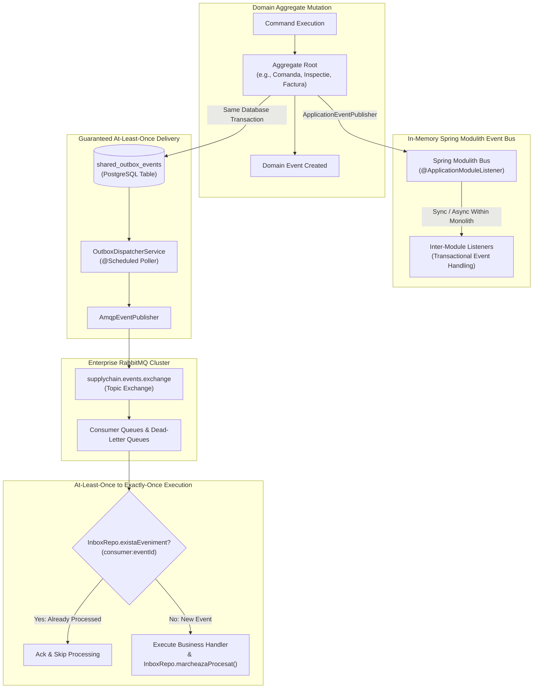

# 24. EVENT-DRIVEN ARCHITECTURE, TRANSACTIONAL OUTBOX & INBOX PATTERNS
**System:** Enterprise Procure-to-Pay (P2P) Supply Chain Modular Monolith  
**Namespace:** `ro.uaic.feaa.sdbis.supplychain`

---

## 1. DUAL EVENT MODEL ARCHITECTURE

To reconcile high transactional consistency within bounded contexts with eventual consistency across distributed systems, the platform implements a **Dual Event Architecture**:



---

## 2. THE DUAL-WRITE PROBLEM & TRANSACTIONAL OUTBOX PATTERN (ADR-002, ADR-004)

### The Distributed Consistency Problem
In enterprise architectures, writing to a database and publishing a message to a message broker in the same operation creates a **Dual-Write Hazard**:
- If the database commit succeeds but the message broker is offline, downstream services never receive the event.
- If the message broker publish succeeds but the database transaction rolls back, downstream services act on phantom uncommitted data.

### The Solution: Transactional Outbox
1. When an aggregate mutates state, the corresponding domain event is serialized to JSON and persisted directly into `shared_outbox_events` in the **exact same database transaction** that commits the business entity.
2. If the transaction rolls back, the outbox record is rolled back atomically.
3. An asynchronous poller reads uncommitted records and transmits them to the broker.

### Database Schema (`shared_outbox_events`)
```sql
CREATE TABLE shared_outbox_events (
    event_id UUID PRIMARY KEY,
    aggregate_type VARCHAR(100) NOT NULL,
    aggregate_id VARCHAR(100) NOT NULL,
    event_type VARCHAR(100) NOT NULL,
    payload TEXT NOT NULL,
    occurred_on TIMESTAMP WITH TIME ZONE NOT NULL,
    published BOOLEAN NOT NULL DEFAULT FALSE,
    published_on TIMESTAMP WITH TIME ZONE
);

CREATE INDEX idx_outbox_unpublished ON shared_outbox_events(published) WHERE published = FALSE;
```

---

## 3. OUTBOX DISPATCHER IMPLEMENTATION

Declared in [OutboxDispatcherService.java](file:///c:/Users/bmugu/Desktop/app/src/main/java/ro/uaic/feaa/sdbis/supplychain/infrastructure/messaging/OutboxDispatcherService.java):

```java
@Service
@InfrastructureService
public class OutboxDispatcherService {

    private final OutboxRepo outboxRepo;
    private final ApplicationEventPublisher eventPublisher;
    private final AmqpEventPublisher amqpPublisher;

    public OutboxDispatcherService(OutboxRepo outboxRepo,
                                  ApplicationEventPublisher eventPublisher,
                                  AmqpEventPublisher amqpPublisher) {
        this.outboxRepo = outboxRepo;
        this.eventPublisher = eventPublisher;
        this.amqpPublisher = amqpPublisher;
    }

    @Scheduled(fixedDelay = 2000)
    @Transactional
    public int dispatchUnpublishedEvents() {
        List<DomainEvent> events = outboxRepo.pollUnpublishedEvents();
        int count = 0;
        for (DomainEvent e : events) {
            try {
                eventPublisher.publishEvent(e);
                amqpPublisher.publishDomainEvent(e);
                outboxRepo.markAsPublished(e.eventId());
                count++;
            } catch (Exception ex) {
                log.error("[Outbox Dispatcher] Failed to publish event {}: {}", e.eventId(), ex.getMessage());
            }
        }
        return count;
    }
}
```

---

## 4. IDEMPOTENT CONSUMER (INBOX PATTERN)

Because message brokers guarantee **At-Least-Once Delivery**, network blips or broker reconnects may cause duplicate message delivery. To prevent double payments or duplicate inventory receipts, consumers implement the **Idempotent Inbox Pattern**.

### Deduplication Key
The inbox deduplication key is composite: `<consumer-identifier>:<event-uuid>`.

```java
@Repository
public class InboxRepoJPA extends AbstractRepositoryJPA<InboxEventEntity, String> implements InboxRepo {

    @Override
    public boolean existaEveniment(String consumer, UUID eventId) {
        String key = (consumer != null ? consumer : "default") + ":" + eventId;
        return em.find(InboxEventEntity.class, key) != null;
    }

    @Override
    public void marcheazaProcesat(String consumer, UUID eventId) {
        if (!existaEveniment(consumer, eventId)) {
            em.persist(new InboxEventEntity(consumer, eventId, Instant.now()));
            em.flush();
        }
    }
}
```

### Database Schema (`shared_inbox_events`)
```sql
CREATE TABLE shared_inbox_events (
    id VARCHAR(150) PRIMARY KEY, -- Format: consumer_name:event_id
    consumer VARCHAR(100) NOT NULL,
    event_id UUID NOT NULL,
    processed_at TIMESTAMP WITH TIME ZONE NOT NULL
);
```

---

## 5. DYNAMIC AMQP ROUTING TAXONOMY

The [AmqpEventPublisher.java](file:///c:/Users/bmugu/Desktop/app/src/main/java/ro/uaic/feaa/sdbis/supplychain/shared/messaging/AmqpEventPublisher.java) inspects the domain event class name and routes it across the RabbitMQ topic exchange:

| Event Class | Dynamic Routing Key | Target Queue Binding | Dead-Letter Routing |
|---|---|---|---|
| `ComandaCreataEvent` | `comenzi.comandacreataevent` | `comenzi.events.queue` | `supplychain.events.dlq` |
| `ComandaAprobataEvent` | `comenzi.comandaaprobataevent` | `comenzi.events.queue` | `supplychain.events.dlq` |
| `InspectieFinalizataEvent` | `calitate.inspectiefinalizataevent` | `calitate.events.queue` | `supplychain.events.dlq` |
| `FurnizorPenalizatEvent` | `calitate.furnizorpenalizatevent` | `calitate.events.queue` | `supplychain.events.dlq` |
| `FacturaCreataEvent` | `facturi.facturacreataevent` | `facturi.events.queue` | `supplychain.events.dlq` |
| `FacturaVerificataEvent` | `facturi.facturaverificataevent` | `facturi.events.queue` | `supplychain.events.dlq` |
| `PlataEfectuataEvent` | `facturi.plataefectuataevent` | `facturi.events.queue` | `supplychain.events.dlq` |
| `OrdinPlataAprobatEvent` | `facturi.ordinplataaprobatevent` | `facturi.events.queue` | `supplychain.events.dlq` |

