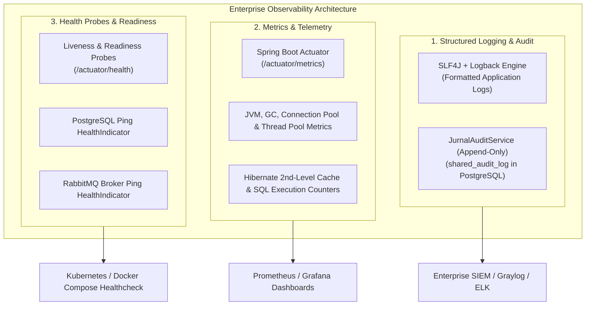

# 25. ENTERPRISE OBSERVABILITY, LOGGING & METRICS
**System:** Enterprise Procure-to-Pay (P2P) Supply Chain Modular Monolith  
**Namespace:** `ro.uaic.feaa.sdbis.supplychain`

---

## 1. THREE PILLARS OF ENTERPRISE OBSERVABILITY

To satisfy production operational requirements and compliance with European cybersecurity guidelines (NIS2 Directive), the platform implements the **Three Pillars of Observability**:



---

## 2. AUDIT TRAIL LOGGING (`shared_audit_log`)

All security events, financial operations, approval decisions, and state mutations are recorded immutably via [JurnalAuditService.java](file:///c:/Users/bmugu/Desktop/app/src/main/java/ro/uaic/feaa/sdbis/supplychain/securitate/JurnalAuditService.java).

### Table Schema & Indexing
```sql
CREATE TABLE shared_audit_log (
    id UUID PRIMARY KEY,
    timestamp TIMESTAMP WITH TIME ZONE NOT NULL,
    actiune VARCHAR(100) NOT NULL,
    obiect VARCHAR(500) NOT NULL
);

CREATE INDEX idx_audit_timestamp ON shared_audit_log(timestamp DESC);
CREATE INDEX idx_audit_actiune ON shared_audit_log(actiune);
```

### Audit Event Taxonomy

| Category | Action Identifier | Trigger Condition | Information Recorded |
|---|---|---|---|
| **Security** | `STRIPE_WEBHOOK_REJECTED` | Missing `Stripe-Signature` header | IP address, timestamp, missing header |
| **Security** | `STRIPE_WEBHOOK_INVALID_SIGNATURE` | HMAC mismatch / clock drift $> 300\text{s}$ | Failed signature string, exception details |
| **Security** | `RBAC_ACCESS_DENIED` | Unauthorized role attempted route | `userId`, `role`, requested URI |
| **Financial** | `CREARE_ORDIN_PLATA` | Order of payment created | Payment order UUID, invoice ID, creator ID |
| **Financial** | `APROBARE_ORDIN_PLATA` | Order of payment approved | Payment order UUID, approver ID (Four-Eyes) |
| **Financial** | `TRANSMITERE_BANCA_STRIPE` | Payment transmitted to gateway | Payment order UUID, IBAN, Stripe reference |
| **Financial** | `PLATA_CONFIRMATA_STRIPE` | Stripe webhook confirms payment | Payment order UUID, bank transfer reference |
| **Quality** | `INSPECTIE_FINALIZATA` | Quality inspection concluded | Inspection ID, lot status, supplier ID |
| **Supplier** | `FURNIZOR_PENALIZAT` | Supplier score drops below threshold | Supplier ID, penalty percentage |

---

## 3. SPRING BOOT ACTUATOR CONFIGURATION

Externalized in [application.properties](file:///c:/Users/bmugu/Desktop/app/src/main/resources/application.properties):

```properties
# Actuator & Observability Exposure
management.endpoints.web.exposure.include=health,info,metrics
management.endpoint.health.show-details=always
management.health.db.enabled=true
management.health.rabbit.enabled=true
```

### Health Check Endpoint (`GET /actuator/health`)
Provides unified status aggregated from subsystems:
```json
{
  "status": "UP",
  "components": {
    "db": {
      "status": "UP",
      "details": {
        "database": "PostgreSQL",
        "validationQuery": "isValid()"
      }
    },
    "diskSpace": {
      "status": "UP",
      "details": {
        "total": 510982971392,
        "free": 182391029760,
        "threshold": 10485760
      }
    },
    "ping": {
      "status": "UP"
    },
    "rabbit": {
      "status": "UP",
      "details": {
        "version": "3.12.12"
      }
    }
  }
}
```

---

## 4. METRICS & OPERATIONAL TELEMETRY

Accessible via `GET /actuator/metrics`:

| Metric Name | Type | Description & Alerting Threshold |
|---|---|---|
| `http.server.requests` | Timer | HTTP endpoint response duration and throughput. Alert if 95th percentile $> 200\text{ ms}$. |
| `jvm.memory.used` | Gauge | Heap and non-heap memory utilization. Alert if $> 85\%$ sustained. |
| `jvm.gc.pause` | Timer | Stop-the-world garbage collection pause times. Alert if pause $> 100\text{ ms}$. |
| `jdbc.connections.active` | Gauge | Active HikariCP connection pool count. Alert if active $> 90\%$ pool capacity. |
| `spring.modulith.events` | Counter | Total published in-memory domain events. |
| `outbox.unpublished.count` | Gauge | Number of unpublished records in `shared_outbox_events`. Alert if $> 500$ records. |
| `rabbitmq.dlq.count` | Gauge | Dead-letter queue depth (`supplychain.events.dlq`). Alert if $> 0$ messages. |

---

## 5. LOGGING STRATEGY & LOGBACK CONFIGURATION

Logs follow structured format with standardized timestamps, thread tags, log levels, logger package names, and contextual tracking keys:

```
2026-10-29 12:45:10.124 DEBUG [http-nio-8080-exec-1] r.u.f.s.s.f.p.FacturaCtrl: [Stripe Webhook] Received webhook event payment_intent.succeeded
2026-10-29 12:45:10.150 INFO  [http-nio-8080-exec-1] r.u.f.s.s.f.i.StripeBancaPlataAdapter: [Stripe Sandbox] Transmitting payment order 8f029... | Sum: 1500.00 RON
2026-10-29 12:45:10.165 INFO  [scheduling-1] r.u.f.s.s.i.m.OutboxDispatcherService: [Outbox Dispatcher] Published event 3a102... of type ComandaCreataEvent
```

