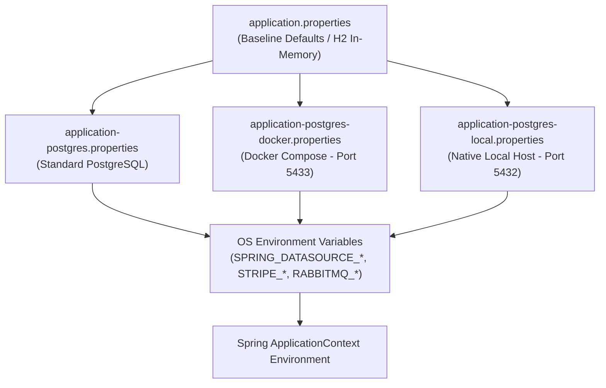

# 27. ENTERPRISE CONFIGURATION & PROPERTY SPECIFICATION
**System:** Enterprise Procure-to-Pay (P2P) Supply Chain Modular Monolith  
**Namespace:** `ro.uaic.feaa.sdbis.supplychain`

---

## 1. SPRING BOOT CONFIGURATION PROFILE HIERARCHY

The configuration framework leverages Spring Boot externalized configuration, allowing profile-specific properties to override baseline definitions according to the execution context:



---

## 2. COMPREHENSIVE CONFIGURATION DICTIONARY

### 2.1 Core Application & Server Properties

| Property Name | Default Value | Description |
|---|---|---|
| `spring.application.name` | `supplychain-p2p` | Spring Application identifier for metrics and service discovery. |
| `server.port` | `8080` | HTTP listening port for embedded Tomcat. |

### 2.2 Relational Datasource & Persistence

| Property Name | Profile: Baseline (H2) | Profile: `postgres` | Profile: `postgres-docker` | Profile: `postgres-local` |
|---|---|---|---|---|
| `spring.datasource.url` | `jdbc:h2:mem:supplychaindb;...` | `jdbc:postgresql://localhost:5432/supplychain_db` | `jdbc:postgresql://localhost:5433/supplychain_db` | `jdbc:postgresql://localhost:5432/supplychain_db` |
| `spring.datasource.driverClassName` | `org.h2.Driver` | `org.postgresql.Driver` | `org.postgresql.Driver` | `org.postgresql.Driver` |
| `spring.datasource.username` | `sa` | `${POSTGRES_USER:postgres}` | `${DOCKER_POSTGRES_USER:supplychain}` | `${POSTGRES_USER:postgres}` |
| `spring.datasource.password` | `""` | `${POSTGRES_PASSWORD:postgres}` | `${DOCKER_POSTGRES_PASSWORD:supplychain_secret}` | `${POSTGRES_PASSWORD:postgres}` |
| `spring.jpa.database-platform` | `org.hibernate.dialect.H2Dialect` | `org.hibernate.dialect.PostgreSQLDialect` | `org.hibernate.dialect.PostgreSQLDialect` | `org.hibernate.dialect.PostgreSQLDialect` |
| `spring.jpa.hibernate.ddl-auto` | `create-drop` | `validate` | `validate` | `validate` |
| `spring.jpa.show-sql` | `true` | `true` | `true` | `true` |
| `spring.jpa.properties.hibernate.format_sql` | `true` | `true` | `true` | `true` |

> [!IMPORTANT]
> In all production and PostgreSQL profiles, `spring.jpa.hibernate.ddl-auto` is strictly set to `validate` (ADR-003). Schema modification is owned exclusively by Flyway migrations.

---

### 2.3 Flyway Database Migration Properties

| Property Name | Default Value | Description |
|---|---|---|
| `spring.flyway.enabled` | `true` | Activates automated database migrations at startup. |
| `spring.flyway.locations` | `classpath:db/migration` | Filesystem / classpath directory containing `V1` through `V6` scripts. |
| `spring.flyway.baseline-on-migrate` | `true` | Creates `flyway_schema_history` baseline if database contains pre-existing tables. |

---

### 2.4 REST Content Negotiation & Jackson

| Property Name | Default Value | Description |
|---|---|---|
| `spring.mvc.contentnegotiation.favor-parameter` | `true` | Enables query parameter-driven format selection (`?format=json` or `?format=xml`). |
| `spring.mvc.contentnegotiation.parameter-name` | `format` | The URL query parameter key used for content negotiation. |
| `spring.jackson.serialization.indent-output` | `true` | Pretty-prints JSON responses for enhanced human developer readability. |
| `spring.jackson.default-property-inclusion` | `non_null` | Excludes `null` JSON fields to reduce payload network bandwidth. |

---

### 2.5 Stripe Payment Gateway Integration (ADR-010)

| Property Name | Injected Field | Environment Variable | Default Value |
|---|---|---|---|
| `stripe.api.key` | `StripeProperties.apiKey` | `STRIPE_API_KEY` | `sk_test_mock_sandbox_key_12345` |
| `stripe.webhook.secret` | `StripeProperties.webhookSecret` | `STRIPE_WEBHOOK_SECRET` | `whsec_mock_sandbox_secret_12345` |
| `stripe.currency` | `stripeCurrency` | `STRIPE_CURRENCY` | `eur` |

---

### 2.6 RabbitMQ AMQP Broker Connectivity (ADR-004)

| Property Name | Injected Value | Default Value | Description |
|---|---|---|---|
| `spring.rabbitmq.host` | `${RABBITMQ_HOST:localhost}` | `localhost` | RabbitMQ server hostname / container name. |
| `spring.rabbitmq.port` | `${RABBITMQ_PORT:5672}` | `5672` | Standard AMQP 0-9-1 TCP listening port. |
| `spring.rabbitmq.username` | `${RABBITMQ_USER:guest}` | `guest` | RabbitMQ authentication username. |
| `spring.rabbitmq.password` | `${RABBITMQ_PASSWORD:guest}` | `guest` | RabbitMQ authentication password. |
| `spring.rabbitmq.listener.simple.auto-startup` | `false` | `false` | Prevents connection timeout exceptions when broker is not running in test mode. |

---

### 2.7 Observability, Actuator & OpenAPI

| Property Name | Default Value | Description |
|---|---|---|
| `management.endpoints.web.exposure.include` | `health,info,metrics` | Whitelisted Actuator endpoints exposed over HTTP. |
| `management.endpoint.health.show-details` | `always` | Exposes detailed subsystem probe diagnostics (database, disk, rabbit). |
| `springdoc.api-docs.path` | `/api-docs` | Path to generated OpenAPI 3.0 specification document. |
| `springdoc.swagger-ui.path` | `/swagger-ui.html` | Path to interactive Swagger UI web interface. |

---

## 3. ENVIRONMENT VARIABLE OVERRIDE CHEAT SHEET

For production container deployment, all settings can be overridden via environment variables without modifying source files:

```bash
# Database
export SPRING_DATASOURCE_URL="jdbc:postgresql://db-cluster.internal:5432/supplychain_prod"
export POSTGRES_USER="p2p_app_user"
export POSTGRES_PASSWORD="secure_vault_password_xyz"

# Stripe
export STRIPE_API_KEY="sk_live_51Pxxxxxxxxxxxxxxxxxxxx"
export STRIPE_WEBHOOK_SECRET="whsec_xxxxxxxxxxxxxxxxxxxx"

# RabbitMQ
export RABBITMQ_HOST="rabbit-cluster.internal"
export RABBITMQ_PORT="5672"
export RABBITMQ_USER="supplychain"
export RABBITMQ_PASSWORD="rabbitmq_secure_password"
```

