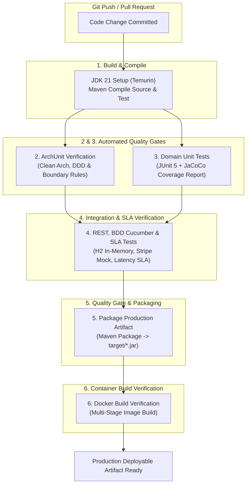

# 28. CONTINUOUS INTEGRATION & CONTINUOUS DELIVERY (CI/CD) PIPELINE
**System:** Enterprise Procure-to-Pay (P2P) Supply Chain Modular Monolith  
**Namespace:** `ro.uaic.feaa.sdbis.supplychain`

---

## 1. ENTERPRISE CI/CD PIPELINE ARCHITECTURE

The automated software delivery pipeline is orchestrated through **GitHub Actions** (`.github/workflows/ci-cd.yml`), adhering to enterprise DevSecOps best practices. Every commit or pull request against `main`, `develop`, `feature/**`, `release/**`, and `hotfix/**` triggers an immutable multi-stage verification flow:



---

## 2. PIPELINE JOB BREAKDOWN & STAGE GATES

### Job 1: Build & Compile Validation
- **Runner:** `ubuntu-latest`
- **Environment:** Eclipse Temurin JDK 21 with Maven local caching (`cache: maven`).
- **Command:** `./mvnw clean test-compile -B -DskipTests`
- **Objective:** Validates Java 21 syntax, Lombok processing, and Maven dependency resolution before running tests.

### Job 2: ArchUnit Architectural Fitness Gate
- **Dependency:** Requires `build`
- **Command:** `./mvnw test -B -Dtest="ro.uaic.feaa.sdbis.supplychain.architecture.**.*Test"`
- **Objective:** Guarantees that modular boundaries, Clean Architecture layer dependencies, and semantic annotations are 100% compliant. Build immediately aborts if any architectural rule is violated.

### Job 3: Domain & Workflow Unit Tests
- **Dependency:** Requires `build`
- **Command:** `./mvnw test -B -Dtest="ro.uaic.feaa.sdbis.supplychain.unit.**.*Test"`
- **JaCoCo Analysis:** Executes `./mvnw jacoco:report -B` and uploads coverage report artifacts via `actions/upload-artifact@v4`.

### Job 4: Integration, REST, BDD & SLA Benchmark Tests
- **Dependency:** Requires `[archunit, unit-tests]`
- **Command:**
  ```bash
  ./mvnw test -B -Dtest="ro.uaic.feaa.sdbis.supplychain.integration.**.*Test,\
  ro.uaic.feaa.sdbis.supplychain.rest.**.*Test,\
  ro.uaic.feaa.sdbis.supplychain.bdd.**.*Test,\
  ro.uaic.feaa.sdbis.supplychain.performance.**.*Test"
  ```
- **Objective:** Executes end-to-end BDD acceptance features, REST controller tests, transactional outbox dispatch, and performance SLA benchmarks ($< 50\text{ ms}$).

### Job 5: Quality Gate & Artifact Packaging
- **Dependency:** Requires `[integration-tests]`
- **Command:** `./mvnw package -B -DskipTests`
- **Artifact Upload:** Stores production-ready `supplychain-p2p-*.jar` as a workflow artifact named `supply-chain-system-artifact`.

### Job 6: Docker Image Build Verification
- **Dependency:** Requires `[quality-and-package]`
- **Action:** Uses `docker/setup-buildx-action@v3`
- **Command:** `docker build -t supplychain-p2p:latest .`
- **Objective:** Verifies that the multi-stage Docker build succeeds and packages a compliant container image with non-root security permissions.

---

## 3. CONCURRENCY & CANCEL-IN-PROGRESS POLICY

To optimize enterprise CI runner compute resources, the pipeline cancels redundant queued builds when new commits are pushed to the same branch:

```yaml
concurrency:
  group: ${{ github.workflow }}-${{ github.ref }}
  cancel-in-progress: true
```

---

## 4. BRANCH PROTECTION & MERGE RULES

The GitHub repository enforces branch protection policies on `main`:
1. **Required Status Checks:** Jobs 1 through 6 must pass with 0 failures before a Pull Request can be merged.
2. **Strict Non-Fast-Forward / Linear History:** Rebase or Squash merges required to maintain clean Git history.
3. **No Direct Commits:** Direct pushes to `main` are strictly prohibited; changes require peer code review.

