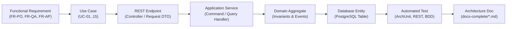

# 29. END-TO-END ENTERPRISE TRACEABILITY MATRIX
**System:** Enterprise Procure-to-Pay (P2P) Supply Chain Modular Monolith  
**Namespace:** `ro.uaic.feaa.sdbis.supplychain`

---

## 1. TRACEABILITY FRAMEWORK & METHODOLOGY

To guarantee that every functional requirement is backed by domain logic, persistent state, automated testing, and architectural documentation, the platform establishes an **End-to-End Traceability Model**:

$$\text{Business Goal} \longrightarrow \text{Requirement (FR)} \longrightarrow \text{Use Case (UC)} \longrightarrow \text{REST API} \longrightarrow \text{Domain Model} \longrightarrow \text{Database Table} \longrightarrow \text{Automated Test}$$

---

## 2. COMPREHENSIVE END-TO-END TRACEABILITY MATRIX

### Purchasing & Purchase Order Management (`comenzi`)

| Req ID | Use Case | API Endpoint & HTTP Method | Domain Aggregate & Method | Database Table | Verification Test | Doc Ref |
|---|---|---|---|---|---|---|
| **FR-PO-01** | UC-01: Emitere Comandă | `POST /api/comenzi` `CreeazaComandaRequest` | `ComandaAprovizionare.creeazaComanda` | `comenzi_comenzi` `comenzi_linii_comanda` | `ComandaCtrlRestTest.testCreeazaComandaSucces` | `docs/04`, `docs/13` |
| **FR-PO-02** | UC-02: Calificare Furnizor | Query `ICalitateModuleApi.isFurnizorEligibil` | `ComandaAprovizionare` validation guard | `calitate_furnizori` | `CreeazaComandaUnitTest.testFurnizorNeeligibil` | `docs/08`, `docs/14` |
| **FR-PO-03** | UC-03: Confirmare Furnizor | `PUT /api/comenzi/{id}/confirmare` | `ComandaAprovizionare.confirmaComanda` | `comenzi_comenzi` | `WorkflowRulesTest.testConfirmareComanda` | `docs/05`, `docs/22` |
| **FR-PO-04** | UC-04: Anulare în Cascadă | `POST /api/comenzi/{id}/anulare` | `ComandaAprovizionare.anuleazaComanda` | `comenzi_comenzi` `comenzi_loturi` | `BddFeaturesTest` (`anulare_in_cascada.feature`) | `docs/03`, `docs/22` |
| **FR-PO-05** | UC-05: Estimare Lead Time | `GET /api/comenzi/furnizori/{id}/lead-time` | `EstimareLeadTimeService.estimeaza` | `comenzi_loturi` | `PerformanceAndSlaTest.testLeadTimeEstimationSLA` | `docs/06`, `docs/25` |

---

### Quality Assurance & Supplier Governance (`calitate`)

| Req ID | Use Case | API Endpoint & HTTP Method | Domain Aggregate & Method | Database Table | Verification Test | Doc Ref |
|---|---|---|---|---|---|---|
| **FR-QA-01** | UC-06: Înregistrare Furnizor | `POST /api/furnizori` `InregistreazaFurnizorRequest` | `Furnizor.inregistreaza` | `calitate_furnizori` | `CalitateCtrlRestTest.testInregistreazaFurnizor` | `docs/13`, `docs/17` |
| **FR-QA-02** | UC-07: Audit & Calificare | `POST /api/furnizori/{id}/calificare` | `Furnizor.califica` | `calitate_furnizori` | `CalitateCtrlRestTest` | `docs/05`, `docs/15` |
| **FR-QA-03** | UC-08: Inspecție Lot AQL | `POST /api/inspectii` `CreeazaInspectieRequest` | `InspectieCalitate.evalueazaConformitate` | `calitate_inspectii` `calitate_defecte` | `ValidationRulesTest.testAqlSamplingCalculation` | `docs/05`, `docs/22` |
| **FR-QA-04** | UC-09: Generare NCR | Verdict `RESPINS` trigger | `RaportNeconformitate (NCR)` | `calitate_ncr` | `WorkflowRulesTest.testGenerareNCRAutomata` | `docs/03`, `docs/08` |
| **FR-QA-05** | UC-10: Scorecard Lunar | `POST /api/furnizori/{id}/scorecard` | `CalculScorecardService.calculeaza` | `calitate_scorecards` | `ComputationRulesTest.testCalculScorecardLunar` | `docs/06`, `docs/22` |
| **FR-QA-06** | UC-11: Blocare Automată | 3 loturi defecte consecutive | `Furnizor.inregistreazaInspectieNeconforma` | `calitate_furnizori` | `WorkflowRulesTest.testBlocareAutomataFurnizor` | `docs/05`, `docs/23` |

---

### Invoicing, 3-Way Match & Bank Payments (`facturi`)

| Req ID | Use Case | API Endpoint & HTTP Method | Domain Aggregate & Method | Database Table | Verification Test | Doc Ref |
|---|---|---|---|---|---|---|
| **FR-AP-01** | UC-12: Înregistrare Factură | `POST /api/facturi` (JSON/XML) `InregistreazaFacturaRequest` | `Factura.inregistreaza` | `facturi_facturi` `facturi_linii_factura` | `ApacheHttpClientContentNegotiationTest` | `docs/12`, `docs/13` |
| **FR-AP-02** | UC-13: Generare NIR Automat | Event `ComandaReceptionataEvent` | `NotaReceptie (NIR)` | `facturi_nir` `facturi_linii_nir` | `PaymentWorkflowIntegrationTest.testIdempotentNIR` | `docs/16`, `docs/24` |
| **FR-AP-03** | UC-14: 3-Way Reconciliation | `POST /api/facturi/{id}/reconciliere` | `ReconciliereService.reconciliaza` | `facturi_facturi` | `BddFeaturesTest` (`reconciliaza_factura.feature`) | `docs/03`, `docs/22` |
| **FR-AP-04** | UC-15: Creare Ordin Plată | `POST /api/facturi/{id}/ordine-plata` `CreeazaOrdinPlataRequest` | `OrdinPlata.creeaza` | `facturi_ordine_plata` | `PaymentWorkflowIntegrationTest` | `docs/13`, `docs/20` |
| **FR-AP-05** | Four-Eyes Approval | `POST /api/ordine-plata/{id}/aprobare` | `OrdinPlata.aproba` (Four-Eyes) | `facturi_ordine_plata` | `FacturaCtrlRestTest.testAprobaOrdinPlataSucces` | `docs/20`, `docs/21` |
| **FR-AP-06** | Stripe Clearing Webhook | `POST /api/ordine-plata/webhook-banca` (`Stripe-Signature`) | `OrdinPlata.marcheazaPlatit` | `facturi_ordine_plata` `shared_audit_log` | `FacturaCtrlRestTest.testWebhookBancaSemnaturaValida` | `docs/20`, `docs/21` |

---

## 3. NON-FUNCTIONAL REQUIREMENTS (NFR) TRACEABILITY

| NFR Category | Requirement Target | Implementation Mechanism | Verification Test |
|---|---|---|---|
| **Architectural Boundaries** | Zero cyclic dependencies across modules | Spring Modulith `@ApplicationModule` + ArchUnit slices | `DependencyCycleTest`, `SpringModulithTest` |
| **Layer Purity** | Clean Architecture concentric layers | ArchUnit `LayerArchitectureTest` | `LayerArchitectureTest` |
| **Subsystem Latency** | Key transactional flows $< 50\text{ ms}$ | Optimized JPA Fetching, HikariCP pool, In-Memory H2 | `PerformanceAndSlaTest` |
| **Payment Security** | HMAC-SHA256 Stripe Webhook Verification | `Webhook.constructEvent(..., 300)` tolerance window | `FacturaCtrlRestTest` |
| **Audit Compliance** | Non-repudiation of financial operations | `JurnalAuditService` with `Propagation.REQUIRES_NEW` | `OutboxAndMessagingIntegrationTest` |

