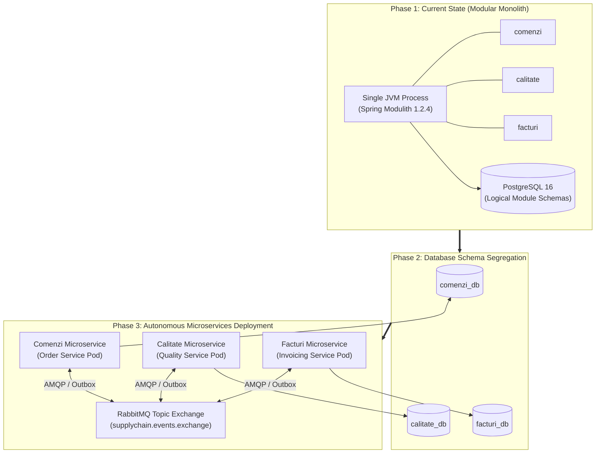
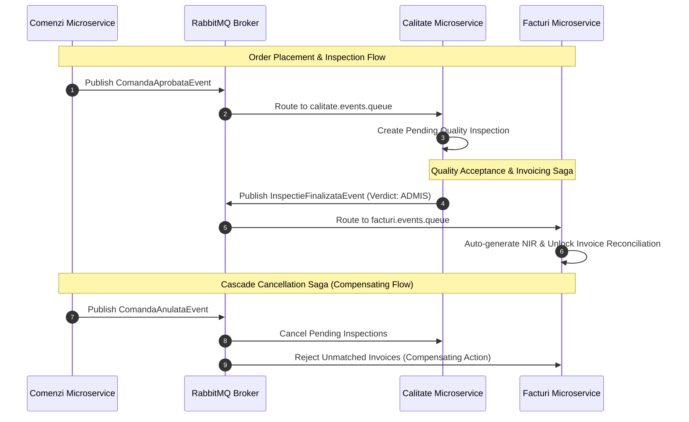

# 31. MICROSERVICE READINESS & DECOMPOSITION ROADMAP
**System:** Enterprise Procure-to-Pay (P2P) Supply Chain Modular Monolith  
**Namespace:** `ro.uaic.feaa.sdbis.supplychain`

---

## 1. STRATEGIC DECOMPOSITION PHILOSOPHY (MODULITH TO MICROSERVICES)

The Procure-to-Pay platform was architected as a **Spring Modulith Modular Monolith** with zero direct cross-module table joins, zero cyclic package dependencies, and strict public API contracts specifically to guarantee **Frictionless Microservice Migration Readiness** when organizational scale demands distributed operations.

---

## 2. BOUNDED CONTEXT INDEPENDENCE AUDIT

An audit of the existing modular boundaries confirms the following architectural independence readiness metrics:

| Bounded Context | Cross-Module Database Foreign Keys | Cross-Module Entity Mappings | Inter-Module Communication | Microservice Readiness Rating |
|---|:---:|:---:|---|:---:|
| **Comenzi** (Purchasing) | **0** (Zero) | **0** (Zero) | Queries `ICalitateModuleApi` interface | **100% Ready** |
| **Calitate** (Quality) | **0** (Zero) | **0** (Zero) | Autonomous (No outgoing synchronous calls) | **100% Ready** |
| **Facturi** (Invoicing) | **0** (Zero) | **0** (Zero) | Queries `IComenziModuleApi` interface | **100% Ready** |

> [!NOTE]
> All inter-module references use opaque UUID identity keys (`UUID comandaId`, `UUID furnizorId`, `UUID facturaId`). There are **no Hibernate `@ManyToOne` or `@OneToMany` relationships traversing module boundaries**.

---

## 3. DATABASE-PER-SERVICE TRANSITION STRATEGY

### Step 1: Logical Schema Partitioning (Completed via Flyway)
Existing Flyway scripts (`V1` to `V6`) prefix all database tables with their bounded context name:
- `comenzi_*`: Owned exclusively by the Purchasing module.
- `calitate_*`: Owned exclusively by the Quality & Supplier module.
- `facturi_*`: Owned exclusively by the Invoicing & Accounts Payable module.
- `shared_*`: Shared Kernel infrastructure (Outbox, Inbox, Audit).

### Step 2: Physical Database Extraction
To achieve true physical isolation, the monolithic database `supplychain_db` will be split into three independent PostgreSQL instances:
1. `comenzi_db`: Tables `comenzi_comenzi`, `comenzi_linii_comanda`, `comenzi_loturi`.
2. `calitate_db`: Tables `calitate_furnizori`, `calitate_inspectii`, `calitate_defecte`, `calitate_ncr`, `calitate_scorecards`.
3. `facturi_db`: Tables `facturi_facturi`, `facturi_linii_factura`, `facturi_nir`, `facturi_linii_nir`, `facturi_ordine_plata`.

Each microservice will maintain its own dedicated `shared_outbox_events` and `shared_inbox_events` tables to manage local asynchronous messaging.

---

## 4. DISTRIBUTED DATA CONSISTENCY & SAGA PATTERN

In a distributed microservice topology, atomic ACID database transactions cannot cross service boundaries. Cross-service business flows will transition from synchronous transactions to **Choreographed Event Sagas**:

---

## 5. SHARED KERNEL & CODE REPOSITORY EVOLUTION

To extract microservices without code duplication:
1. **Extract `supplychain-shared-kernel`:** Publish `ro.uaic.feaa.sdbis.supplychain.shared.*` as an enterprise internal Maven artifact.
2. **Convert Public Module APIs to REST / OpenFeign Clients:** The existing interface [ICalitateModuleApi.java](file:///c:/Users/bmugu/Desktop/app/src/main/java/ro/uaic/feaa/sdbis/supplychain/calitate/api/ICalitateModuleApi.java) will be backed by a Spring Cloud OpenFeign client calling `http://calitate-service/api/furnizori/{id}/summary`.
3. **API Gateway Ingress:** Introduce Spring Cloud Gateway or Traefik at the edge to route external requests to individual service pods.

