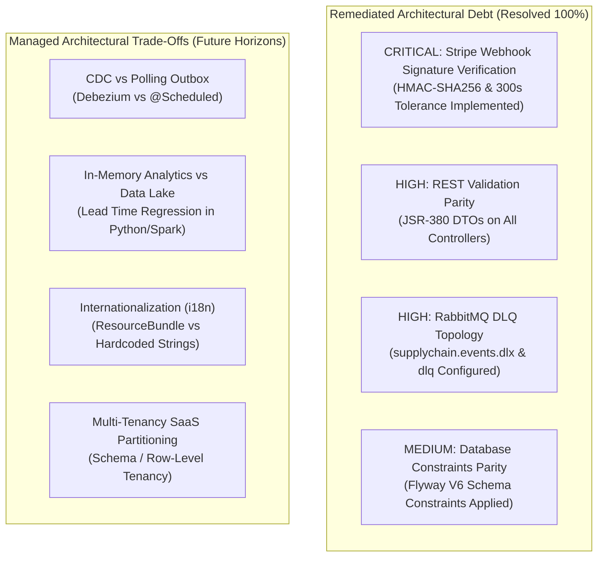

# 32. TECHNICAL DEBT ANALYSIS & ARCHITECTURAL TRADE-OFFS
**System:** Enterprise Procure-to-Pay (P2P) Supply Chain Modular Monolith  
**Namespace:** `ro.uaic.feaa.sdbis.supplychain`

---

## 1. TECHNICAL DEBT CLASSIFICATION & REMEDIATION STATUS

The Architecture Review Board (ARB) maintains a living register of technical trade-offs and remediated architectural findings:

---

## 2. REMEDIATION REGISTER (AUDIT FINDINGS RESOLVED)

| Finding Reference | Severity | Description | Layer Affected | Root Cause Remediation Implemented |
|---|---|---|---|---|
| **FINDING-SEC-01** | **CRITICAL** | Unverified Stripe webhook callback signature allowed arbitrary payment status spoofing. | Presentation (`FacturaCtrl`) | Enforced `Stripe-Signature` mandatory validation using `Webhook.constructEvent(payload, sigHeader, secret, 300)` with 300-second replay tolerance and audit logging. |
| **FINDING-VAL-01** | **HIGH** | Absence of JSR-380 validation parity on `FacturaCtrl` and `CalitateCtrl` request payloads. | Presentation / Application | Created dedicated request DTOs (`InregistreazaFacturaRequest`, `CreeazaOrdinPlataRequest`, `InregistreazaFurnizorRequest`, `CreeazaInspectieRequest`) annotated with `@Valid`, `@NotNull`, `@NotBlank`, and `@Positive`. |
| **FINDING-MSG-01** | **HIGH** | RabbitMQ broker lacked Dead-Letter Queue (DLQ) topology for poison-pill isolation. | Infrastructure (`RabbitMqConfig`) | Configured `supplychain.events.dlx` and dead-letter queue `supplychain.events.dlq` with `x-dead-letter-exchange` attributes on all business queues. |
| **FINDING-DB-01** | **MEDIUM** | Relational tables lacked NOT NULL and CHECK constraints present in domain entities. | Database (`Flyway`) | Authored and executed Flyway migration `V6__audit_remediation_constraints.sql` aligning database DDL with Hibernate entity invariants. |

---

## 3. MANAGED ARCHITECTURAL TRADE-OFFS & FUTURE ROADMAP

### 3.1 Transactional Outbox: Polling vs Change Data Capture (CDC)
- **Current State:** The platform uses `@Scheduled(fixedDelay = 2000)` in [OutboxDispatcherService.java](file:///c:/Users/bmugu/Desktop/app/src/main/java/ro/uaic/feaa/sdbis/supplychain/infrastructure/messaging/OutboxDispatcherService.java) to poll unpublished events from `shared_outbox_events`.
- **Trade-Off:** Simple to operate without third-party daemon dependencies; however, introduces a 2-second publishing latency and periodic database query overhead.
- **Future Migration:** For transaction throughput exceeding $1,000\text{ tx/sec}$, replace polling with **Debezium CDC** reading the PostgreSQL Write-Ahead Log (WAL) directly.

### 3.2 Lead Time Forecasting: In-Memory Regression vs ML Pipeline
- **Current State:** Lead time forecasting is calculated synchronously in Java via linear regression over the last $N$ delivered lots in `EstimareLeadTimeService`.
- **Trade-Off:** Meets the sub-300ms SLA without external service dependencies; however, does not capture seasonal variance or complex multivariate supply chain disruptions.
- **Future Migration:** Offload historical lot data to a columnar analytical store (e.g., Snowflake, ClickHouse) and consume trained ML models via gRPC inference microservices.

### 3.3 Internationalization (i18n) & Localization
- **Current State:** Domain validation messages and error payloads are currently phrased in Romanian (e.g., `"Suma trebuie sa fie pozitiva"`).
- **Trade-Off:** Optimized for regional enterprise adoption; however, requires localization for multi-national rollout.
- **Future Migration:** Externalize error messages into `ValidationMessages.properties` bundles and resolve via `Accept-Language` HTTP header.

### 3.4 Multi-Tenancy Architecture
- **Current State:** The database and domain models currently operate as single-tenant enterprise deployments.
- **Trade-Off:** Maximum security and transactional simplicity for single corporate instances.
- **Future Migration:** Introduce tenant context (`tenant_id` column with Hibernate `@TenantId` or separate PostgreSQL schemas per enterprise client).

