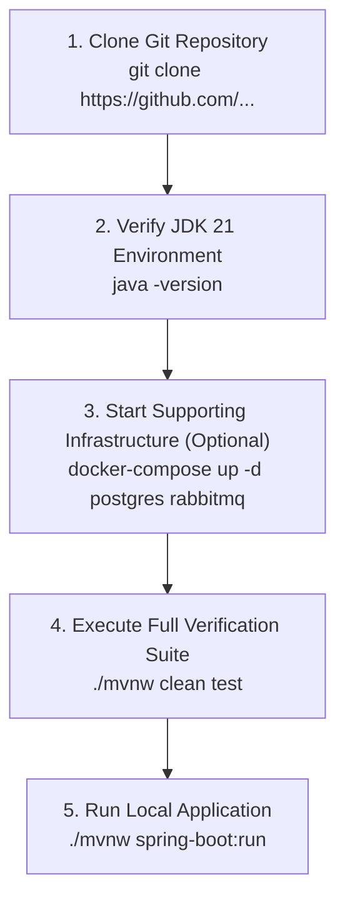
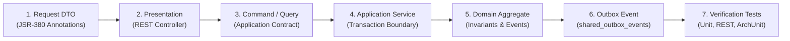

# 33. ENTERPRISE DEVELOPER ONBOARDING & EXTENSION GUIDE
**System:** Enterprise Procure-to-Pay (P2P) Supply Chain Modular Monolith  
**Namespace:** `ro.uaic.feaa.sdbis.supplychain`

---

## 1. DEVELOPER PREREQUISITES & ENVIRONMENT SETUP

To build, test, and run the Supply Chain P2P platform locally, the workstation must have:
- **Java Development Kit (JDK):** Java 21 LTS (e.g., Eclipse Temurin 21 or Microsoft OpenJDK 21).
- **Build Tool:** Apache Maven 3.9+ (or use the bundled `./mvnw` wrapper).
- **Container Engine:** Docker Engine 24+ & Docker Compose v2.
- **Git:** Git 2.40+.
- **IDE:** IntelliJ IDEA (recommended) or VS Code with Java Extension Pack.



---

## 2. COMPILATION, TESTING & RUNNING COMMANDS

### Verify Test Suite (96 Tests)
```bash
# On Linux / macOS:
./mvnw clean test

# On Windows PowerShell:
$env:JAVA_HOME = "C:\Users\<user>\.jdks\ms-21.0.9"
.\mvnw.cmd clean test
```

### Run Application with In-Memory H2 (Zero External Dependencies)
```bash
./mvnw spring-boot:run
```
- App listens on: `http://localhost:8080`
- Swagger UI: `http://localhost:8080/swagger-ui.html`
- OpenAPI JSON: `http://localhost:8080/api-docs`
- Actuator Health: `http://localhost:8080/actuator/health`

### Run Application with Docker Compose Infrastructure (PostgreSQL + RabbitMQ)
```bash
docker-compose up -d postgres rabbitmq
./mvnw spring-boot:run -Dspring-boot.run.profiles=postgres-docker
```

---

## 3. STEP-BY-STEP RECIPES FOR SYSTEM EXTENSION

### Recipe 1: Adding a New Use Case

When implementing a new business feature, follow the Clean Architecture concentric layers from the outside in:



1. **Create Request DTO:** Place in `presentation/dto/` or controller file. Annotate all fields with JSR-380 constraints (`@NotNull`, `@NotBlank`, `@Positive`).
2. **Expose REST Endpoint:** In the module's controller, annotate with `@PostMapping` or `@PutMapping`, specifying `consumes` and `produces` headers. Validate with `@Valid`.
3. **Define Command:** Place immutable record in `application/command/`.
4. **Implement Application Service Method:** Decorate with `@Transactional`. Load Aggregate Root from repository, invoke business method, persist changes.
5. **Enforce Aggregate Invariant:** Place validation and state transitions inside the Aggregate Root (`@AggregateRoot`). Raise domain event if other modules or subscribers need notification.
6. **Write Automated Tests:**
   - Unit test in `src/test/java/.../unit/` testing invariant logic in isolation.
   - REST test using `MockMvc` testing HTTP status codes and validation errors.
   - Run ArchUnit tests to ensure no boundary leaks were introduced.

---

### Recipe 2: Authoring a New Database Migration

1. Navigate to `src/main/resources/db/migration/`.
2. Identify the highest current script version (e.g., `V6`).
3. Create the new script using Flyway standard naming convention:
   `V<N>__<descriptive_snake_case_title>.sql` (e.g., `V7__add_supplier_discount_tiers.sql`).
4. Write idempotent, deterministic DDL with explicit `NOT NULL`, `CHECK`, and foreign key constraints.
5. Prefix tables with the module name (`comenzi_*`, `calitate_*`, `facturi_*`).
6. Run `./mvnw clean test` to verify migration execution against in-memory H2 and Hibernate schema validation.

---

### Recipe 3: Publishing & Handling Cross-Module Domain Events

1. **Define Event:** Create an immutable record implementing `DomainEvent`:
   ```java
   public record PretFurnizorActualizatEvent(
       UUID eventId,
       Instant occurredOn,
       UUID furnizorId,
       BigDecimal pretNou
   ) implements DomainEvent {}
   ```
2. **Publish from Application Service:**
   ```java
   eventPublisher.publishEvent(new PretFurnizorActualizatEvent(UUID.randomUUID(), Instant.now(), furnizorId, pretNou));
   ```
3. **Consume in Target Module:**
   Use Spring Modulith's transactional listener:
   ```java
   @ApplicationModuleListener
   public void onPretFurnizorActualizat(PretFurnizorActualizatEvent event) {
       // Handle cross-module reaction asynchronously within the monolith
   }
   ```
4. **Outbox & AMQP:** The `OutboxDispatcherService` will automatically serialize the event and dispatch it across RabbitMQ topic exchange to external systems.

---

## 4. CODE STYLE & SEMANTIC ANNOTATION GUIDELINES

Every new Java class must be annotated with its corresponding DDD semantic stereotype from `ro.uaic.feaa.sdbis.supplychain.shared.annotation.*`:
- `@AggregateRoot`: For primary domain entities managing consistency boundaries.
- `@DomainEntity`: For internal child entities owned by an aggregate root.
- `@ValueObject`: For immutable concepts without independent lifecycle identity.
- `@DomainRepository`: For domain-level repository interfaces.
- `@DomainService`: For stateless pure business calculations spanning multiple aggregates.
- `@ApplicationService`: For transaction orchestration and application use cases.
- `@QueryService`: For CQRS read operations.

