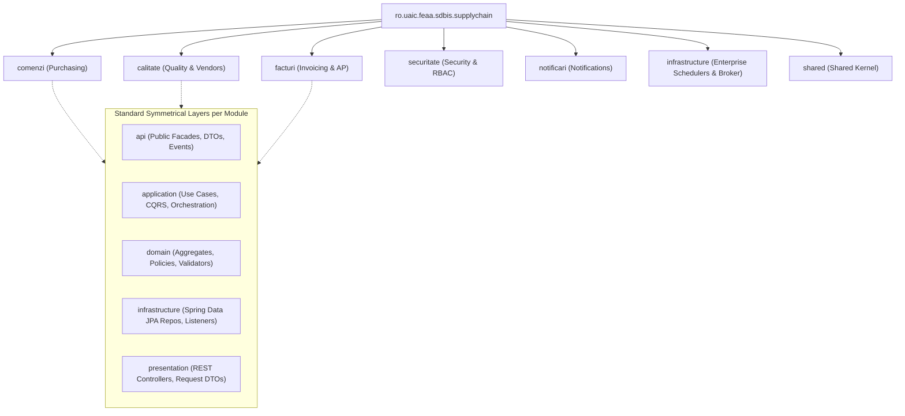

# 34. ENTERPRISE PACKAGE & NAMESPACE REFERENCE
**System:** Enterprise Procure-to-Pay (P2P) Supply Chain Modular Monolith  
**Namespace:** `ro.uaic.feaa.sdbis.supplychain`

---

## 1. STRUCTURAL PACKAGE HIERARCHY

The codebase adheres strictly to Clean Architecture and Spring Modulith conventions, organizing classes into symmetrical subpackages within each bounded context:

---

## 2. EXHAUSTIVE PACKAGE CATALOG & RESPONSIBILITIES

### 2.1 Purchasing & Purchase Orders (`comenzi`)

| Full Package Name | Architectural Layer | Visibility | Responsibility & Contents |
|---|---|:---:|---|
| `ro.uaic.feaa.sdbis.supplychain.comenzi` | Root Module | Package | Module declaration and Spring Modulith `@ApplicationModule`. |
| `...comenzi.api` | Module API | **Public** | Public facade interface `IComenziModuleApi` for cross-module queries. |
| `...comenzi.api.command` | Module API | **Public** | Public commands for invoking order workflows from external contexts. |
| `...comenzi.api.dto` | Module API | **Public** | Summary data transfer records (`ComandaSummaryDTO`, `LinieComandaSummaryDTO`). |
| `...comenzi.api.event` | Module API | **Public** | Integration events published when orders are created, approved, or cancelled. |
| `...comenzi.application` | Application | Internal | Primary application service `ComandaApplicationService`. |
| `...comenzi.application.command` | Application | Internal | Internal command records and command handlers. |
| `...comenzi.application.dto` | Application | Internal | Use-case specific internal DTO projections. |
| `...comenzi.application.query` | Application | Internal | CQRS query service `ComandaQueryService` reading read-only projections. |
| `...comenzi.domain` | Domain | Internal | Aggregate Roots (`ComandaAprovizionare`), child entities (`LinieComanda`), repository interfaces (`IComandaRepository`). |
| `...comenzi.domain.computation` | Domain | Internal | Domain computation services (`CalculTotalComandaService`, `EstimareLeadTimeService`). |
| `...comenzi.domain.event` | Domain | Internal | Internal domain events capturing local state mutations. |
| `...comenzi.domain.factory` | Domain | Internal | Domain aggregate factories for complex instantiation. |
| `...comenzi.domain.policy` | Domain | Internal | Business policies (`PoliticaAprobareComanda`, `PoliticaAnulareComanda`). |
| `...comenzi.domain.validation` | Domain | Internal | Pure domain validators (`ValidareComandaService`). |
| `...comenzi.infrastructure.configuration`| Infrastructure | Internal | Spring `@Configuration` specific to Comenzi beans and adapters. |
| `...comenzi.infrastructure.listener` | Infrastructure | Internal | Modulith event listeners reacting to external events. |
| `...comenzi.infrastructure.persistence`| Infrastructure | Internal | Spring Data JPA repositories, entity mappers, and repository adapters. |
| `...comenzi.presentation` | Presentation | **Public** | REST Controllers (`ComandaCtrl`) and request/response DTOs. |

---

### 2.2 Quality Assurance & Vendor Evaluation (`calitate`)

| Full Package Name | Architectural Layer | Visibility | Responsibility & Contents |
|---|---|:---:|---|
| `ro.uaic.feaa.sdbis.supplychain.calitate` | Root Module | Package | Module declaration and Spring Modulith `@ApplicationModule`. |
| `...calitate.api` | Module API | **Public** | Public facade interface `ICalitateModuleApi` for vendor status queries. |
| `...calitate.api.dto` | Module API | **Public** | `FurnizorSummaryDTO`, `ScorecardSummaryDTO`. |
| `...calitate.api.event` | Module API | **Public** | `InspectieFinalizataEvent`, `FurnizorPenalizatEvent`. |
| `...calitate.application` | Application | Internal | `CalitateApplicationService`. |
| `...calitate.application.command` | Application | Internal | Command handlers (`InregistreazaVerdictCommand`). |
| `...calitate.application.dto` | Application | Internal | Application query records. |
| `...calitate.application.query` | Application | Internal | `CalitateQueryService`. |
| `...calitate.domain` | Domain | Internal | `Furnizor`, `InspectieCalitate`, `RaportNeconformitate (NCR)`, `ScorecardLunar`. |
| `...calitate.domain.computation` | Domain | Internal | `CalculScorecardService` (40% OTIF, 40% Quality, 20% Price). |
| `...calitate.domain.event` | Domain | Internal | Internal inspection and supplier events. |
| `...calitate.domain.factory` | Domain | Internal | `InspectieFactory`. |
| `...calitate.domain.policy` | Domain | Internal | `PoliticaCalificareFurnizor`, `PoliticaPenalizareFurnizor`. |
| `...calitate.domain.validation` | Domain | Internal | `ValidareAqlService` (ISO 2859-1 lot sampling). |
| `...calitate.infrastructure.configuration`| Infrastructure | Internal | Module bean definitions. |
| `...calitate.infrastructure.persistence` | Infrastructure | Internal | `FurnizorRepositoryJPA`, `InspectieRepositoryJPA`. |
| `...calitate.presentation` | Presentation | **Public** | REST Controller `CalitateCtrl`. |

---

### 2.3 Invoicing, 3-Way Match & Bank Payments (`facturi`)

| Full Package Name | Architectural Layer | Visibility | Responsibility & Contents |
|---|---|:---:|---|
| `ro.uaic.feaa.sdbis.supplychain.facturi` | Root Module | Package | Module declaration and Spring Modulith `@ApplicationModule`. |
| `...facturi.api` | Module API | **Public** | Public facade interface `IFacturiModuleApi`. |
| `...facturi.api.dto` | Module API | **Public** | `FacturaSummaryDTO`, `NotaReceptieSummaryDTO`. |
| `...facturi.api.event` | Module API | **Public** | `FacturaVerificataEvent`, `PlataEfectuataEvent`. |
| `...facturi.application` | Application | Internal | `FacturaApplicationService`. |
| `...facturi.application.command` | Application | Internal | `InregistreazaFacturaCommand`, `CreeazaOrdinPlataCommand`. |
| `...facturi.application.dto` | Application | Internal | Reconciliation projection DTOs. |
| `...facturi.application.query` | Application | Internal | `FacturaQueryService`. |
| `...facturi.domain` | Domain | Internal | `Factura`, `NotaReceptie (NIR)`, `OrdinPlata`, `LinieFactura`. |
| `...facturi.domain.computation` | Domain | Internal | `CalculTvaService`, `CalculTotalFacturaService`. |
| `...facturi.domain.event` | Domain | Internal | `OrdinPlataCreatEvent`, `OrdinPlataAprobatEvent`. |
| `...facturi.domain.factory` | Domain | Internal | `FacturaFactory`, `NotaReceptieFactory`. |
| `...facturi.domain.policy` | Domain | Internal | `PoliticaReconciliere3Way`, `PoliticaPlataFactura`. |
| `...facturi.domain.validation` | Domain | Internal | `ValidareFacturaService`. |
| `...facturi.infrastructure` | Infrastructure | Internal | `StripeBancaPlataAdapter`, `StripeProperties`. |
| `...facturi.infrastructure.persistence` | Infrastructure | Internal | `FacturaRepositoryJPA`, `OrdinPlataRepositoryJPA`. |
| `...facturi.presentation` | Presentation | **Public** | REST Controller `FacturaCtrl` (JSON/XML & Stripe Webhook). |

---

### 2.4 Supporting & Infrastructure Modules

| Full Package Name | Responsibility & Key Components |
|---|---|
| `ro.uaic.feaa.sdbis.supplychain.securitate` | Spring Security configuration, `RbacSecurityFilter` Zero-Trust filter, and `JurnalAuditService`. |
| `ro.uaic.feaa.sdbis.supplychain.notificari` | Notification services and email dispatchers for supplier alerts. |
| `ro.uaic.feaa.sdbis.supplychain.infrastructure.messaging` | `OutboxDispatcherService` poller, AMQP topic publishing. |
| `ro.uaic.feaa.sdbis.supplychain.infrastructure.scheduler` | Enterprise schedulers (`MonthlyScorecardScheduler`, `SupplierCatalogSyncScheduler`). |
| `ro.uaic.feaa.sdbis.supplychain.shared.annotation` | Semantic DDD stereotype annotations (`@AggregateRoot`, `@ValueObject`, etc.). |
| `ro.uaic.feaa.sdbis.supplychain.shared.messaging` | `RabbitMqConfig`, topic exchange definitions, `AmqpEventPublisher`. |
| `ro.uaic.feaa.sdbis.supplychain.shared.persistence` | `AbstractRepositoryJPA`, `JPAConfig`, `OutboxRepoJPA`, `InboxRepoJPA`. |
| `ro.uaic.feaa.sdbis.supplychain.shared.persistence.converters` | JPA 2.1 attribute converters (`MonedaConverter`, `IbanConverter`, `CifConverter`). |

