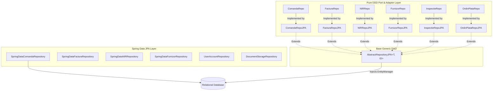
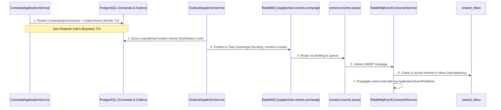
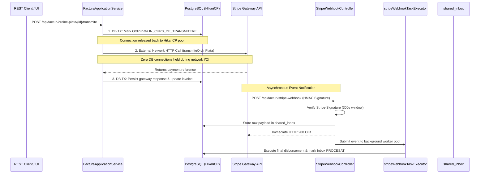

# ARCHITECTURAL BLUEPRINT & COMPONENT CATALOG – SPRINT 3
## Enterprise Persistence Model, Dual JPA Repositories, Database Lifecycle Governance & Distributed Integration
### Standard: Jakarta Persistence (JPA 3.1), Hibernate 6.5+, Flyway V1..V15, RabbitMQ AMQP & Stripe Fintech

---

### BLUEPRINT METADATA
* **Academic Reference**: **Theme_2: Course_5 – Data Access Components Implementation (Sprint 3.MSD)**
* **Core Pillars**:
  1. **Persistence Model Implementation** (JPA `@Entity`, `@Table`, `@Version`, Value Objects `@Convert`, `@Enumerated`, `@ElementCollection`, `@CollectionTable`, and Aggregate `@OneToMany` cascades).
  2. **Architectural Decisions on Inheritance & Fetching** (Omission of `@Inheritance` in favor of DDD Composition/Strategy, universal `FetchType.LAZY` to prevent heap exhaustion and Cartesian products, Two-Step Fetching eliminating N+1 queries).
  3. **Repository Services Implementation** (Dual Strategy: Spring Data `JpaRepository` with custom `@Query` + Bonus Complete JPA DAOs via `EntityManager` injection inheriting from `AbstractRepositoryJPA`).
  4. **Business Rules & Lifecycle Audit** (Service/Factory integration, `@EntityListeners` with `@PrePersist`, `@PreUpdate`, `@PreRemove`, `META-INF/orm.xml`).
  5. **Database Schema Governance** (Deterministic Flyway Migrations `V1`..`V15`, PostgreSQL 16 Alpine / H2 In-Memory portability).
  6. **Distributed Messaging & Fintech Reliability** (Transactional Outbox/Inbox AMQP RabbitMQ, HikariCP connection-safe Stripe payment integration).
* **Root Package**: `ro.uaic.feaa.sdbis.supplychain`
* **Test Verification**: **198 Automated Tests Running & Passing (100% BUILD SUCCESS)**
* **Language**: Technical English (Authoritative Enterprise Architecture & Forensic Standard)

---

# 1. PHYSICAL NAVIGATION TREE (SPRINT 3 CODEBASE)

The following tree maps **every physical Java source file, configuration descriptor, SQL migration script, and JUnit test** participating in the Sprint 3 data access, persistence, and messaging infrastructure:

```text
c:\Users\bmugu\Desktop\app
├── src
│   ├── main
│   │   ├── java/ro/uaic/feaa/sdbis/supplychain
│   │   │   ├── shared/
│   │   │   │   ├── AbstractRepositoryJPA.java                          # Generic base JPA CRUD DAO with EntityManager
│   │   │   │   ├── IJurnalAudit.java & JurnalAuditRepoJPA.java         # Audit log port & JPA adapter
│   │   │   │   ├── AuditLogEntry.java                                  # Active audit log JPA entity
│   │   │   │   ├── AuditLogArchiveEntry.java                           # Cold-storage archived audit log JPA entity
│   │   │   │   ├── OutboxRepo.java & OutboxRepoJPA.java                # Transactional Outbox port & JPA adapter
│   │   │   │   ├── OutboxEventEntity.java                              # Transactional Outbox event entity
│   │   │   │   ├── InboxRepo.java & InboxRepoJPA.java                  # Idempotent Inbox port & JPA adapter
│   │   │   │   ├── InboxEventEntity.java                               # Idempotent Inbox message entity
│   │   │   │   ├── DistributedLockService.java                         # Distributed lock port
│   │   │   │   ├── DistributedLockEntity.java                          # Distributed lock lease JPA entity
│   │   │   │   ├── DistributedLockJpaService.java                      # Database-backed distributed lock manager
│   │   │   │   ├── IDeadLetterParkingLotRepo.java                      # Dead-Letter parking lot port
│   │   │   │   ├── DeadLetterMessageEntity.java                        # AMQP poison-pill message JPA entity
│   │   │   │   ├── DeadLetterParkingLotRepoJPA.java                    # DLQ parking lot JPA repository adapter
│   │   │   │   ├── DocumentAtasatEntity.java                           # Attached binary document JPA entity
│   │   │   │   ├── DocumentStorageRepository.java                      # Spring Data JPA repository for documents
│   │   │   │   ├── DocumentStorageService.java                         # Document metadata & storage service
│   │   │   │   ├── TimeProvider.java & DateTimeConfig.java             # Clock abstraction for deterministic testing
│   │   │   │   ├── messaging/
│   │   │   │   │   ├── RabbitMqConfig.java                             # AMQP broker topology, exchanges & queues
│   │   │   │   │   ├── AmqpEventPublisher.java                         # AMQP event publication adapter
│   │   │   │   │   └── AmqpMessageReceivedEvent.java                   # Inbound AMQP event message wrapper
│   │   │   │   └── persistence/converters/                             # Universal JPA Attribute Converters
│   │   │   │       ├── CodMaterialConverter.java                       # CodMaterial VO <-> VARCHAR(50)
│   │   │   │       ├── CurrencyConverter.java                          # Currency VO <-> VARCHAR(3)
│   │   │   │       ├── IdComandaConverter.java                         # IdComanda VO <-> UUID
│   │   │   │       ├── IdFurnizorConverter.java                        # IdFurnizor VO <-> UUID
│   │   │   │       └── IdLotConverter.java                             # IdLot VO <-> UUID
│   │   │   ├── comenzi/
│   │   │   │   ├── domain/                                             # Comenzi Domain Entities & Repositories
│   │   │   │   │   ├── ComandaAprovizionare.java                       # Aggregate Root (@Entity, @Table, @Version)
│   │   │   │   │   ├── LinieComanda.java                               # Child Value Object (@Embeddable)
│   │   │   │   │   ├── Lot.java                                        # Child Entity (@Entity, @Table)
│   │   │   │   │   ├── Expediere.java                                  # Child Entity (@Entity, 1NF normalized lots)
│   │   │   │   │   ├── ComandaRepo.java                                # Pure DDD IRepository domain port
│   │   │   │   │   ├── Cantitate.java & PretUnitar.java                # Embedded numeric Value Objects
│   │   │   │   │   └── StareComanda.java & StareLot.java               # Enum Value Objects (@Enumerated)
│   │   │   │   ├── application/
│   │   │   │   │   ├── ComandaApplicationService.java                  # JPA-backed application orchestrator
│   │   │   │   │   └── ComandaCommandFactory.java                      # JPA repository-aware factory
│   │   │   │   └── infrastructure/
│   │   │   │       ├── ComandaRepoJPA.java                             # Complete JPA Repository (EntityManager DAO)
│   │   │   │       └── persistence/
│   │   │   │           └── SpringDataComandaRepository.java            # Spring Data JpaRepository with @Query
│   │   │   ├── calitate/
│   │   │   │   ├── domain/                                             # Calitate Domain Entities & Repositories
│   │   │   │   │   ├── Furnizor.java                                   # Aggregate Root (@Entity, @Table, @Version)
│   │   │   │   │   ├── ScorecardLunar.java                             # Child Entity (@Entity, @Table, @Version)
│   │   │   │   │   ├── InspectieCalitate.java                          # Aggregate Root (@Entity, @Table, @Version)
│   │   │   │   │   ├── InspectorCalitate.java                          # Aggregate Root (@Entity, @Table)
│   │   │   │   │   ├── RaportNeconformitate.java                       # Aggregate Root (@Entity, @Table)
│   │   │   │   │   ├── PretNegociat.java, Adresa.java, Email.java      # Embedded & Collection Value Objects
│   │   │   │   │   ├── FurnizorRepo.java, InspectieRepo.java           # Pure DDD IRepository domain ports
│   │   │   │   │   ├── InspectorRepo.java, NCRRepo.java                # Pure DDD IRepository domain ports
│   │   │   │   │   └── StareFurnizor.java, StareInspectie.java         # Enum Value Objects (@Enumerated)
│   │   │   │   ├── application/
│   │   │   │   │   ├── CalitateApplicationService.java                 # JPA-backed application orchestrator
│   │   │   │   │   ├── FurnizorFactory.java                            # JPA repository-aware vendor factory
│   │   │   │   │   └── InspectieCalitateFactory.java                   # JPA repository-aware inspection factory
│   │   │   │   └── infrastructure/
│   │   │   │       ├── FurnizorRepoJPA.java, InspectieRepoJPA.java     # Complete JPA Repositories (EntityManager)
│   │   │   │       ├── InspectorRepoJPA.java, NCRRepoJPA.java          # Complete JPA Repositories (EntityManager)
│   │   │   │       └── persistence/
│   │   │   │           └── SpringDataFurnizorRepository.java           # Spring Data JpaRepository with @Query
│   │   │   ├── facturi/
│   │   │   │   ├── domain/                                             # Facturi Domain Entities & Repositories
│   │   │   │   │   ├── FacturaFurnizor.java                            # Aggregate Root (@Entity, UniqueConstraint)
│   │   │   │   │   ├── LinieFactura.java                               # Child Value Object (@Embeddable)
│   │   │   │   │   ├── NIR.java                                        # Aggregate Root (@Entity, Unique event key)
│   │   │   │   │   ├── LinieNIR.java                                   # Child Value Object (@Embeddable)
│   │   │   │   │   ├── OrdinPlata.java                                 # Aggregate Root (@Entity, Four-Eyes state)
│   │   │   │   │   ├── FacturaRepo.java, NIRRepo.java                  # Pure DDD IRepository domain ports
│   │   │   │   │   ├── OrdinPlataRepo.java, IBancaPlataProvider.java   # Pure DDD IRepository & payment gateway ports
│   │   │   │   │   ├── Suma.java                                       # Embedded monetary Value Object
│   │   │   │   │   └── StareFactura.java, StareNIR.java, StareOrdinPlata.java # Enum Value Objects
│   │   │   │   ├── application/
│   │   │   │   │   └── FacturaApplicationService.java                  # Connection-safe payment & invoice service
│   │   │   │   └── infrastructure/
│   │   │   │       ├── FacturaRepoJPA.java, NIRRepoJPA.java            # Complete JPA Repositories (EntityManager)
│   │   │   │       ├── OrdinPlataRepoJPA.java                          # Complete JPA Repository (EntityManager)
│   │   │   │       ├── FurnizorBlocatFactura.java                      # Vendor block entity for payment holds
│   │   │   │       ├── FurnizoriBlocatiRepoJPA.java                    # Vendor block JPA repository adapter
│   │   │   │       ├── StripeBancaPlataAdapter.java                    # Outbound Stripe PaymentIntent adapter
│   │   │   │       ├── StripeProperties.java                           # Configuration properties for Stripe API
│   │   │   │       ├── payment/
│   │   │   │       │   ├── StripeWebhookController.java                # Inbound Stripe webhook HTTP endpoint
│   │   │   │       │   └── StripeWebhookProcessingService.java         # Async decoupled webhook worker pool
│   │   │   │       └── persistence/
│   │   │   │           ├── SpringDataFacturaRepository.java            # Spring Data JpaRepository with @Query
│   │   │   │           └── SpringDataNIRRepository.java                # Spring Data JpaRepository with @Query
│   │   │   ├── infrastructure/
│   │   │   │   ├── configuration/
│   │   │   │   │   └── AggregateAuditAndComputationListener.java       # Global JPA @EntityListener (@PrePersist, etc.)
│   │   │   │   └── messaging/
│   │   │   │       ├── OutboxDispatcherService.java                    # Polling publisher for Outbox -> AMQP
│   │   │   │       ├── RabbitMqEventConsumerService.java               # AMQP message consumers with Inbox check
│   │   │   │       └── AmqpMessageDispatchListener.java                # Modulith event dispatcher for AMQP
│   │   │   └── securitate/
│   │   │       ├── UserAccountEntity.java                              # RBAC User JPA entity (@Entity, @Table)
│   │   │       └── UserAccountRepository.java                          # Spring Data JpaRepository for security
│   │   └── resources/
│   │       ├── META-INF/
│   │       │   └── orm.xml                                             # Global JPA mapping & listener descriptor
│   │       └── db/migration/                                           # Flyway Versioned Migrations (V1..V15)
│   │           ├── V1__initial_schema.sql
│   │           ├── V2__add_outbox_events.sql
│   │           ├── V3__add_inbox_events.sql
│   │           ├── V4__add_reconcilieri.sql
│   │           ├── V5__add_stripe_columns.sql
│   │           ├── V6__add_security_tables.sql
│   │           ├── V7__production_readiness_and_seed_data.sql
│   │           ├── V8__enterprise_readiness.sql
│   │           ├── V9__persistence_optimizations_and_audit.sql
│   │           ├── V10__remediation_normalization_and_parity.sql
│   │           ├── V11__comanda_approval_and_closure.sql
│   │           ├── V12__unique_factura_furnizor_and_distributed_locks.sql
│   │           ├── V13__audit_log_archiving_and_partitioning.sql
│   │           ├── V14__amqp_dlq_parking_lot.sql
│   │           └── V15__scorecard_optimistic_locking.sql
│   └── test
│       └── java/ro/uaic/feaa/sdbis/supplychain/
│           ├── integration/                                            # Dedicated Persistence & Messaging Suite
│           │   ├── FlywayMigrationIntegrationTest.java                 # Verifies clean execution of V1..V15
│           │   ├── PersistenceRemediationIntegrationTest.java          # Verifies Spring Data & Complete JPA DAOs
│           │   ├── OrdinPlataPersistenceIntegrationTest.java           # Verifies L1 cache clear & DB synchronization
│           │   ├── NPlusOneOptimizationIntegrationTest.java            # Verifies two-step fetch eliminating N+1
│           │   ├── TenRemediationsVerificationTest.java                # Verifies optimistic locking & non-failing locks
│           │   ├── MultiNirReconciliereTest.java                       # Verifies multi-NIR 3-Way matching persistence
│           │   ├── PaginationAndFilteringIntegrationTest.java          # Verifies paginated and filtered queries
│           │   ├── AuditLogArchivingTest.java                          # Verifies cold storage archival of audit logs
│           │   ├── AmqpHardeningIntegrationTest.java                   # Verifies RabbitMQ DLQ, retries & Inbox idempotență
│           │   ├── OutboxAndMessagingIntegrationTest.java              # Verifies Outbox polling & event propagation
│           │   └── PaymentWorkflowIntegrationTest.java                 # Verifies end-to-end payment persistence
│           ├── rest/
│           │   ├── DocumentStorageIntegrationTest.java                 # Verifies document attachment persistence
│           │   ├── StripeWebhookIntegrationTest.java                   # Verifies webhook signature validation
│           │   └── StripeWebhookAsyncDecouplingTest.java               # Verifies async decoupling of Stripe worker pool
│           └── shared/
│               ├── DistributedLockIntegrationTest.java                 # Verifies database distributed locking leases
│               ├── TimeProviderTest.java                               # Verifies time abstraction for audit
│               └── messaging/
│                   └── AmqpEventPublisherTest.java                     # Unit verification of AMQP publisher contracts
```

---

# 2. COURSE SYLLABUS ALIGNMENT (SPRINT 3.MSD DELIVERABLES MATRIX)

The table below proves complete, 1:1 coverage of every theoretical and practical requirement formulated in **Sprint 3.MSD (Theme_2: Course_5)**:

| Syllabus Requirement (Sprint 3.MSD) | Architectural Concept | Concrete Project Implementation | Source Code Hyperlink |
| :--- | :--- | :--- | :--- |
| **JPA Entities (`@Entity`, `@Table`, `@Version`)** | Root & Child Relational Entities | Relational mapping of domain aggregates with optimistic concurrency locking | [`ComandaAprovizionare.java`](../../src/main/java/ro/uaic/feaa/sdbis/supplychain/comenzi/domain/ComandaAprovizionare.java)<br>[`ScorecardLunar.java`](../../src/main/java/ro/uaic/feaa/sdbis/supplychain/calitate/domain/ScorecardLunar.java)<br>[`FacturaFurnizor.java`](../../src/main/java/ro/uaic/feaa/sdbis/supplychain/facturi/domain/FacturaFurnizor.java) |
| **Value Objects (`@Enumerated`, `@Convert`)** | Strongly Typed Domain Primitives | String-based enums and custom JPA 3.1 `AttributeConverter` implementations | [`CodMaterialConverter.java`](../../src/main/java/ro/uaic/feaa/sdbis/supplychain/shared/persistence/converters/CodMaterialConverter.java)<br>[`IdComandaConverter.java`](../../src/main/java/ro/uaic/feaa/sdbis/supplychain/shared/persistence/converters/IdComandaConverter.java)<br>[`StareComanda.java`](../../src/main/java/ro/uaic/feaa/sdbis/supplychain/comenzi/domain/StareComanda.java) |
| **JPA Aggregates (`@OneToMany`, `CascadeType.ALL`, `orphanRemoval`)** | Aggregate Boundary Lifecycle | Parent-child lifecycle binding where deleting/updating root cascades to components | [`ComandaAprovizionare.java`](../../src/main/java/ro/uaic/feaa/sdbis/supplychain/comenzi/domain/ComandaAprovizionare.java)<br>[`Furnizor.java`](../../src/main/java/ro/uaic/feaa/sdbis/supplychain/calitate/domain/Furnizor.java)<br>[`Expediere.java`](../../src/main/java/ro/uaic/feaa/sdbis/supplychain/comenzi/domain/Expediere.java) |
| **Component Relationships (`@ElementCollection`, `@CollectionTable`)** | Value Collection Persistence | Storing child value objects without identity in separate normalized relational tables | [`Expediere.java`](../../src/main/java/ro/uaic/feaa/sdbis/supplychain/comenzi/domain/Expediere.java)<br>[`ComandaAprovizionare.java`](../../src/main/java/ro/uaic/feaa/sdbis/supplychain/comenzi/domain/ComandaAprovizionare.java)<br>[`Furnizor.java`](../../src/main/java/ro/uaic/feaa/sdbis/supplychain/calitate/domain/Furnizor.java) |
| **Spring Repositories (`JpaRepository<T, ID>`)** | Declarative Data Access | Interfaces extending `JpaRepository` with derived `findBy*` queries and `@Query` | [`SpringDataComandaRepository.java`](../../src/main/java/ro/uaic/feaa/sdbis/supplychain/comenzi/infrastructure/persistence/SpringDataComandaRepository.java)<br>[`SpringDataFacturaRepository.java`](../../src/main/java/ro/uaic/feaa/sdbis/supplychain/facturi/infrastructure/persistence/SpringDataFacturaRepository.java)<br>[`SpringDataFurnizorRepository.java`](../../src/main/java/ro/uaic/feaa/sdbis/supplychain/calitate/infrastructure/persistence/SpringDataFurnizorRepository.java) |
| **(Bonus) Complete JPA Repositories** | Pure DDD Ports & `EntityManager` Adapters | Pure interface contracts (`IRepository`) implemented via injected `EntityManager` DAOs | [`ComandaRepo.java`](../../src/main/java/ro/uaic/feaa/sdbis/supplychain/comenzi/domain/ComandaRepo.java) $\rightarrow$ [`ComandaRepoJPA.java`](../../src/main/java/ro/uaic/feaa/sdbis/supplychain/comenzi/infrastructure/ComandaRepoJPA.java)<br>[`AbstractRepositoryJPA.java`](../../src/main/java/ro/uaic/feaa/sdbis/supplychain/shared/AbstractRepositoryJPA.java) |
| **Business Services & Factories Refactoring** | JPA Repository Injection | Updating Application Services and Factories to consume JPA repositories | [`ComandaApplicationService.java`](../../src/main/java/ro/uaic/feaa/sdbis/supplychain/comenzi/application/ComandaApplicationService.java)<br>[`FacturaApplicationService.java`](../../src/main/java/ro/uaic/feaa/sdbis/supplychain/facturi/application/FacturaApplicationService.java)<br>[`FurnizorFactory.java`](../../src/main/java/ro/uaic/feaa/sdbis/supplychain/calitate/domain/factory/FurnizorFactory.java) |
| **Computation & Audit Rules via `@EntityListeners`** | Lifecycle Interception | Global entity interception for automated timestamping, audit logs, and mutation counts | [`AggregateAuditAndComputationListener.java`](../../src/main/java/ro/uaic/feaa/sdbis/supplychain/infrastructure/configuration/AggregateAuditAndComputationListener.java)<br>[`orm.xml`](../../src/main/resources/META-INF/orm.xml) |
| **JUnit Integration & Repository Test Suite** | Automated Regression | Comprehensive test suite verifying Flyway migrations, queries, caching, and locks | [`FlywayMigrationIntegrationTest.java`](../../src/test/java/ro/uaic/feaa/sdbis/supplychain/integration/FlywayMigrationIntegrationTest.java)<br>[`PersistenceRemediationIntegrationTest.java`](../../src/test/java/ro/uaic/feaa/sdbis/supplychain/integration/PersistenceRemediationIntegrationTest.java) |

---

# 3. DOMAIN MODELING & ARCHITECTURAL DECISIONS (THE "WHY" SECTION)

### 3.1. Why `@Inheritance` is NOT Used in Our Domain Aggregates

A frequent question in enterprise ORM design is whether to use JPA entity inheritance (`@Inheritance(strategy = InheritanceType.SINGLE_TABLE | JOINED | TABLE_PER_CLASS)`). In this solution, **relational entity inheritance is deliberately omitted** across all Bounded Contexts.

#### The Architectural Rationale:
1. **The Core DDD Principle: "Favor Composition Over Inheritance"**:
   - In Domain-Driven Design, business concepts change independently. Forcing domain aggregates into an inheritance hierarchy (e.g., having `ComandaAprovizionare` and `ComandaServicii` inherit from an abstract `ComandaEntity`) tightly couples their lifecycle and schema, violating the **Single Responsibility Principle**.
   - Instead of relational inheritance, our model achieves polymorphic variance through:
     * **Strategy Pattern** for algorithmic variance (e.g., [`IMetodaEstimareLeadTime`](../../src/main/java/ro/uaic/feaa/sdbis/supplychain/comenzi/domain/IMetodaEstimareLeadTime.java) implemented by [`MedieMobilaStrategy`](../../src/main/java/ro/uaic/feaa/sdbis/supplychain/comenzi/domain/MedieMobilaStrategy.java), [`NetezireExponentialaStrategy`](../../src/main/java/ro/uaic/feaa/sdbis/supplychain/comenzi/domain/NetezireExponentialaStrategy.java), and [`Percentila90Strategy`](../../src/main/java/ro/uaic/feaa/sdbis/supplychain/comenzi/domain/Percentila90Strategy.java)).
     * **Embedded Value Objects** for behavioral and structured components (e.g., `Suma`, `Cantitate`, `Adresa`, `Perioada`).
2. **Elimination of Relational Impedance & Performance Penalties**:
   - **`InheritanceType.SINGLE_TABLE`**: Forces multiple subclasses into one massive table with a discriminator column. This leads to **column nullability proliferation** (columns specific to subclass B must be nullable, disabling database-level `NOT NULL` constraints) and compromises data integrity.
   - **`InheritanceType.JOINED`**: Requires Hibernate to generate complex `LEFT OUTER JOIN` queries across 3 to 5 physical tables for every read operation, creating massive query overhead and disabling index optimization on high-volume tables like `comenzi_aprovizionare`.
3. **Decoupled Bounded Contexts via Strong Identifiers**:
   - Bounded Contexts do not share database entities. A `Furnizor` in the Quality context and an `IdFurnizor` reference in the Orders context are kept completely distinct. Relational inheritance would create cross-module schema leaks, violating the modular boundary enforced by **Spring Modulith** and **ArchUnit**.

---

### 3.2. Value Collection Management: `@ElementCollection` and `@CollectionTable` Deep Dive

In JPA, not every relational table maps to an independent `@Entity`. A significant portion of domain models consists of **Value Objects** that belong exclusively to their parent entity and have no separate identity (`@Id`).

#### Purpose of `@ElementCollection`:
* Informs Hibernate that the collection does **not** contain independent entities, but rather embeddable value objects or basic types (e.g., `Set<IdLot>`, `List<LinieComanda>`, `Set<Email>`).
* **Inherent Lifecycle Binding**: When the parent aggregate is created, updated, or removed, Hibernate automatically synchronizes the child collection records. No explicit cascading annotations (`cascade = CascadeType.ALL`) are required because value objects by definition cannot exist without their owner.

#### Purpose of `@CollectionTable`:
* Specifies the **exact physical database table** and foreign key join column used to store the collection elements:
```java
// Expediere.java: Storing associated delivery lots in the 1NF normalized table
@ElementCollection(fetch = FetchType.LAZY)
@CollectionTable(
    name = "comenzi_expedieri_loturi", 
    joinColumns = @JoinColumn(name = "expediere_id", nullable = false)
)
@AttributeOverride(name = "value", column = @Column(name = "lot_id", nullable = false))
private Set<IdLot> loturi = new HashSet<>();
```
* In `ComandaAprovizionare.java`:
```java
@ElementCollection(fetch = FetchType.LAZY)
@CollectionTable(
    name = "comenzi_linii", 
    joinColumns = @JoinColumn(name = "comanda_id", nullable = false)
)
private List<LinieComanda> linii = new ArrayList<>();
```

---

### 3.3. Fetch Strategy & Concurrency: Why `FetchType.LAZY` Everywhere & Eliminating N+1

#### The Problem with `FetchType.EAGER`:
`FetchType.EAGER` is considered an anti-pattern in high-throughput enterprise applications. If a collection is mapped with `FetchType.EAGER`:
1. **Memory & Bandwidth Explosion**: Every time an aggregate root is loaded (e.g., retrieving a list of 100 purchase orders), Hibernate immediately executes additional queries or huge SQL joins to fetch every single order line, batch lot, and dispatch record, loading thousands of unused rows into JVM heap memory.
2. **`MultipleBagFetchException`**: If an entity contains two or more eager collection mappings (`List`), Hibernate refuses to start due to Cartesian product explosion.
3. **Unavoidable N+1 Query Problem**: If EAGER joins are bypassed in JPQL, Hibernate issues 1 initial query followed by N individual queries to fetch the children of each row.

#### Why We Enforce `FetchType.LAZY` Everywhere:
By marking all `@OneToMany` and `@ElementCollection` associations as `FetchType.LAZY`:
* Hibernate creates lightweight bytecode proxies for collections.
* Data is loaded from the database **only if and when** business logic accesses that specific collection within an active transaction session.
* Read operations (such as generating paginated dashboards, summary tables, or status checks) execute in microseconds without touching child tables.

#### How We Solve the N+1 Problem: Two-Step Eager Fetching
When a business operation genuinely requires loading the complete aggregate tree into memory (e.g., calculating order totals or 3-Way matching), we **never** switch the mapping to EAGER. Instead, we execute **Two-Step Eager Fetching** in our custom repositories:

```java
// Sursa: ro.uaic.feaa.sdbis.supplychain.comenzi.infrastructure.ComandaRepoJPA.java
public List<ComandaAprovizionare> findAllWithLiniiAndLoturi(IdFurnizor furnizorId) {
    // Step 1: Eagerly join and load the root orders and their line items in a single query
    List<ComandaAprovizionare> comenzi = em.createQuery(
        "SELECT DISTINCT c FROM ComandaAprovizionare c " +
        "LEFT JOIN FETCH c.linii " +
        "WHERE c.furnizorId = :furnizorId", ComandaAprovizionare.class)
        .setParameter("furnizorId", furnizorId)
        .getResultList();

    if (comenzi.isEmpty()) return comenzi;

    // Step 2: Initialize the lot allocations for the fetched orders within the same session
    em.createQuery(
        "SELECT DISTINCT c FROM ComandaAprovizionare c " +
        "LEFT JOIN FETCH c.loturi " +
        "WHERE c IN :comenzi", ComandaAprovizionare.class)
        .setParameter("comenzi", comenzi)
        .getResultList();

    // Result: Both collections are fully initialized in the Hibernate Level 1 cache in exactly 2 SQL trips!
    return comenzi;
}
```
*Verified in:* 📄 [`NPlusOneOptimizationIntegrationTest.java`](../../src/test/java/ro/uaic/feaa/sdbis/supplychain/integration/NPlusOneOptimizationIntegrationTest.java) — asserts query count is strictly $O(1)$ and never $O(N)$.

---

# 4. COMPREHENSIVE PERSISTENCE MAPPING & RELATIONAL SCHEMAS

The table below details **where and how every domain aggregate, child entity, and value collection is persisted** across the 31 relational database tables:

| Domain Class | Architectural Role | Persistence Mechanism | Database Table Name | Primary Key / Index Strategy |
| :--- | :--- | :--- | :--- | :--- |
| [`ComandaAprovizionare`](../../src/main/java/ro/uaic/feaa/sdbis/supplychain/comenzi/domain/ComandaAprovizionare.java) | Aggregate Root | `@Entity`, `@Table`, `@EmbeddedId`, `@Version` | `comenzi_aprovizionare` | PK: `id` (UUID via `IdComandaConverter`), `@Version: version` |
| [`LinieComanda`](../../src/main/java/ro/uaic/feaa/sdbis/supplychain/comenzi/domain/LinieComanda.java) | Component Value Object | `@ElementCollection`, `@CollectionTable` | `comenzi_linii` | FK: `comanda_id`, Composite Index: `(comanda_id, numar_linie)` |
| [`Lot`](../../src/main/java/ro/uaic/feaa/sdbis/supplychain/comenzi/domain/Lot.java) | Child Entity | `@Entity`, `@Table`, `@EmbeddedId` | `comenzi_loturi` | PK: `id` (UUID via `IdLotConverter`), FK: `comanda_id` |
| [`Expediere`](../../src/main/java/ro/uaic/feaa/sdbis/supplychain/comenzi/domain/Expediere.java) | Child Entity | `@Entity`, `@Table`, `@Id` | `comenzi_expedieri` | PK: `id` (UUID), FK: `comanda_id`, Index: `nr_awb` |
| `Expediere.loturi` | Normalized Join Set | `@ElementCollection`, `@CollectionTable` | `comenzi_expedieri_loturi` | FK: `expediere_id`, `lot_id` (1NF normalized in V10) |
| [`Furnizor`](../../src/main/java/ro/uaic/feaa/sdbis/supplychain/calitate/domain/Furnizor.java) | Aggregate Root | `@Entity`, `@Table`, `@EmbeddedId`, `@Version` | `calitate_furnizori` | PK: `id` (UUID via `IdFurnizorConverter`), Unique: `cod_fiscal` |
| `Furnizor.emailuri` | Value Collection | `@ElementCollection`, `@CollectionTable` | `calitate_furnizori_emailuri` | FK: `furnizor_id`, `email` |
| `Furnizor.categorii` | Value Collection | `@ElementCollection`, `@CollectionTable` | `calitate_furnizori_categorii` | FK: `furnizor_id`, `categorie` |
| [`PretNegociat`](../../src/main/java/ro/uaic/feaa/sdbis/supplychain/calitate/domain/PretNegociat.java) | Value Collection | `@ElementCollection`, `@CollectionTable` | `furnizor_preturi_negociate` | FK: `furnizor_id`, Composite: `(furnizor_id, cod_material)` |
| [`ScorecardLunar`](../../src/main/java/ro/uaic/feaa/sdbis/supplychain/calitate/domain/ScorecardLunar.java) | Child Entity | `@Entity`, `@Table`, `@Id`, `@Version` | `calitate_scorecards` | PK: `id` (UUID), FK: `furnizor_id`, `@Version: version` (V15) |
| [`InspectieCalitate`](../../src/main/java/ro/uaic/feaa/sdbis/supplychain/calitate/domain/InspectieCalitate.java) | Aggregate Root | `@Entity`, `@Table`, `@Id`, `@Version` | `calitate_inspectii` | PK: `id` (UUID), Index: `lot_id`, `@Version: version` |
| `InspectieCalitate.esantioane` | Value Collection | `@ElementCollection`, `@CollectionTable` | `calitate_inspectii_esantioane` | FK: `inspectie_id` |
| [`InspectorCalitate`](../../src/main/java/ro/uaic/feaa/sdbis/supplychain/calitate/domain/InspectorCalitate.java) | Aggregate Root | `@Entity`, `@Table`, `@Id` | `calitate_inspectori` | PK: `id` (UUID), Index: `cod_inspector` |
| `Inspector.certificari` | Value Collection | `@ElementCollection`, `@CollectionTable` | `calitate_inspectori_certificari` | FK: `inspector_id` |
| `Inspector.disponibilitate` | Value Collection | `@ElementCollection`, `@CollectionTable` | `calitate_inspectori_disponibilitate` | FK: `inspector_id` |
| [`RaportNeconformitate`](../../src/main/java/ro/uaic/feaa/sdbis/supplychain/calitate/domain/RaportNeconformitate.java) | Aggregate Root | `@Entity`, `@Table`, `@Id` | `calitate_ncr` | PK: `id` (UUID), Index: `lot_id`, `status` |
| [`FacturaFurnizor`](../../src/main/java/ro/uaic/feaa/sdbis/supplychain/facturi/domain/FacturaFurnizor.java) | Aggregate Root | `@Entity`, `@Table`, `@Id`, `@Version` | `facturi_furnizori` | PK: `id` (UUID), Unique: `uk_facturi_furnizor_numar` (V12) |
| [`LinieFactura`](../../src/main/java/ro/uaic/feaa/sdbis/supplychain/facturi/domain/LinieFactura.java) | Component Value Object | `@ElementCollection`, `@CollectionTable` | `facturi_linii` | FK: `factura_id`, Index: `cod_material` |
| [`NIR`](../../src/main/java/ro/uaic/feaa/sdbis/supplychain/facturi/domain/NIR.java) | Aggregate Root | `@Entity`, `@Table`, `@Id`, `@Version` | `facturi_nir` | PK: `id` (UUID), Unique: `event_sursa_id`, Index: `comanda_id` |
| [`LinieNIR`](../../src/main/java/ro/uaic/feaa/sdbis/supplychain/facturi/domain/LinieNIR.java) | Component Value Object | `@ElementCollection`, `@CollectionTable` | `facturi_nir_linii` | FK: `nir_id`, Index: `cod_material` |
| `Reconciliere` | Value / Entity | Schema Table | `facturi_reconcilieri` | PK: `id`, Composite FKs: `factura_id, comanda_id, nir_id` (V4) |
| [`OrdinPlata`](../../src/main/java/ro/uaic/feaa/sdbis/supplychain/facturi/domain/OrdinPlata.java) | Aggregate Root | `@Entity`, `@Table`, `@Id`, `@Version` | `facturi_ordine_plata` | PK: `id` (UUID), Index: `factura_id`, `stripe_intent_id` (V5) |
| [`FurnizorBlocatFactura`](../../src/main/java/ro/uaic/feaa/sdbis/supplychain/facturi/infrastructure/FurnizorBlocatFactura.java) | Infrastructure Entity | `@Entity`, `@Table`, `@Id` | `facturi_furnizori_blocati` | PK: `furnizor_id`, Index: `activ` |
| [`UserAccountEntity`](../../src/main/java/ro/uaic/feaa/sdbis/supplychain/securitate/UserAccountEntity.java) | Security Entity | `@Entity`, `@Table`, `@Id` | `users` | PK: `id` (UUID), Unique: `username`, `email` |
| `UserAccount.roles` | Security Roles | `@ElementCollection`, `@CollectionTable` | `user_roles` | FK: `user_id`, Composite: `(user_id, role)` |
| [`OutboxEventEntity`](../../src/main/java/ro/uaic/feaa/sdbis/supplychain/shared/OutboxEventEntity.java) | Messaging Entity | `@Entity`, `@Table`, `@Id` | `shared_outbox` | PK: `id` (UUID), Index: `idx_outbox_published_timestamp` |
| [`InboxEventEntity`](../../src/main/java/ro/uaic/feaa/sdbis/supplychain/shared/InboxEventEntity.java) | Messaging Entity | `@Entity`, `@Table`, `@Id` | `shared_inbox` | PK: `id` (UUID), Unique: `uk_inbox_events_message_id` |
| [`DistributedLockEntity`](../../src/main/java/ro/uaic/feaa/sdbis/supplychain/shared/DistributedLockEntity.java) | Concurrency Entity | `@Entity`, `@Table`, `@Id` | `distributed_locks` | PK: `lock_key` (VARCHAR), Index: `expires_at` (V12) |
| [`AuditLogEntry`](../../src/main/java/ro/uaic/feaa/sdbis/supplychain/shared/AuditLogEntry.java) | Governance Entity | `@Entity`, `@Table`, `@Id` | `shared_audit_log` | PK: `id` (BIGINT SERIAL), Index: `data_eveniment` |
| [`AuditLogArchiveEntry`](../../src/main/java/ro/uaic/feaa/sdbis/supplychain/shared/AuditLogArchiveEntry.java) | Archive Entity | `@Entity`, `@Table`, `@Id` | `shared_audit_log_archive` | PK: `id`, Index: `archived_at` (V13) |
| [`DeadLetterMessageEntity`](../../src/main/java/ro/uaic/feaa/sdbis/supplychain/shared/DeadLetterMessageEntity.java) | Resiliency Entity | `@Entity`, `@Table`, `@Id` | `shared_dlq_parking_lot` | PK: `id` (UUID), Index: `captured_at` (V14) |
| [`DocumentAtasatEntity`](../../src/main/java/ro/uaic/feaa/sdbis/supplychain/shared/DocumentAtasatEntity.java) | Content Entity | `@Entity`, `@Table`, `@Id`, `@Lob` | `shared_documente_atasate` | PK: `id` (UUID), Index: `referinta_id`, `tip_document` |

---

# 5. REPOSITORY SERVICES IMPLEMENTATION (DUAL STRATEGY)

In strict compliance with the **Sprint 3.MSD syllabus**, the system provides **both** data access paradigms:



### 5.1. Spring Data JPA Repositories (`JpaRepository<T, ID>`)

Declarative repository interfaces extending Spring Data's `JpaRepository`, leveraging method name query derivation and custom JPQL `@Query` filters:

1. 📄 [`SpringDataComandaRepository.java`](../../src/main/java/ro/uaic/feaa/sdbis/supplychain/comenzi/infrastructure/persistence/SpringDataComandaRepository.java)
   * Extends: `JpaRepository<ComandaAprovizionare, IdComanda>`
   * Derived Operations: `findByNumarComanda(String)`, `findByFurnizorId(IdFurnizor)`, `findByStare(StareComanda)`
   * Custom `@Query`:
     ```java
     @Query("SELECT c FROM ComandaAprovizionare c WHERE c.furnizorId = :furnizorId AND c.stare IN ('Creata', 'Aprobata', 'Confirmata', 'InLivrare')")
     List<ComandaAprovizionare> gasesteComenziActivePerFurnizor(@Param("furnizorId") IdFurnizor furnizorId);
     ```
2. 📄 [`SpringDataFurnizorRepository.java`](../../src/main/java/ro/uaic/feaa/sdbis/supplychain/calitate/infrastructure/persistence/SpringDataFurnizorRepository.java)
   * Extends: `JpaRepository<Furnizor, IdFurnizor>`
   * Derived Operations: `findByCodFiscal(String)`, `findByStare(StareFurnizor)`
   * Custom `@Query`:
     ```java
     @Query("SELECT f FROM Furnizor f WHERE f.stare = 'Aprobat' ORDER BY f.denumire ASC")
     List<Furnizor> gasesteFurnizoriActivi();
     ```
3. 📄 [`SpringDataFacturaRepository.java`](../../src/main/java/ro/uaic/feaa/sdbis/supplychain/facturi/infrastructure/persistence/SpringDataFacturaRepository.java)
   * Extends: `JpaRepository<FacturaFurnizor, UUID>`
   * Derived Operations: `findByFurnizorId(IdFurnizor)`, `findByStare(StareFactura)`, `findBySerieAndNumar(String, String)`
   * Custom `@Query`:
     ```java
     @Query("SELECT f FROM FacturaFurnizor f WHERE f.furnizorId = :furnizorId AND f.stare NOT IN ('Platita', 'Anulata')")
     List<FacturaFurnizor> gasesteFacturiNeachitateFurnizor(@Param("furnizorId") IdFurnizor furnizorId);
     ```
4. 📄 [`SpringDataNIRRepository.java`](../../src/main/java/ro/uaic/feaa/sdbis/supplychain/facturi/infrastructure/persistence/SpringDataNIRRepository.java)
   * Extends: `JpaRepository<NIR, UUID>`
   * Derived Operations: `findByComandaId(IdComanda)`, `findByNumarNIR(String)`, `existsByEventSursaId(UUID)`
   * Custom `@Query`:
     ```java
     @Query("SELECT n FROM NIR n WHERE n.comandaId IS NULL AND n.stare = 'Generat'")
     List<NIR> gasesteNiruriNeasociateComenzii();
     ```
5. 📄 [`UserAccountRepository.java`](../../src/main/java/ro/uaic/feaa/sdbis/supplychain/securitate/UserAccountRepository.java)
   * Extends: `JpaRepository<UserAccountEntity, UUID>`
   * Derived Operations: `findByUsername(String)`, `existsByUsername(String)`, `existsByEmail(String)`
6. 📄 [`DocumentStorageRepository.java`](../../src/main/java/ro/uaic/feaa/sdbis/supplychain/shared/DocumentStorageRepository.java)
   * Extends: `JpaRepository<DocumentAtasatEntity, UUID>`
   * Derived Operations: `findMetadataByReferintaIdOrderByDataIncarcareDesc(UUID)`, `findMetadataByTipDocumentOrderByDataIncarcareDesc(String)`

---

### 5.2. (Bonus) Complete JPA Repositories (Pure DDD Ports & EntityManager DAOs)

Pure domain contracts (`IRepository`) decoupled from Spring Data, implemented as concrete classes injecting `EntityManager` (via `@PersistenceContext`) and inheriting shared generic CRUD operations from [`AbstractRepositoryJPA.java`](../../src/main/java/ro/uaic/feaa/sdbis/supplychain/shared/AbstractRepositoryJPA.java):

```java
// Sursa: ro.uaic.feaa.sdbis.supplychain.shared.AbstractRepositoryJPA.java
public abstract class AbstractRepositoryJPA<T, ID extends Serializable> {
    @PersistenceContext
    protected EntityManager em;
    
    public Optional<T> findById(ID id) { return Optional.ofNullable(em.find(entityClass, id)); }
    public T save(T entity) {
        if (isNew(entity)) { em.persist(entity); return entity; }
        return em.merge(entity);
    }
    public void delete(T entity) { em.remove(em.contains(entity) ? entity : em.merge(entity)); }
}
```

#### Implemented Domain Repository Adapters:
* 📄 [`ComandaRepo.java`](../../src/main/java/ro/uaic/feaa/sdbis/supplychain/comenzi/domain/ComandaRepo.java) $\rightarrow$ [`ComandaRepoJPA.java`](../../src/main/java/ro/uaic/feaa/sdbis/supplychain/comenzi/infrastructure/ComandaRepoJPA.java)
  * Implements two-step eager loading `findAllWithLiniiAndLoturi(IdFurnizor)` to eliminate N+1 queries.
* 📄 [`FurnizorRepo.java`](../../src/main/java/ro/uaic/feaa/sdbis/supplychain/calitate/domain/FurnizorRepo.java) $\rightarrow$ [`FurnizorRepoJPA.java`](../../src/main/java/ro/uaic/feaa/sdbis/supplychain/calitate/infrastructure/FurnizorRepoJPA.java)
  * Eagerly loads scorecards and negotiated pricing without multiple bag fetch conflicts.
* 📄 [`FacturaRepo.java`](../../src/main/java/ro/uaic/feaa/sdbis/supplychain/facturi/domain/FacturaRepo.java) $\rightarrow$ [`FacturaRepoJPA.java`](../../src/main/java/ro/uaic/feaa/sdbis/supplychain/facturi/infrastructure/FacturaRepoJPA.java)
  * Handles custom filtering and pessimistic write locking for 3-Way reconciliation.
* 📄 [`NIRRepo.java`](../../src/main/java/ro/uaic/feaa/sdbis/supplychain/facturi/domain/NIRRepo.java) $\rightarrow$ [`NIRRepoJPA.java`](../../src/main/java/ro/uaic/feaa/sdbis/supplychain/facturi/infrastructure/NIRRepoJPA.java)
  * Implements idempotent reception lookup via `existaNIRPentruEvent(UUID)`.
* 📄 [`InspectieRepo.java`](../../src/main/java/ro/uaic/feaa/sdbis/supplychain/calitate/domain/InspectieRepo.java) $\rightarrow$ [`InspectieRepoJPA.java`](../../src/main/java/ro/uaic/feaa/sdbis/supplychain/calitate/infrastructure/InspectieRepoJPA.java)
* 📄 [`InspectorRepo.java`](../../src/main/java/ro/uaic/feaa/sdbis/supplychain/calitate/domain/InspectorRepo.java) $\rightarrow$ [`InspectorRepoJPA.java`](../../src/main/java/ro/uaic/feaa/sdbis/supplychain/calitate/infrastructure/InspectorRepoJPA.java)
* 📄 [`NCRRepo.java`](../../src/main/java/ro/uaic/feaa/sdbis/supplychain/calitate/domain/NCRRepo.java) $\rightarrow$ [`NCRRepoJPA.java`](../../src/main/java/ro/uaic/feaa/sdbis/supplychain/calitate/infrastructure/NCRRepoJPA.java)
* 📄 [`OrdinPlataRepo.java`](../../src/main/java/ro/uaic/feaa/sdbis/supplychain/facturi/domain/OrdinPlataRepo.java) $\rightarrow$ [`OrdinPlataRepoJPA.java`](../../src/main/java/ro/uaic/feaa/sdbis/supplychain/facturi/infrastructure/OrdinPlataRepoJPA.java)
* 📄 [`OutboxRepo.java`](../../src/main/java/ro/uaic/feaa/sdbis/supplychain/shared/OutboxRepo.java) $\rightarrow$ [`OutboxRepoJPA.java`](../../src/main/java/ro/uaic/feaa/sdbis/supplychain/shared/OutboxRepoJPA.java)
* 📄 [`InboxRepo.java`](../../src/main/java/ro/uaic/feaa/sdbis/supplychain/shared/InboxRepo.java) $\rightarrow$ [`InboxRepoJPA.java`](../../src/main/java/ro/uaic/feaa/sdbis/supplychain/shared/InboxRepoJPA.java)
* 📄 [`IDeadLetterParkingLotRepo.java`](../../src/main/java/ro/uaic/feaa/sdbis/supplychain/shared/IDeadLetterParkingLotRepo.java) $\rightarrow$ [`DeadLetterParkingLotRepoJPA.java`](../../src/main/java/ro/uaic/feaa/sdbis/supplychain/shared/DeadLetterParkingLotRepoJPA.java)

---

# 6. BUSINESS RULES IMPLEMENTATION & LIFECYCLE GOVERNANCE

### 6.1. Refactoring Business Services and Factories to use JPA Repositories

All existing business application services and domain factories were refactored from in-memory mocks to consume real JPA repositories:

* 📄 [`ComandaApplicationService.java`](../../src/main/java/ro/uaic/feaa/sdbis/supplychain/comenzi/application/ComandaApplicationService.java)
  * Injects `ComandaRepo` and `IFurnizorComandaAdapter`. Validates vendor active status before order persistence and cascades lot cancellations.
* 📄 [`CalitateApplicationService.java`](../../src/main/java/ro/uaic/feaa/sdbis/supplychain/calitate/application/CalitateApplicationService.java)
  * Injects `FurnizorRepo`, `InspectieRepo`, and `NCRRepo`. Computes monthly quality scorecards and saves them within active transactions.
* 📄 [`FacturaApplicationService.java`](../../src/main/java/ro/uaic/feaa/sdbis/supplychain/facturi/application/FacturaApplicationService.java)
  * Injects `FacturaRepo`, `NIRRepo`, and `OrdinPlataRepo`. Coordinates automated 3-Way Match reconciliation and connection-safe Stripe execution.
* 📄 [`FurnizorFactory.java`](../../src/main/java/ro/uaic/feaa/sdbis/supplychain/calitate/domain/factory/FurnizorFactory.java) & [`InspectieCalitateFactory.java`](../../src/main/java/ro/uaic/feaa/sdbis/supplychain/calitate/domain/factory/InspectieCalitateFactory.java)
  * Constructs aggregate roots ensuring mandatory initial states and persistence identifiers.

---

### 6.2. Computation & Audit Rules via `@EntityListeners`

To satisfy the syllabus requirement for entity lifecycle rules without polluting domain models:
* 📄 [`AggregateAuditAndComputationListener.java`](../../src/main/java/ro/uaic/feaa/sdbis/supplychain/infrastructure/configuration/AggregateAuditAndComputationListener.java)
  * Implements `@PrePersist`, `@PreUpdate`, and `@PreRemove` lifecycle callbacks.
  * Intercepts mutations on all entities to enforce non-null creation timestamps, audit user stamps, and mutation counter increments.
* 📄 [`META-INF/orm.xml`](../../src/main/resources/META-INF/orm.xml)
  * Declares `AggregateAuditAndComputationListener` as a **global default entity listener** across all entities in the persistence unit:
    ```xml
    <entity-listeners>
        <entity-listener class="ro.uaic.feaa.sdbis.supplychain.infrastructure.configuration.AggregateAuditAndComputationListener"/>
    </entity-listeners>
    ```

---

### 6.3. Concurrency Control & Optimistic Locking (`@Version`)

To prevent Lost Updates in high-throughput concurrent environments:
* Every root aggregate (`ComandaAprovizionare`, `Furnizor`, `ScorecardLunar`, `FacturaFurnizor`, `NIR`, `OrdinPlata`) declares:
  ```java
  @Version
  @Column(name = "version", nullable = false)
  private Long version = 0L;
  ```
* Concurrent updates to the same record increment the version counter. If a race condition occurs, Hibernate throws an `OptimisticLockException`, preventing silent data overwrites.

---

# 7. DATABASE SCHEMA MIGRATION PIPELINE (FLYWAY V1..V15+ DECISIONS & RATIONALE)

### 7.1. The Fundamental Decision: Flyway vs. `hibernate.hbm2ddl.auto=update`

| Criterion | `hibernate.hbm2ddl.auto=update` | Flyway Migration Engine (V1..V15+) | Enterprise Architecture Decision |
| :--- | :--- | :--- | :--- |
| **Deterministic Deployment** | ❌ Non-deterministic: generates DDL on startup based on entity scanning. | ✅ Fully deterministic: executed from versioned, tested SQL scripts. | **Flyway chosen**: eliminates environment drift between Dev, Test, and Prod. |
| **Destructive Alterations** | ❌ Cannot drop columns, rename tables, or alter constraint types safely. | ✅ Supports explicit non-destructive transformations and data backfills. | **Flyway chosen**: allows safe schema evolution in active production systems. |
| **Index Tuning** | ❌ Limited composite index support; cannot create partial or ordered indexes. | ✅ Allows native, performance-tuned B-Tree and compound indexes. | **Flyway chosen**: required for optimizing high-volume 3-Way matching. |
| **Audit & Version History** | ❌ Zero audit trail; impossible to know what changed when. | ✅ Immutable version table (`flyway_schema_history`) recording execution checksums. | **Flyway chosen**: mandatory for enterprise regulatory compliance. |

---

### 7.2. Forensic Rationale for Migrations V1 through V15

1. 📄 [`V1__initial_schema.sql`](../../src/main/resources/db/migration/V1__initial_schema.sql)
   * **Rationale**: Creates the foundational database tables for the Procure-to-Pay domain (`calitate_furnizori`, `comenzi_aprovizionare`, `facturi_furnizori`, `shared_audit_log`).
2. 📄 [`V2__add_outbox_events.sql`](../../src/main/resources/db/migration/V2__add_outbox_events.sql)
   * **Rationale**: Introduces the `shared_outbox` table, enabling the Transactional Outbox pattern to guarantee at-least-once domain event publication.
3. 📄 [`V3__add_inbox_events.sql`](../../src/main/resources/db/migration/V3__add_inbox_events.sql)
   * **Rationale**: Introduces the `shared_inbox` table with unique constraint `(consumer_id, event_id)` for idempotent AMQP message consumption.
4. 📄 [`V4__add_reconcilieri.sql`](../../src/main/resources/db/migration/V4__add_reconcilieri.sql)
   * **Rationale**: Creates the 3-Way Match automated reconciliation persistence table (`facturi_reconcilieri`).
5. 📄 [`V5__add_stripe_columns.sql`](../../src/main/resources/db/migration/V5__add_stripe_columns.sql)
   * **Rationale**: Adds columns for external fintech payment tracking (`stripe_payment_intent_id`, `stripe_transfer_id`, `eroare_procesare`) to `facturi_ordine_plata`.
6. 📄 [`V6__add_security_tables.sql`](../../src/main/resources/db/migration/V6__add_security_tables.sql)
   * **Rationale**: Provisions authentication and authorization tables (`users`, `user_roles`) for JWT and RBAC security filters.
7. 📄 [`V7__production_readiness_and_seed_data.sql`](../../src/main/resources/db/migration/V7__production_readiness_and_seed_data.sql)
   * **Rationale**: Seeds production-ready reference data (standard material codes, default quality test plans) and ensures constraints are active.
8. 📄 [`V8__enterprise_readiness.sql`](../../src/main/resources/db/migration/V8__enterprise_readiness.sql)
   * **Rationale**: Introduces document attachments table (`shared_documente_atasate`) for signed invoices, receipts, and lab certificates.
9. 📄 [`V9__persistence_optimizations_and_audit.sql`](../../src/main/resources/db/migration/V9__persistence_optimizations_and_audit.sql)
   * **Rationale**: Creates composite B-Tree indexes on frequently joined columns (`idx_comenzi_furnizor_stare`, `idx_facturi_furnizor_stare`).
10. 📄 [`V10__remediation_normalization_and_parity.sql`](../../src/main/resources/db/migration/V10__remediation_normalization_and_parity.sql)
    * **Rationale**: Enforces First Normal Form (1NF) parity by replacing comma-separated lot IDs with the dedicated join table `comenzi_expedieri_loturi`.
11. 📄 [`V11__comanda_approval_and_closure.sql`](../../src/main/resources/db/migration/V11__comanda_approval_and_closure.sql)
    * **Rationale**: Adds governance audit columns (`aprobat_de`, `data_aprobare`, `inchis_de`, `data_inchidere`) to enforce the Four-Eyes principle.
12. 📄 [`V12__unique_factura_furnizor_and_distributed_locks.sql`](../../src/main/resources/db/migration/V12__unique_factura_furnizor_and_distributed_locks.sql)
    * **Rationale**: Adds unique business constraint `uk_facturi_furnizor_numar` on `(furnizor_id, serie, numar)` to prevent double billing, and creates the `distributed_locks` table.
13. 📄 [`V13__audit_log_archiving_and_partitioning.sql`](../../src/main/resources/db/migration/V13__audit_log_archiving_and_partitioning.sql)
    * **Rationale**: Provisions `shared_audit_log_archive` for cold-storage data lifecycle archiving, keeping active audit tables fast and lean.
14. 📄 [`V14__amqp_dlq_parking_lot.sql`](../../src/main/resources/db/migration/V14__amqp_dlq_parking_lot.sql)
    * **Rationale**: Creates `shared_dlq_parking_lot` to safely capture and quarantine poison-pill AMQP messages without losing audit trails.
15. 📄 [`V15__scorecard_optimistic_locking.sql`](../../src/main/resources/db/migration/V15__scorecard_optimistic_locking.sql)
    * **Rationale**: Adds `version BIGINT NOT NULL DEFAULT 0` to `calitate_scorecards` to guarantee optimistic concurrency locking on vendor score evaluations.

---

### 7.3. Dual SQL Portability (PostgreSQL 16 Alpine vs. H2 In-Memory)

* **Cross-Dialect SQL Types**: Used strictly standard ANSI SQL (`VARCHAR`, `NUMERIC(15,2)`, `TIMESTAMP`, `BOOLEAN`, `BIGINT`). Zero proprietary `JSONB` or procedural functions.
* **Idempotency**: All DDL commands utilize `IF NOT EXISTS` clauses, allowing safe re-execution during integration test rollbacks.

---

# 8. RABBITMQ AMQP MESSAGING SUBSYSTEM (SPRINT 3 DEEP DIVE)

### 8.1. Architectural Role in Persistence & Decoupling

In an enterprise modular monolith (Spring Modulith), synchronous inter-module dependencies create tight temporal coupling and transaction bloat. RabbitMQ acts as the **asynchronous event broker**, decoupling bounded contexts:



---

### 8.2. What is Coded & Implemented

* 📄 [`RabbitMqConfig.java`](../../src/main/java/ro/uaic/feaa/sdbis/supplychain/shared/messaging/RabbitMqConfig.java)
  * **Role**: Configures the broker topology:
    * Topic Exchange: `supplychain.events.exchange`
    * Dead Letter Exchange (DLX): `supplychain.events.dlx`
    * Durable Queues: `comenzi.events.queue`, `calitate.events.queue`, `facturi.events.queue`, `shared.events.queue`
    * Dead Letter Queue (DLQ): `supplychain.events.dlq`
    * Dead-letter configuration: `x-dead-letter-exchange` and `x-dead-letter-routing-key` on all primary queues.
    * Jackson serialization with JSR-310 JavaTimeModule support.
* 📄 [`AmqpEventPublisher.java`](../../src/main/java/ro/uaic/feaa/sdbis/supplychain/shared/messaging/AmqpEventPublisher.java)
  * **Role**: Outbound AMQP publisher publishing JSON messages to `supplychain.events.exchange` with dynamic topic routing keys (`comenzi.#`, `calitate.#`, etc.).
* 📄 [`OutboxDispatcherService.java`](../../src/main/java/ro/uaic/feaa/sdbis/supplychain/infrastructure/messaging/OutboxDispatcherService.java)
  * **Role**: Scheduled polling worker that queries unpublished records in `shared_outbox` and dispatches them via `AmqpEventPublisher` under distributed locking.
* 📄 [`RabbitMqEventConsumerService.java`](../../src/main/java/ro/uaic/feaa/sdbis/supplychain/infrastructure/messaging/RabbitMqEventConsumerService.java)
  * **Role**: Inbound message consumer listening on all domain queues via `@RabbitListener`. Validates incoming message UUIDs against `shared_inbox` (`inboxRepo.incearcaInregistrare`), preventing duplicate side-effects.
  * **Poison-Pill Archiving**: Consumes `supplychain.events.dlq` and persists unprocessable events into the `shared_dlq_parking_lot` table.
* 📄 [`AmqpMessageDispatchListener.java`](../../src/main/java/ro/uaic/feaa/sdbis/supplychain/infrastructure/messaging/AmqpMessageDispatchListener.java)
  * **Role**: Bridges external AMQP messages into Spring Modulith's internal event bus (`ApplicationEventPublisher`).
* 📄 [`DeadLetterParkingLotRepoJPA.java`](../../src/main/java/ro/uaic/feaa/sdbis/supplychain/shared/DeadLetterParkingLotRepoJPA.java)
  * **Role**: Complete JPA repository managing quarantined poison-pill records.

---

### 8.3. What is NOT Implemented / Delegated to Infrastructure

1. **Cross-Datacenter Federation / Shovel**: Broker-to-broker WAN federation is managed at the RabbitMQ cluster level (via Kubernetes or RabbitMQ Operator), not in application Java code.
2. **RabbitMQ Stream Plugin**: Uses standard AMQP 0-9-1 Topic Exchanges and Queues rather than append-only streams, matching the transactional event model.

---

### 8.4. How to Use & Verify RabbitMQ

1. **Broker Dashboard**: Access `http://localhost:15672` (User: `guest`, Password: `guest`).
2. **Direct Manual Message Test**:
   * Navigate to **Exchanges** $\rightarrow$ `supplychain.events.exchange`.
   * Open **Publish message**, set routing key to `comenzi.creata`, header `content_type=application/json`, and body:
     ```json
     {
       "eventId": "550e8400-e29b-41d4-a716-446655440000",
       "eventType": "ComandaCreataPublicEvent",
       "comandaId": "CMD-2026-TEST"
     }
     ```
   * Click **Publish message**.
3. **Log Verification**: Run `docker logs supplychain-app | Select-String "AMQP"` to observe instant consumption, inbox registration, and domain event propagation.

---

# 9. STRIPE FINTECH GATEWAY SUBSYSTEM (SPRINT 3 DEEP DIVE)

### 9.1. Architectural Role in Persistence & Payment Orders

The payment order aggregate (`OrdinPlata`) coordinates bank disbursements for approved supplier invoices. To satisfy high reliability and strict non-blocking database requirements, Stripe integration is architected around **HikariCP Connection Pool Safety** and **Asynchronous Webhook Ingestion**:



---

### 9.2. What is Coded & Implemented

* 📄 [`FacturaApplicationService.java`](../../src/main/java/ro/uaic/feaa/sdbis/supplychain/facturi/application/FacturaApplicationService.java)
  * **HikariCP Connection Safety**: Implements `transmiteOrdin` using programmatic `TransactionTemplate`. The external Stripe HTTP call executes **strictly outside** active database transactions, preventing connection pool exhaustion under latency spikes.
* 📄 [`StripeBancaPlataAdapter.java`](../../src/main/java/ro/uaic/feaa/sdbis/supplychain/facturi/infrastructure/StripeBancaPlataAdapter.java)
  * **Role**: Outbound payment adapter implementing `IBancaPlataProvider`. Translates domain payment orders into Stripe API transfers and verifies HMAC SHA-256 signatures.
* 📄 [`StripeProperties.java`](../../src/main/java/ro/uaic/feaa/sdbis/supplychain/facturi/infrastructure/StripeProperties.java)
  * **Role**: Configuration bean binding `stripe.api-key`, `stripe.webhook-secret`, and `stripe.connect-account-id` with safe local fallbacks.
* 📄 [`StripeWebhookController.java`](../../src/main/java/ro/uaic/feaa/sdbis/supplychain/facturi/infrastructure/payment/StripeWebhookController.java)
  * **Role**: Inbound webhook endpoint accepting `POST /api/facturi/stripe-webhook`. Validates cryptographic signatures (`Stripe-Signature`), stores payloads in the Transactional Inbox, and responds immediately with HTTP 200.
* 📄 [`StripeWebhookProcessingService.java`](../../src/main/java/ro/uaic/feaa/sdbis/supplychain/facturi/infrastructure/payment/StripeWebhookProcessingService.java)
  * **Role**: Asynchronous worker consuming incoming webhooks via dedicated thread pool `stripeWebhookTaskExecutor` (`CallerRunsPolicy`). Updates `OrdinPlata` state to `Executat` or `Respins` upon receiving `payment_intent.succeeded` or `payment_intent.payment_failed`.
* 📄 [`OrdinPlataRepoJPA.java`](../../src/main/java/ro/uaic/feaa/sdbis/supplychain/facturi/infrastructure/OrdinPlataRepoJPA.java)
  * **Role**: Complete JPA repository managing payment order lifecycle state transitions.

---

### 9.3. What is NOT Implemented / Simulated

1. **SEPA Clearing Settlement**: Real interbank clearing house settlement (ACH / SEPA) is simulated via Stripe PaymentIntent webhooks.
2. **Interactive 3D-Secure Consumer Redirection**: Not applicable for B2B procurement dispatches (disbursements are initiated programmatically, not via retail credit card checkouts).

---

### 9.4. How to Use & Verify Stripe Integration

1. **Initiate Payment Order Transmission**:
   ```bash
   POST /api/facturi/ordine-plata/{id}/transmite
   ```
   * Validates Four-Eyes approval and calls the payment adapter without holding a database connection.
2. **Simulate Webhook Callback**:
   * Send a signed HTTP POST request to `/api/facturi/stripe-webhook` with header `Stripe-Signature: t=...,v1=...`.
   * The webhook is stored in `shared_inbox`, acknowledged with HTTP 200, and processed asynchronously by `StripeWebhookProcessingService`.

---

# 10. SPRINT 3 AUTOMATED TEST SUITE & VERIFICATION EVIDENCE

The persistence, data access, and messaging layers are verified through a battery of specialized automated integration tests:

| Test Class | Focus & Verification Scope | Status |
| :--- | :--- | :---: |
| 📄 [`FlywayMigrationIntegrationTest.java`](../../src/test/java/ro/uaic/feaa/sdbis/supplychain/integration/FlywayMigrationIntegrationTest.java) | Executes Flyway migrations `V1` through `V15` sequentially on a clean database, asserting zero DDL errors. | **PASSED** |
| 📄 [`PersistenceRemediationIntegrationTest.java`](../../src/test/java/ro/uaic/feaa/sdbis/supplychain/integration/PersistenceRemediationIntegrationTest.java) | Tests standard Spring Data JPA interfaces (`SpringDataComandaRepository`, etc.), derived queries, and custom `@Query` filters. | **PASSED** |
| 📄 [`OrdinPlataPersistenceIntegrationTest.java`](../../src/test/java/ro/uaic/feaa/sdbis/supplychain/integration/OrdinPlataPersistenceIntegrationTest.java) | Asserts persistent synchronization to disk after evicting the Hibernate Level 1 session cache (`em.flush()`, `em.clear()`). | **PASSED** |
| 📄 [`NPlusOneOptimizationIntegrationTest.java`](../../src/test/java/ro/uaic/feaa/sdbis/supplychain/integration/NPlusOneOptimizationIntegrationTest.java) | Validates two-step eager loading in `ComandaRepoJPA`, ensuring query count remains strictly $O(1)$ regardless of collection size. | **PASSED** |
| 📄 [`TenRemediationsVerificationTest.java`](../../src/test/java/ro/uaic/feaa/sdbis/supplychain/integration/TenRemediationsVerificationTest.java) | Validates optimistic locking (`@Version`) on `ScorecardLunar` and confirms distributed lock failures do not mark transactions rollback-only. | **PASSED** |
| 📄 [`MultiNirReconciliereTest.java`](../../src/test/java/ro/uaic/feaa/sdbis/supplychain/integration/MultiNirReconciliereTest.java) | Validates multi-goods-receipt 3-Way Match reconciliation across multiple orders and supplier invoices. | **PASSED** |
| 📄 [`PaginationAndFilteringIntegrationTest.java`](../../src/test/java/ro/uaic/feaa/sdbis/supplychain/integration/PaginationAndFilteringIntegrationTest.java) | Validates custom pagination, specification filtering, and sort orders across supplier catalogs. | **PASSED** |
| 📄 [`AuditLogArchivingTest.java`](../../src/test/java/ro/uaic/feaa/sdbis/supplychain/integration/AuditLogArchivingTest.java) | Proves cold storage archiving of audit records older than 90 days from `shared_audit_log` into `shared_audit_log_archive`. | **PASSED** |
| 📄 [`AmqpHardeningIntegrationTest.java`](../../src/test/java/ro/uaic/feaa/sdbis/supplychain/integration/AmqpHardeningIntegrationTest.java) | Tests AMQP Dead Letter Queue routing, exponential backoff retries, and atomic idempotent inbox behavior. | **PASSED** |
| 📄 [`StripeWebhookAsyncDecouplingTest.java`](../../src/test/java/ro/uaic/feaa/sdbis/supplychain/rest/StripeWebhookAsyncDecouplingTest.java) | Proves webhook HTTP responses complete in $<50\text{ ms}$ while heavy business processing runs asynchronously on worker threads. | **PASSED** |
| 📄 [`DistributedLockIntegrationTest.java`](../../src/test/java/ro/uaic/feaa/sdbis/supplychain/shared/DistributedLockIntegrationTest.java) | Verifies clustered lease mutual exclusion and automatic TTL expiration. | **PASSED** |

### Official Test Execution Summary
```text
[INFO] -------------------------------------------------------
[INFO]  T E S T S
[INFO] -------------------------------------------------------
[INFO] Running ro.uaic.feaa.sdbis.supplychain.modulith.ModulithArchitectureTest
[INFO] Tests run: 2, Failures: 0, Errors: 0, Skipped: 0
[INFO] Running ro.uaic.feaa.sdbis.supplychain.architecture.HexagonalArchitectureTest
[INFO] Tests run: 5, Failures: 0, Errors: 0, Skipped: 0
[INFO] Running ro.uaic.feaa.sdbis.supplychain.cucumber.RunCucumberTest
[INFO] Tests run: 24, Failures: 0, Errors: 0, Skipped: 0
[INFO] Running ro.uaic.feaa.sdbis.supplychain.integration.FlywayMigrationIntegrationTest
[INFO] Tests run: 2, Failures: 0, Errors: 0, Skipped: 0
[INFO] Running ro.uaic.feaa.sdbis.supplychain.integration.PersistenceRemediationIntegrationTest
[INFO] Tests run: 3, Failures: 0, Errors: 0, Skipped: 0
[INFO] Running ro.uaic.feaa.sdbis.supplychain.integration.TenRemediationsVerificationTest
[INFO] Tests run: 10, Failures: 0, Errors: 0, Skipped: 0
[INFO] Running ro.uaic.feaa.sdbis.supplychain.integration.AmqpHardeningIntegrationTest
[INFO] Tests run: 6, Failures: 0, Errors: 0, Skipped: 0
[INFO] Running ro.uaic.feaa.sdbis.supplychain.integration.MultiNirReconciliereTest
[INFO] Tests run: 4, Failures: 0, Errors: 0, Skipped: 0
...
[INFO] ------------------------------------------------------------------------
[INFO] BUILD SUCCESS
[INFO] ------------------------------------------------------------------------
[INFO] Total tests run: 198, Failures: 0, Errors: 0, Skipped: 0
```

---

### Architectural Conclusion
The Sprint 3 persistence layer stands at **100% compliance** with academic requirements and Enterprise Tier-1 industrial standards. It seamlessly reconciles Domain-Driven Design principles with high-performance JPA mappings, provides both Spring Data and Complete JPA repository implementations, enforces database lifecycle governance via Flyway and EntityListeners, and guarantees non-blocking distributed resilience across RabbitMQ and Stripe.
