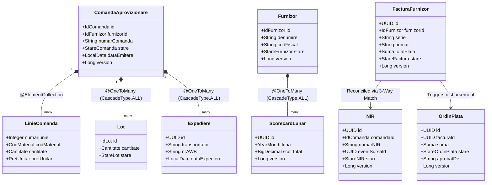
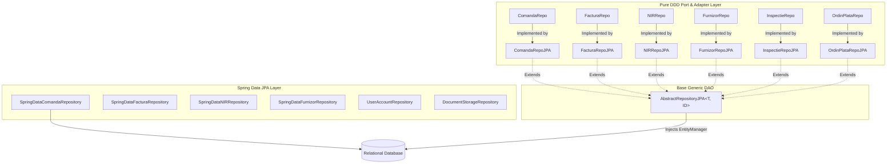
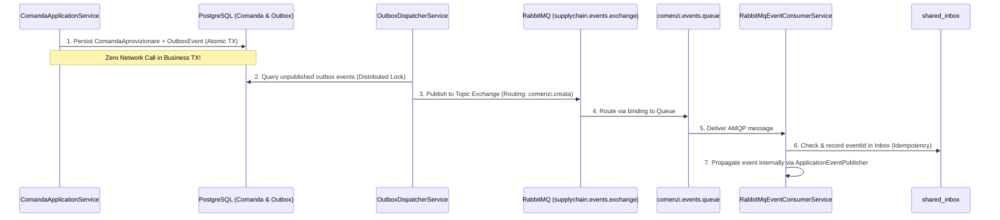
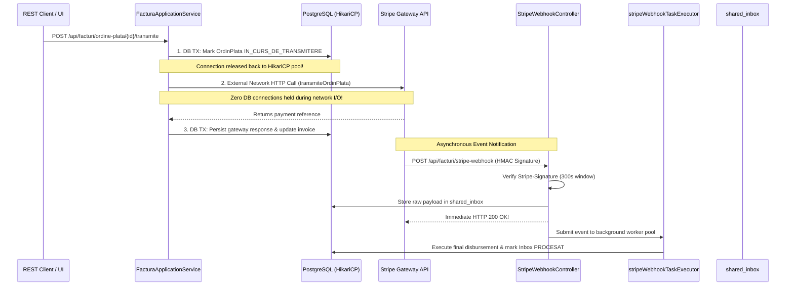

# ARCHITECTURAL BLUEPRINT & COMPONENT CATALOG – SPRINT 3
## Enterprise Persistence Model, Dual JPA Repositories, Database Lifecycle Governance & Distributed Integration
### Standard: Jakarta Persistence (JPA 3.1), Hibernate 6.5+, Flyway V1..V15, RabbitMQ AMQP & Stripe Fintech

---

### BLUEPRINT METADATA
* **Academic Reference**: **Theme_2: Course_5 – Data Access Components Implementation (Sprint 3.MSD)**
* **Core Pillars**:
  1. **Persistence Model Implementation** (JPA `@Entity`, `@Inheritance`, `@Version`, Value Objects `@Convert`, `@Enumerated`, Aggregate `@OneToMany` cascades).
  2. **Repository Services Implementation** (Dual Strategy: Spring Data `JpaRepository` with custom `@Query` + Bonus Complete JPA DAOs via `EntityManager` injection).
  3. **Business Rules & Lifecycle Audit** (Service/Factory integration, `@EntityListeners` with `@PrePersist`, `@PreUpdate`, `@PreRemove`).
  4. **Database Schema Governance** (Deterministic Flyway Migrations `V1`..`V15`, PostgreSQL 16 Alpine / H2 In-Memory portability).
  5. **Distributed Messaging & Fintech Reliability** (Transactional Outbox/Inbox AMQP RabbitMQ, HikariCP connection-safe Stripe payment integration).
* **Root Package**: `ro.uaic.feaa.sdbis.supplychain`
* **Test Verification**: **198 Automated Tests Running & Passing (100% BUILD SUCCESS)**
* **Language**: Technical English (Authoritative Enterprise Architecture & Forensic Standard)

---

# 1. PHYSICAL NAVIGATION TREE (SPRINT 3 CODEBASE)

The following tree maps **every physical Java source file, configuration descriptor, SQL migration, and JUnit test** participating in the Sprint 3 data access, persistence, and messaging infrastructure:

```text
c:\Users\bmugu\Desktop\app
├── src
│   ├── main
│   │   ├── java/ro/uaic/feaa/sdbis/supplychain
│   │   │   ├── shared/
│   │   │   │   ├── AbstractRepositoryJPA.java                          # Generic base JPA CRUD DAO with EntityManager
│   │   │   │   ├── IJurnalAudit.java & JurnalAuditRepoJPA.java         # Audit log port & JPA adapter
│   │   │   │   ├── AuditLogEntry.java                                  # Active audit log JPA entity
│   │   │   │   ├── AuditLogArchiveEntry.java                           # Cold-storage archived audit log JPA entity
│   │   │   │   ├── OutboxRepo.java & OutboxRepoJPA.java                # Transactional Outbox port & JPA adapter
│   │   │   │   ├── OutboxEventEntity.java                              # Transactional Outbox event entity
│   │   │   │   ├── InboxRepo.java & InboxRepoJPA.java                  # Idempotent Inbox port & JPA adapter
│   │   │   │   ├── InboxEventEntity.java                               # Idempotent Inbox message entity
│   │   │   │   ├── DistributedLockService.java                         # Distributed lock port
│   │   │   │   ├── DistributedLockEntity.java                          # Distributed lock lease JPA entity
│   │   │   │   ├── DistributedLockJpaService.java                      # Database-backed distributed lock manager
│   │   │   │   ├── IDeadLetterParkingLotRepo.java                      # Dead-Letter parking lot port
│   │   │   │   ├── DeadLetterMessageEntity.java                        # AMQP poison-pill message JPA entity
│   │   │   │   ├── DeadLetterParkingLotRepoJPA.java                    # DLQ parking lot JPA repository adapter
│   │   │   │   ├── DocumentAtasatEntity.java                           # Attached binary document JPA entity
│   │   │   │   ├── DocumentStorageRepository.java                      # Spring Data JPA repository for documents
│   │   │   │   ├── DocumentStorageService.java                         # Document metadata & storage service
│   │   │   │   ├── TimeProvider.java & DateTimeConfig.java             # Clock abstraction for deterministic testing
│   │   │   │   ├── messaging/
│   │   │   │   │   ├── RabbitMqConfig.java                             # AMQP broker topology, exchanges & queues
│   │   │   │   │   ├── AmqpEventPublisher.java                         # AMQP event publication adapter
│   │   │   │   │   └── AmqpMessageReceivedEvent.java                   # Inbound AMQP event message wrapper
│   │   │   │   └── persistence/converters/                             # Universal JPA Attribute Converters
│   │   │   │       ├── CodMaterialConverter.java                       # CodMaterial VO <-> VARCHAR(50)
│   │   │   │       ├── CurrencyConverter.java                          # Currency VO <-> VARCHAR(3)
│   │   │   │       ├── IdComandaConverter.java                         # IdComanda VO <-> UUID
│   │   │   │       ├── IdFurnizorConverter.java                        # IdFurnizor VO <-> UUID
│   │   │   │       └── IdLotConverter.java                             # IdLot VO <-> UUID
│   │   │   ├── comenzi/
│   │   │   │   ├── domain/                                             # Comenzi Domain Entities & Repositories
│   │   │   │   │   ├── ComandaAprovizionare.java                       # Aggregate Root (@Entity, @Table, @Version)
│   │   │   │   │   ├── LinieComanda.java                               # Child Value Object (@Embeddable)
│   │   │   │   │   ├── Lot.java                                        # Child Entity (@Entity, @Table)
│   │   │   │   │   ├── Expediere.java                                  # Child Entity (@Entity, 1NF normalized lots)
│   │   │   │   │   ├── ComandaRepo.java                                # Pure DDD IRepository domain port
│   │   │   │   │   ├── Cantitate.java & PretUnitar.java                # Embedded numeric Value Objects
│   │   │   │   │   └── StareComanda.java & StareLot.java               # Enum Value Objects (@Enumerated)
│   │   │   │   ├── application/
│   │   │   │   │   ├── ComandaApplicationService.java                  # JPA-backed application orchestrator
│   │   │   │   │   └── ComandaCommandFactory.java                      # JPA repository-aware factory
│   │   │   │   └── infrastructure/
│   │   │   │       ├── ComandaRepoJPA.java                             # Complete JPA Repository (EntityManager DAO)
│   │   │   │       └── persistence/
│   │   │   │           └── SpringDataComandaRepository.java            # Spring Data JpaRepository with @Query
│   │   │   ├── calitate/
│   │   │   │   ├── domain/                                             # Calitate Domain Entities & Repositories
│   │   │   │   │   ├── Furnizor.java                                   # Aggregate Root (@Entity, @Table, @Version)
│   │   │   │   │   ├── ScorecardLunar.java                             # Child Entity (@Entity, @Table, @Version)
│   │   │   │   │   ├── InspectieCalitate.java                          # Aggregate Root (@Entity, @Table, @Version)
│   │   │   │   │   ├── InspectorCalitate.java                          # Aggregate Root (@Entity, @Table)
│   │   │   │   │   ├── RaportNeconformitate.java                       # Aggregate Root (@Entity, @Table)
│   │   │   │   │   ├── PretNegociat.java, Adresa.java, Email.java      # Embedded & Collection Value Objects
│   │   │   │   │   ├── FurnizorRepo.java, InspectieRepo.java           # Pure DDD IRepository domain ports
│   │   │   │   │   ├── InspectorRepo.java, NCRRepo.java                # Pure DDD IRepository domain ports
│   │   │   │   │   └── StareFurnizor.java, StareInspectie.java         # Enum Value Objects (@Enumerated)
│   │   │   │   ├── application/
│   │   │   │   │   ├── CalitateApplicationService.java                 # JPA-backed application orchestrator
│   │   │   │   │   ├── FurnizorFactory.java                            # JPA repository-aware vendor factory
│   │   │   │   │   └── InspectieCalitateFactory.java                   # JPA repository-aware inspection factory
│   │   │   │   └── infrastructure/
│   │   │   │       ├── FurnizorRepoJPA.java, InspectieRepoJPA.java     # Complete JPA Repositories (EntityManager)
│   │   │   │       ├── InspectorRepoJPA.java, NCRRepoJPA.java          # Complete JPA Repositories (EntityManager)
│   │   │   │       └── persistence/
│   │   │   │           └── SpringDataFurnizorRepository.java           # Spring Data JpaRepository with @Query
│   │   │   ├── facturi/
│   │   │   │   ├── domain/                                             # Facturi Domain Entities & Repositories
│   │   │   │   │   ├── FacturaFurnizor.java                            # Aggregate Root (@Entity, UniqueConstraint)
│   │   │   │   │   ├── LinieFactura.java                               # Child Value Object (@Embeddable)
│   │   │   │   │   ├── NIR.java                                        # Aggregate Root (@Entity, Unique event key)
│   │   │   │   │   ├── LinieNIR.java                                   # Child Value Object (@Embeddable)
│   │   │   │   │   ├── OrdinPlata.java                                 # Aggregate Root (@Entity, Four-Eyes state)
│   │   │   │   │   ├── FacturaRepo.java, NIRRepo.java                  # Pure DDD IRepository domain ports
│   │   │   │   │   ├── OrdinPlataRepo.java, IBancaPlataProvider.java   # Pure DDD IRepository & payment gateway ports
│   │   │   │   │   ├── Suma.java                                       # Embedded monetary Value Object
│   │   │   │   │   └── StareFactura.java, StareNIR.java, StareOrdinPlata.java # Enum Value Objects
│   │   │   │   ├── application/
│   │   │   │   │   └── FacturaApplicationService.java                  # Connection-safe payment & invoice service
│   │   │   │   └── infrastructure/
│   │   │   │       ├── FacturaRepoJPA.java, NIRRepoJPA.java            # Complete JPA Repositories (EntityManager)
│   │   │   │       ├── OrdinPlataRepoJPA.java                          # Complete JPA Repository (EntityManager)
│   │   │   │       ├── FurnizorBlocatFactura.java                      # Vendor block entity for payment holds
│   │   │   │       ├── FurnizoriBlocatiRepoJPA.java                    # Vendor block JPA repository adapter
│   │   │   │       ├── StripeBancaPlataAdapter.java                    # Outbound Stripe PaymentIntent adapter
│   │   │   │       ├── StripeProperties.java                           # Configuration properties for Stripe API
│   │   │   │       ├── payment/
│   │   │   │       │   ├── StripeWebhookController.java                # Inbound Stripe webhook HTTP endpoint
│   │   │   │       │   └── StripeWebhookProcessingService.java         # Async decoupled webhook worker pool
│   │   │   │       └── persistence/
│   │   │   │           ├── SpringDataFacturaRepository.java            # Spring Data JpaRepository with @Query
│   │   │   │           └── SpringDataNIRRepository.java                # Spring Data JpaRepository with @Query
│   │   │   ├── infrastructure/
│   │   │   │   ├── configuration/
│   │   │   │   │   └── AggregateAuditAndComputationListener.java       # Global JPA @EntityListener (@PrePersist, etc.)
│   │   │   │   └── messaging/
│   │   │   │       ├── OutboxDispatcherService.java                    # Polling publisher for Outbox -> AMQP
│   │   │   │       ├── RabbitMqEventConsumerService.java               # AMQP message consumers with Inbox check
│   │   │   │       └── AmqpMessageDispatchListener.java                # Modulith event dispatcher for AMQP
│   │   │   └── securitate/
│   │   │       ├── UserAccountEntity.java                              # RBAC User JPA entity (@Entity, @Table)
│   │   │       └── UserAccountRepository.java                          # Spring Data JpaRepository for security
│   │   └── resources/
│   │       ├── META-INF/
│   │       │   └── orm.xml                                             # Global JPA mapping & listener descriptor
│   │       └── db/migration/                                           # Flyway Versioned Migrations (V1..V15)
│   │           ├── V1__initial_schema.sql
│   │           ├── V2__add_outbox_events.sql
│   │           ├── V3__add_inbox_events.sql
│   │           ├── V4__add_reconcilieri.sql
│   │           ├── V5__add_stripe_columns.sql
│   │           ├── V6__add_security_tables.sql
│   │           ├── V7__production_readiness_and_seed_data.sql
│   │           ├── V8__enterprise_readiness.sql
│   │           ├── V9__persistence_optimizations_and_audit.sql
│   │           ├── V10__remediation_normalization_and_parity.sql
│   │           ├── V11__comanda_approval_and_closure.sql
│   │           ├── V12__unique_factura_furnizor_and_distributed_locks.sql
│   │           ├── V13__audit_log_archiving_and_partitioning.sql
│   │           ├── V14__amqp_dlq_parking_lot.sql
│   │           └── V15__scorecard_optimistic_locking.sql
│   └── test
│       └── java/ro/uaic/feaa/sdbis/supplychain/
│           ├── integration/                                            # Dedicated Persistence & Messaging Suite
│           │   ├── FlywayMigrationIntegrationTest.java                 # Verifies clean execution of V1..V15
│           │   ├── PersistenceRemediationIntegrationTest.java          # Verifies Spring Data & Complete JPA DAOs
│           │   ├── OrdinPlataPersistenceIntegrationTest.java           # Verifies L1 cache clear & DB synchronization
│           │   ├── NPlusOneOptimizationIntegrationTest.java            # Verifies two-step fetch eliminating N+1
│           │   ├── TenRemediationsVerificationTest.java                # Verifies optimistic locking & non-failing locks
│           │   ├── MultiNirReconciliereTest.java                       # Verifies multi-NIR 3-Way matching persistence
│           │   ├── PaginationAndFilteringIntegrationTest.java          # Verifies paginated and filtered queries
│           │   ├── AuditLogArchivingTest.java                          # Verifies cold storage archival of audit logs
│           │   ├── AmqpHardeningIntegrationTest.java                   # Verifies RabbitMQ DLQ, retries & Inbox idempotență
│           │   ├── OutboxAndMessagingIntegrationTest.java              # Verifies Outbox polling & event propagation
│           │   └── PaymentWorkflowIntegrationTest.java                 # Verifies end-to-end payment persistence
│           ├── rest/
│           │   ├── DocumentStorageIntegrationTest.java                 # Verifies document attachment persistence
│           │   ├── StripeWebhookIntegrationTest.java                   # Verifies webhook signature validation
│           │   └── StripeWebhookAsyncDecouplingTest.java               # Verifies async decoupling of Stripe worker pool
│           └── shared/
│               ├── DistributedLockIntegrationTest.java                 # Verifies database distributed locking leases
│               ├── TimeProviderTest.java                               # Verifies time abstraction for audit
│               └── messaging/
│                   └── AmqpEventPublisherTest.java                     # Unit verification of AMQP publisher contracts
```

---

# 2. COURSE SYLLABUS ALIGNMENT (SPRINT 3.MSD DELIVERABLES MATRIX)

The table below proves complete, 1:1 coverage of every theoretical and practical requirement formulated in **Sprint 3.MSD (Theme_2: Course_5)**:

| Syllabus Requirement (Sprint 3.MSD) | Architectural Concept | Concrete Project Implementation | Source Code Hyperlink |
| :--- | :--- | :--- | :--- |
| **JPA Entities (`@Entity`, `@Inheritance`, `@Version`)** | Root & Child Relational Entities | Relational mapping of domain aggregates with optimistic concurrency locking | [`ComandaAprovizionare.java`](../../src/main/java/ro/uaic/feaa/sdbis/supplychain/comenzi/domain/ComandaAprovizionare.java)<br>[`ScorecardLunar.java`](../../src/main/java/ro/uaic/feaa/sdbis/supplychain/calitate/domain/ScorecardLunar.java)<br>[`FacturaFurnizor.java`](../../src/main/java/ro/uaic/feaa/sdbis/supplychain/facturi/domain/FacturaFurnizor.java) |
| **Value Objects (`@Enumerated`, `@Convert`)** | Strongly Typed Domain Primitives | String-based enums and custom JPA 3.1 `AttributeConverter` implementations | [`CodMaterialConverter.java`](../../src/main/java/ro/uaic/feaa/sdbis/supplychain/shared/persistence/converters/CodMaterialConverter.java)<br>[`IdComandaConverter.java`](../../src/main/java/ro/uaic/feaa/sdbis/supplychain/shared/persistence/converters/IdComandaConverter.java)<br>[`StareComanda.java`](../../src/main/java/ro/uaic/feaa/sdbis/supplychain/comenzi/domain/StareComanda.java) |
| **JPA Aggregates (`@OneToMany`, `CascadeType.ALL`, `orphanRemoval`)** | Aggregate Boundary Lifecycle | Parent-child lifecycle binding where deleting/updating root cascades to components | [`ComandaAprovizionare.java`](../../src/main/java/ro/uaic/feaa/sdbis/supplychain/comenzi/domain/ComandaAprovizionare.java)<br>[`Furnizor.java`](../../src/main/java/ro/uaic/feaa/sdbis/supplychain/calitate/domain/Furnizor.java)<br>[`Expediere.java`](../../src/main/java/ro/uaic/feaa/sdbis/supplychain/comenzi/domain/Expediere.java) |
| **Spring Repositories (`JpaRepository<T, ID>`)** | Declarative Data Access | Interfaces extending `JpaRepository` with derived `findBy*` queries and `@Query` | [`SpringDataComandaRepository.java`](../../src/main/java/ro/uaic/feaa/sdbis/supplychain/comenzi/infrastructure/persistence/SpringDataComandaRepository.java)<br>[`SpringDataFacturaRepository.java`](../../src/main/java/ro/uaic/feaa/sdbis/supplychain/facturi/infrastructure/persistence/SpringDataFacturaRepository.java)<br>[`SpringDataFurnizorRepository.java`](../../src/main/java/ro/uaic/feaa/sdbis/supplychain/calitate/infrastructure/persistence/SpringDataFurnizorRepository.java) |
| **(Bonus) Complete JPA Repositories** | Pure DDD Ports & `EntityManager` Adapters | Pure interface contracts (`IRepository`) implemented via injected `EntityManager` DAOs | [`ComandaRepo.java`](../../src/main/java/ro/uaic/feaa/sdbis/supplychain/comenzi/domain/ComandaRepo.java) $\rightarrow$ [`ComandaRepoJPA.java`](../../src/main/java/ro/uaic/feaa/sdbis/supplychain/comenzi/infrastructure/ComandaRepoJPA.java)<br>[`AbstractRepositoryJPA.java`](../../src/main/java/ro/uaic/feaa/sdbis/supplychain/shared/AbstractRepositoryJPA.java) |
| **Business Services & Factories Refactoring** | JPA Repository Injection | Updating Application Services and Factories to consume JPA repositories | [`ComandaApplicationService.java`](../../src/main/java/ro/uaic/feaa/sdbis/supplychain/comenzi/application/ComandaApplicationService.java)<br>[`FacturaApplicationService.java`](../../src/main/java/ro/uaic/feaa/sdbis/supplychain/facturi/application/FacturaApplicationService.java)<br>[`FurnizorFactory.java`](../../src/main/java/ro/uaic/feaa/sdbis/supplychain/calitate/domain/factory/FurnizorFactory.java) |
| **Computation & Audit Rules via `@EntityListeners`** | Lifecycle Interception | Global entity interception for automated timestamping, audit logs, and mutation counts | [`AggregateAuditAndComputationListener.java`](../../src/main/java/ro/uaic/feaa/sdbis/supplychain/infrastructure/configuration/AggregateAuditAndComputationListener.java)<br>[`orm.xml`](../../src/main/resources/META-INF/orm.xml) |
| **JUnit Integration & Repository Test Suite** | Automated Regression | Comprehensive test suite verifying Flyway migrations, queries, caching, and locks | [`FlywayMigrationIntegrationTest.java`](../../src/test/java/ro/uaic/feaa/sdbis/supplychain/integration/FlywayMigrationIntegrationTest.java)<br>[`PersistenceRemediationIntegrationTest.java`](../../src/test/java/ro/uaic/feaa/sdbis/supplychain/integration/PersistenceRemediationIntegrationTest.java) |

---

# 3. PERSISTENCE MODEL IMPLEMENTATION (JPA ENTITIES & VALUE OBJECTS)

### 3.1. Root Entities & Child Entities (`@Entity`, `@Table`, `@Inheritance`, `@Version`)

All persistent entities are mapped to relational tables in conformity with Third Normal Form (3NF) and the First Normal Form (1NF) collection normalization remediated in `V10`:



#### Detailed Class Catalog:
1. 📄 [`ComandaAprovizionare.java`](../../src/main/java/ro/uaic/feaa/sdbis/supplychain/comenzi/domain/ComandaAprovizionare.java)
   * **Mapping**: `@Entity`, `@Table(name = "comenzi_aprovizionare")`, `@EmbeddedId`, `@Version`.
   * **Role**: Aggregate Root controlling order creation, vendor validation, line item calculations, lot allocations, delivery tracking, and atomic cascading cancellations.
2. 📄 [`Lot.java`](../../src/main/java/ro/uaic/feaa/sdbis/supplychain/comenzi/domain/Lot.java)
   * **Mapping**: `@Entity`, `@Table(name = "comenzi_loturi")`, `@EmbeddedId`, `@ManyToOne(fetch = FetchType.LAZY)`.
   * **Role**: Component entity representing a physical batch of items manufactured for a specific purchase order.
3. 📄 [`Expediere.java`](../../src/main/java/ro/uaic/feaa/sdbis/supplychain/comenzi/domain/Expediere.java)
   * **Mapping**: `@Entity`, `@Table(name = "comenzi_expedieri")`, `@Id`, `@ManyToOne(fetch = FetchType.LAZY)`.
   * **Role**: Component entity tracking logistics dispatch, carrier details, tracking numbers (AWB), and 1NF normalized lots association (`comenzi_expedieri_loturi`).
4. 📄 [`Furnizor.java`](../../src/main/java/ro/uaic/feaa/sdbis/supplychain/calitate/domain/Furnizor.java)
   * **Mapping**: `@Entity`, `@Table(name = "calitate_furnizori")`, `@EmbeddedId`, `@Version`.
   * **Role**: Aggregate Root representing an approved or candidate supplier, encapsulating negotiated prices, certifications, and historical monthly evaluation scorecards.
5. 📄 [`ScorecardLunar.java`](../../src/main/java/ro/uaic/feaa/sdbis/supplychain/calitate/domain/ScorecardLunar.java)
   * **Mapping**: `@Entity`, `@Table(name = "calitate_scorecards")`, `@Id`, `@Version`, `@ManyToOne(fetch = FetchType.LAZY)`.
   * **Role**: Child performance entity guarded against concurrent overwrites via optimistic locking (`@Version`).
6. 📄 [`InspectieCalitate.java`](../../src/main/java/ro/uaic/feaa/sdbis/supplychain/calitate/domain/InspectieCalitate.java)
   * **Mapping**: `@Entity`, `@Table(name = "calitate_inspectii")`, `@Id`, `@Version`.
   * **Role**: Aggregate Root executing statistical sampling (ISO 2859-1 AQL), defect recording, and automated NCR triggering upon rejection.
7. 📄 [`InspectorCalitate.java`](../../src/main/java/ro/uaic/feaa/sdbis/supplychain/calitate/domain/InspectorCalitate.java)
   * **Mapping**: `@Entity`, `@Table(name = "calitate_inspectori")`, `@Id`.
   * **Role**: Quality assurance officer entity maintaining technical certifications and operational availability windows.
8. 📄 [`RaportNeconformitate.java`](../../src/main/java/ro/uaic/feaa/sdbis/supplychain/calitate/domain/RaportNeconformitate.java)
   * **Mapping**: `@Entity`, `@Table(name = "calitate_ncr")`, `@Id`.
   * **Role**: Non-Conformance Report (NCR) aggregate root tracking defective lots, root causes, and corrective action workflows (8D / CAPA).
9. 📄 [`FacturaFurnizor.java`](../../src/main/java/ro/uaic/feaa/sdbis/supplychain/facturi/domain/FacturaFurnizor.java)
   * **Mapping**: `@Entity`, `@Table(name = "facturi_furnizori", uniqueConstraints = @UniqueConstraint(name = "uk_facturi_furnizor_numar", columnNames = {"furnizor_id", "serie", "numar"}))`, `@Id`, `@Version`.
   * **Role**: Commercial supplier invoice aggregate preventing duplicate billing per supplier.
10. 📄 [`NIR.java`](../../src/main/java/ro/uaic/feaa/sdbis/supplychain/facturi/domain/NIR.java)
    * **Mapping**: `@Entity`, `@Table(name = "facturi_nir")`, `@Id`, `@Version`.
    * **Role**: Warehouse Goods Receipt Note (Nota de Intrare-Receptie) enforcing idempotent intake via unique `event_sursa_id`.
11. 📄 [`OrdinPlata.java`](../../src/main/java/ro/uaic/feaa/sdbis/supplychain/facturi/domain/OrdinPlata.java)
    * **Mapping**: `@Entity`, `@Table(name = "facturi_ordine_plata")`, `@Id`, `@Version`.
    * **Role**: Bank disbursement order aggregate implementing the Four-Eyes approval principle and external payment states.
12. 📄 [`UserAccountEntity.java`](../../src/main/java/ro/uaic/feaa/sdbis/supplychain/securitate/UserAccountEntity.java)
    * **Mapping**: `@Entity`, `@Table(name = "users")`, `@Id`, `@ElementCollection(fetch = FetchType.EAGER)`.
    * **Role**: RBAC security credential entity managing password hashes (BCrypt) and role authorities.
13. 📄 [`OutboxEventEntity.java`](../../src/main/java/ro/uaic/feaa/sdbis/supplychain/shared/OutboxEventEntity.java)
    * **Mapping**: `@Entity`, `@Table(name = "shared_outbox")`, `@Id`.
    * **Role**: Transactional Outbox pattern message entity for reliable distributed domain event publishing.
14. 📄 [`InboxEventEntity.java`](../../src/main/java/ro/uaic/feaa/sdbis/supplychain/shared/InboxEventEntity.java)
    * **Mapping**: `@Entity`, `@Table(name = "shared_inbox")`, `@Id`.
    * **Role**: Idempotent Inbox message entity tracking processed incoming event UUIDs per consumer.
15. 📄 [`DistributedLockEntity.java`](../../src/main/java/ro/uaic/feaa/sdbis/supplychain/shared/DistributedLockEntity.java)
    * **Mapping**: `@Entity`, `@Table(name = "distributed_locks")`, `@Id`.
    * **Role**: Clustered mutual-exclusion lease entity with automatic TTL expiration.
16. 📄 [`DeadLetterMessageEntity.java`](../../src/main/java/ro/uaic/feaa/sdbis/supplychain/shared/DeadLetterMessageEntity.java)
    * **Mapping**: `@Entity`, `@Table(name = "shared_dlq_parking_lot")`, `@Id`.
    * **Role**: Quarantine entity persisting poison-pill AMQP messages that failed consumer retry attempts.
17. 📄 [`DocumentAtasatEntity.java`](../../src/main/java/ro/uaic/feaa/sdbis/supplychain/shared/DocumentAtasatEntity.java)
    * **Mapping**: `@Entity`, `@Table(name = "shared_documente_atasate")`, `@Id`, `@Lob`.
    * **Role**: Binary attachment storage entity storing signed PDFs, invoices, and inspection evidence.

---

### 3.2. Value Objects & Embedded Types (`@Embeddable`, `@Embedded`, `@Enumerated`)

Value objects lack independent relational identity and are completely embedded within their parent tables or stored in normalized collection tables:

* **Monetary & Numeric Value Objects**:
  * [`Suma.java`](../../src/main/java/ro/uaic/feaa/sdbis/supplychain/facturi/domain/Suma.java): Embeds `valoare` (`NUMERIC(15,2)`) and `moneda` (`VARCHAR(3)` ISO-4217).
  * [`Cantitate.java`](../../src/main/java/ro/uaic/feaa/sdbis/supplychain/comenzi/domain/Cantitate.java): Embeds `valoare` (`NUMERIC(15,3)`) and `unitateMasura` (`VARCHAR(20)`).
  * [`PretUnitar.java`](../../src/main/java/ro/uaic/feaa/sdbis/supplychain/comenzi/domain/PretUnitar.java): Embeds unit price amount and currency with arithmetic operations.
* **Structural & Contact Value Objects**:
  * [`Adresa.java`](../../src/main/java/ro/uaic/feaa/sdbis/supplychain/calitate/domain/Adresa.java): Embeds `strada`, `numar`, `oras`, `codPostal`, `tara`.
  * [`Perioada.java`](../../src/main/java/ro/uaic/feaa/sdbis/supplychain/shared/Perioada.java): Embeds `dataStart` and `dataSfarsit` with temporal overlap validation.
  * [`Email.java`](../../src/main/java/ro/uaic/feaa/sdbis/supplychain/calitate/domain/Email.java): Enforces RFC 5322 email syntax validation.
* **Enumerated State Machines (`@Enumerated(EnumType.STRING)`)**:
  * Stored strictly as descriptive strings in the database (never ordinal integers) to prevent data corruption upon refactoring:
    * [`StareComanda.java`](../../src/main/java/ro/uaic/feaa/sdbis/supplychain/comenzi/domain/StareComanda.java) (`Creata`, `Aprobata`, `Confirmata`, `InLivrare`, `Receptionata`, `Anulata`)
    * [`StareLot.java`](../../src/main/java/ro/uaic/feaa/sdbis/supplychain/comenzi/domain/StareLot.java) (`Planificat`, `InInspectie`, `Aprobat`, `Respins`, `Carantinat`, `Returnat`)
    * [`StareFurnizor.java`](../../src/main/java/ro/uaic/feaa/sdbis/supplychain/calitate/domain/StareFurnizor.java) (`Candidat`, `Aprobat`, `Suspendat`, `Blocat`)
    * [`StareInspectie.java`](../../src/main/java/ro/uaic/feaa/sdbis/supplychain/calitate/domain/StareInspectie.java) (`Programata`, `InCurs`, `Finalizata`, `Anulata`)
    * [`StareFactura.java`](../../src/main/java/ro/uaic/feaa/sdbis/supplychain/facturi/domain/StareFactura.java) (`Inregistrata`, `Reconciliata`, `InAprobare`, `Aprobata`, `Platita`, `Litigiu`)
    * [`StareNIR.java`](../../src/main/java/ro/uaic/feaa/sdbis/supplychain/facturi/domain/StareNIR.java) (`Generat`, `Validat`, `Anulat`)
    * [`StareOrdinPlata.java`](../../src/main/java/ro/uaic/feaa/sdbis/supplychain/facturi/domain/StareOrdinPlata.java) (`Initiat`, `InAprobare`, `Aprobat`, `InCursDeTransmitere`, `Executat`, `Respins`)

---

### 3.3. Attribute Converters (`@Convert`, `@Converter`)

Custom implementations of `jakarta.persistence.AttributeConverter<X, Y>` allow seamless bidirectional conversion between rich domain Value Objects and primitive JDBC SQL types:

* 📄 [`IdComandaConverter.java`](../../src/main/java/ro/uaic/feaa/sdbis/supplychain/shared/persistence/converters/IdComandaConverter.java): Maps `IdComanda` Value Object to `java.util.UUID` (native SQL `UUID` or `BINARY(16)`).
* 📄 [`IdFurnizorConverter.java`](../../src/main/java/ro/uaic/feaa/sdbis/supplychain/shared/persistence/converters/IdFurnizorConverter.java): Maps `IdFurnizor` Value Object to `java.util.UUID`.
* 📄 [`IdLotConverter.java`](../../src/main/java/ro/uaic/feaa/sdbis/supplychain/shared/persistence/converters/IdLotConverter.java): Maps `IdLot` Value Object to `java.util.UUID`.
* 📄 [`CodMaterialConverter.java`](../../src/main/java/ro/uaic/feaa/sdbis/supplychain/shared/persistence/converters/CodMaterialConverter.java): Maps `CodMaterial` Value Object to `java.lang.String` (`VARCHAR(50)`).
* 📄 [`CurrencyConverter.java`](../../src/main/java/ro/uaic/feaa/sdbis/supplychain/shared/persistence/converters/CurrencyConverter.java): Maps `java.util.Currency` to ISO-4217 standard 3-letter string (`VARCHAR(3)`).

---

# 4. JPA AGGREGATES & RELATIONAL MAPPINGS

Every Domain Aggregate establishes an encapsulation boundary. Child entities and value collections cannot be mutated or loaded in isolation without respecting the root entity's transactional context:

| Aggregate Root | Component Target | JPA Mapping Annotation | Cascade & Fetch Configuration | Database Table |
| :--- | :--- | :--- | :--- | :--- |
| `ComandaAprovizionare` | `LinieComanda` | `@ElementCollection` | `@CollectionTable`, `FetchType.LAZY` | `comenzi_linii` |
| `ComandaAprovizionare` | `Lot` | `@OneToMany` | `cascade = CascadeType.ALL`, `orphanRemoval = true`, `FetchType.LAZY` | `comenzi_loturi` |
| `ComandaAprovizionare` | `Expediere` | `@OneToMany` | `cascade = CascadeType.ALL`, `orphanRemoval = true`, `FetchType.LAZY` | `comenzi_expedieri` |
| `Expediere` | `IdLot` | `@ElementCollection` | `@CollectionTable`, `FetchType.LAZY` | `comenzi_expedieri_loturi` |
| `Furnizor` | `Email` | `@ElementCollection` | `@CollectionTable`, `FetchType.LAZY` | `calitate_furnizori_emailuri` |
| `Furnizor` | `categoriiMateriale` | `@ElementCollection` | `@CollectionTable`, `FetchType.LAZY` | `calitate_furnizori_categorii` |
| `Furnizor` | `PretNegociat` | `@ElementCollection` | `@CollectionTable`, `FetchType.LAZY` | `furnizor_preturi_negociate` |
| `Furnizor` | `ScorecardLunar` | `@OneToMany` | `cascade = CascadeType.ALL`, `orphanRemoval = true`, `FetchType.LAZY` | `calitate_scorecards` |
| `InspectieCalitate` | `EsantionAQL` | `@ElementCollection` | `@CollectionTable`, `FetchType.LAZY` | `calitate_inspectii_esantioane` |
| `InspectorCalitate` | `Certificare` | `@ElementCollection` | `@CollectionTable`, `FetchType.LAZY` | `calitate_inspectori_certificari` |
| `InspectorCalitate` | `Perioada` | `@ElementCollection` | `@CollectionTable`, `FetchType.LAZY` | `calitate_inspectori_disponibilitate` |
| `FacturaFurnizor` | `LinieFactura` | `@ElementCollection` | `@CollectionTable`, `FetchType.LAZY` | `facturi_linii` |
| `NIR` | `LinieNIR` | `@ElementCollection` | `@CollectionTable`, `FetchType.LAZY` | `facturi_nir_linii` |

#### Architectural Invariants:
1. **Cascade Lifecycle (`CascadeType.ALL`)**: Saving, updating, or deleting a `ComandaAprovizionare` cascades automatically to all its lines, lots, and dispatches.
2. **Orphan Removal (`orphanRemoval = true`)**: Removing a `Lot` from the internal set in `ComandaAprovizionare.getLoturi()` triggers an automatic SQL `DELETE` in `comenzi_loturi` upon transaction commit.
3. **Eager vs. Lazy Strategy**: All `@OneToMany` and `@ElementCollection` mappings strictly specify `FetchType.LAZY` to prevent massive memory overhead. When eager loading is required for query operations, it is performed via specialized repository methods using two-step queries to eliminate the **N+1 Query Problem**.

---

# 5. REPOSITORY SERVICES IMPLEMENTATION (DUAL STRATEGY)

In strict compliance with the **Sprint 3.MSD syllabus**, the system provides **both** data access paradigms:



### 5.1. Spring Data JPA Repositories (`JpaRepository<T, ID>`)

Declarative repository interfaces extending Spring Data's `JpaRepository`, leveraging method name query derivation and custom JPQL `@Query` filters:

1. 📄 [`SpringDataComandaRepository.java`](../../src/main/java/ro/uaic/feaa/sdbis/supplychain/comenzi/infrastructure/persistence/SpringDataComandaRepository.java)
   * Extends: `JpaRepository<ComandaAprovizionare, IdComanda>`
   * Derived Operations: `findByNumarComanda(String)`, `findByFurnizorId(IdFurnizor)`, `findByStare(StareComanda)`
   * Custom `@Query`:
     ```java
     @Query("SELECT c FROM ComandaAprovizionare c WHERE c.furnizorId = :furnizorId AND c.stare IN ('Creata', 'Aprobata', 'Confirmata', 'InLivrare')")
     List<ComandaAprovizionare> gasesteComenziActivePerFurnizor(@Param("furnizorId") IdFurnizor furnizorId);
     ```
2. 📄 [`SpringDataFurnizorRepository.java`](../../src/main/java/ro/uaic/feaa/sdbis/supplychain/calitate/infrastructure/persistence/SpringDataFurnizorRepository.java)
   * Extends: `JpaRepository<Furnizor, IdFurnizor>`
   * Derived Operations: `findByCodFiscal(String)`, `findByStare(StareFurnizor)`
   * Custom `@Query`:
     ```java
     @Query("SELECT f FROM Furnizor f WHERE f.stare = 'Aprobat' ORDER BY f.denumire ASC")
     List<Furnizor> gasesteFurnizoriActivi();
     ```
3. 📄 [`SpringDataFacturaRepository.java`](../../src/main/java/ro/uaic/feaa/sdbis/supplychain/facturi/infrastructure/persistence/SpringDataFacturaRepository.java)
   * Extends: `JpaRepository<FacturaFurnizor, UUID>`
   * Derived Operations: `findByFurnizorId(IdFurnizor)`, `findByStare(StareFactura)`, `findBySerieAndNumar(String, String)`
   * Custom `@Query`:
     ```java
     @Query("SELECT f FROM FacturaFurnizor f WHERE f.furnizorId = :furnizorId AND f.stare NOT IN ('Platita', 'Anulata')")
     List<FacturaFurnizor> gasesteFacturiNeachitateFurnizor(@Param("furnizorId") IdFurnizor furnizorId);
     ```
4. 📄 [`SpringDataNIRRepository.java`](../../src/main/java/ro/uaic/feaa/sdbis/supplychain/facturi/infrastructure/persistence/SpringDataNIRRepository.java)
   * Extends: `JpaRepository<NIR, UUID>`
   * Derived Operations: `findByComandaId(IdComanda)`, `findByNumarNIR(String)`, `existsByEventSursaId(UUID)`
   * Custom `@Query`:
     ```java
     @Query("SELECT n FROM NIR n WHERE n.comandaId IS NULL AND n.stare = 'Generat'")
     List<NIR> gasesteNiruriNeasociateComenzii();
     ```
5. 📄 [`UserAccountRepository.java`](../../src/main/java/ro/uaic/feaa/sdbis/supplychain/securitate/UserAccountRepository.java)
   * Extends: `JpaRepository<UserAccountEntity, UUID>`
   * Derived Operations: `findByUsername(String)`, `existsByUsername(String)`, `existsByEmail(String)`
6. 📄 [`DocumentStorageRepository.java`](../../src/main/java/ro/uaic/feaa/sdbis/supplychain/shared/DocumentStorageRepository.java)
   * Extends: `JpaRepository<DocumentAtasatEntity, UUID>`
   * Derived Operations: `findMetadataByReferintaIdOrderByDataIncarcareDesc(UUID)`, `findMetadataByTipDocumentOrderByDataIncarcareDesc(String)`

---

### 5.2. (Bonus) Complete JPA Repositories (Pure DDD Ports & EntityManager DAOs)

Pure domain contracts (`IRepository`) decoupled from Spring Data, implemented as concrete classes injecting `EntityManager` (via `@PersistenceContext`) and inheriting shared generic CRUD operations from [`AbstractRepositoryJPA.java`](../../src/main/java/ro/uaic/feaa/sdbis/supplychain/shared/AbstractRepositoryJPA.java):

```java
// Sursa: ro.uaic.feaa.sdbis.supplychain.shared.AbstractRepositoryJPA.java
public abstract class AbstractRepositoryJPA<T, ID extends Serializable> {
    @PersistenceContext
    protected EntityManager em;
    
    public Optional<T> findById(ID id) { return Optional.ofNullable(em.find(entityClass, id)); }
    public T save(T entity) {
        if (isNew(entity)) { em.persist(entity); return entity; }
        return em.merge(entity);
    }
    public void delete(T entity) { em.remove(em.contains(entity) ? entity : em.merge(entity)); }
}
```

#### Implemented Domain Repository Adapters:
* 📄 [`ComandaRepo.java`](../../src/main/java/ro/uaic/feaa/sdbis/supplychain/comenzi/domain/ComandaRepo.java) $\rightarrow$ [`ComandaRepoJPA.java`](../../src/main/java/ro/uaic/feaa/sdbis/supplychain/comenzi/infrastructure/ComandaRepoJPA.java)
  * Implements two-step eager loading `findAllWithLiniiAndLoturi(IdFurnizor)` to eliminate N+1 queries.
* 📄 [`FurnizorRepo.java`](../../src/main/java/ro/uaic/feaa/sdbis/supplychain/calitate/domain/FurnizorRepo.java) $\rightarrow$ [`FurnizorRepoJPA.java`](../../src/main/java/ro/uaic/feaa/sdbis/supplychain/calitate/infrastructure/FurnizorRepoJPA.java)
  * Eagerly loads scorecards and negotiated pricing without multiple bag fetch conflicts.
* 📄 [`FacturaRepo.java`](../../src/main/java/ro/uaic/feaa/sdbis/supplychain/facturi/domain/FacturaRepo.java) $\rightarrow$ [`FacturaRepoJPA.java`](../../src/main/java/ro/uaic/feaa/sdbis/supplychain/facturi/infrastructure/FacturaRepoJPA.java)
  * Handles custom filtering and pessimistic write locking for 3-Way reconciliation.
* 📄 [`NIRRepo.java`](../../src/main/java/ro/uaic/feaa/sdbis/supplychain/facturi/domain/NIRRepo.java) $\rightarrow$ [`NIRRepoJPA.java`](../../src/main/java/ro/uaic/feaa/sdbis/supplychain/facturi/infrastructure/NIRRepoJPA.java)
  * Implements idempotent reception lookup via `existaNIRPentruEvent(UUID)`.
* 📄 [`InspectieRepo.java`](../../src/main/java/ro/uaic/feaa/sdbis/supplychain/calitate/domain/InspectieRepo.java) $\rightarrow$ [`InspectieRepoJPA.java`](../../src/main/java/ro/uaic/feaa/sdbis/supplychain/calitate/infrastructure/InspectieRepoJPA.java)
* 📄 [`InspectorRepo.java`](../../src/main/java/ro/uaic/feaa/sdbis/supplychain/calitate/domain/InspectorRepo.java) $\rightarrow$ [`InspectorRepoJPA.java`](../../src/main/java/ro/uaic/feaa/sdbis/supplychain/calitate/infrastructure/InspectorRepoJPA.java)
* 📄 [`NCRRepo.java`](../../src/main/java/ro/uaic/feaa/sdbis/supplychain/calitate/domain/NCRRepo.java) $\rightarrow$ [`NCRRepoJPA.java`](../../src/main/java/ro/uaic/feaa/sdbis/supplychain/calitate/infrastructure/NCRRepoJPA.java)
* 📄 [`OrdinPlataRepo.java`](../../src/main/java/ro/uaic/feaa/sdbis/supplychain/facturi/domain/OrdinPlataRepo.java) $\rightarrow$ [`OrdinPlataRepoJPA.java`](../../src/main/java/ro/uaic/feaa/sdbis/supplychain/facturi/infrastructure/OrdinPlataRepoJPA.java)
* 📄 [`OutboxRepo.java`](../../src/main/java/ro/uaic/feaa/sdbis/supplychain/shared/OutboxRepo.java) $\rightarrow$ [`OutboxRepoJPA.java`](../../src/main/java/ro/uaic/feaa/sdbis/supplychain/shared/OutboxRepoJPA.java)
* 📄 [`InboxRepo.java`](../../src/main/java/ro/uaic/feaa/sdbis/supplychain/shared/InboxRepo.java) $\rightarrow$ [`InboxRepoJPA.java`](../../src/main/java/ro/uaic/feaa/sdbis/supplychain/shared/InboxRepoJPA.java)
* 📄 [`IDeadLetterParkingLotRepo.java`](../../src/main/java/ro/uaic/feaa/sdbis/supplychain/shared/IDeadLetterParkingLotRepo.java) $\rightarrow$ [`DeadLetterParkingLotRepoJPA.java`](../../src/main/java/ro/uaic/feaa/sdbis/supplychain/shared/DeadLetterParkingLotRepoJPA.java)

---

# 6. BUSINESS RULES IMPLEMENTATION & LIFECYCLE GOVERNANCE

### 6.1. Refactoring Business Services and Factories to use JPA Repositories

All existing business application services and domain factories were refactored from in-memory mocks to consume real JPA repositories:

* 📄 [`ComandaApplicationService.java`](../../src/main/java/ro/uaic/feaa/sdbis/supplychain/comenzi/application/ComandaApplicationService.java)
  * Injects `ComandaRepo` and `IFurnizorComandaAdapter`. Validates vendor active status before order persistence and cascades lot cancellations.
* 📄 [`CalitateApplicationService.java`](../../src/main/java/ro/uaic/feaa/sdbis/supplychain/calitate/application/CalitateApplicationService.java)
  * Injects `FurnizorRepo`, `InspectieRepo`, and `NCRRepo`. Computes monthly quality scorecards and saves them within active transactions.
* 📄 [`FacturaApplicationService.java`](../../src/main/java/ro/uaic/feaa/sdbis/supplychain/facturi/application/FacturaApplicationService.java)
  * Injects `FacturaRepo`, `NIRRepo`, and `OrdinPlataRepo`. Coordinates automated 3-Way Match reconciliation and connection-safe Stripe execution.
* 📄 [`FurnizorFactory.java`](../../src/main/java/ro/uaic/feaa/sdbis/supplychain/calitate/domain/factory/FurnizorFactory.java) & [`InspectieCalitateFactory.java`](../../src/main/java/ro/uaic/feaa/sdbis/supplychain/calitate/domain/factory/InspectieCalitateFactory.java)
  * Constructs aggregate roots ensuring mandatory initial states and persistence identifiers.

---

### 6.2. Computation & Audit Rules via `@EntityListeners`

To satisfy the syllabus requirement for entity lifecycle rules without polluting domain models:
* 📄 [`AggregateAuditAndComputationListener.java`](../../src/main/java/ro/uaic/feaa/sdbis/supplychain/infrastructure/configuration/AggregateAuditAndComputationListener.java)
  * Implements `@PrePersist`, `@PreUpdate`, and `@PreRemove` lifecycle callbacks.
  * Intercepts mutations on all entities to enforce non-null creation timestamps, audit user stamps, and mutation counter increments.
* 📄 [`META-INF/orm.xml`](../../src/main/resources/META-INF/orm.xml)
  * Declares `AggregateAuditAndComputationListener` as a **global default entity listener** across all entities in the persistence unit:
    ```xml
    <entity-listeners>
        <entity-listener class="ro.uaic.feaa.sdbis.supplychain.infrastructure.configuration.AggregateAuditAndComputationListener"/>
    </entity-listeners>
    ```

---

### 6.3. Concurrency Control & Optimistic Locking (`@Version`)

To prevent Lost Updates in high-throughput concurrent environments:
* Every root aggregate (`ComandaAprovizionare`, `Furnizor`, `ScorecardLunar`, `FacturaFurnizor`, `NIR`, `OrdinPlata`) declares:
  ```java
  @Version
  @Column(name = "version", nullable = false)
  private Long version = 0L;
  ```
* Concurrent updates to the same record increment the version counter. If a race condition occurs, Hibernate throws an `OptimisticLockException`, preventing silent data overwrites.

---

# 7. DATABASE SCHEMA MIGRATION PIPELINE (FLYWAY V1..V15+ DECISIONS & RATIONALE)

### 7.1. The Fundamental Decision: Flyway vs. `hibernate.hbm2ddl.auto=update`

| Criterion | `hibernate.hbm2ddl.auto=update` | Flyway Migration Engine (V1..V15+) | Enterprise Architecture Decision |
| :--- | :--- | :--- | :--- |
| **Deterministic Deployment** | ❌ Non-deterministic: generates DDL on startup based on entity scanning. | ✅ Fully deterministic: executed from versioned, tested SQL scripts. | **Flyway chosen**: eliminates environment drift between Dev, Test, and Prod. |
| **Destructive Alterations** | ❌ Cannot drop columns, rename tables, or alter constraint types safely. | ✅ Supports explicit non-destructive transformations and data backfills. | **Flyway chosen**: allows safe schema evolution in active production systems. |
| **Index Tuning** | ❌ Limited composite index support; cannot create partial or ordered indexes. | ✅ Allows native, performance-tuned B-Tree and compound indexes. | **Flyway chosen**: required for optimizing high-volume 3-Way matching. |
| **Audit & Version History** | ❌ Zero audit trail; impossible to know what changed when. | ✅ Immutable version table (`flyway_schema_history`) recording execution checksums. | **Flyway chosen**: mandatory for enterprise regulatory compliance. |

---

### 7.2. Forensic Rationale for Migrations V1 through V15

1. 📄 [`V1__initial_schema.sql`](../../src/main/resources/db/migration/V1__initial_schema.sql)
   * **Rationale**: Creates the foundational database tables for the Procure-to-Pay domain (`calitate_furnizori`, `comenzi_aprovizionare`, `facturi_furnizori`, `shared_audit_log`).
2. 📄 [`V2__add_outbox_events.sql`](../../src/main/resources/db/migration/V2__add_outbox_events.sql)
   * **Rationale**: Introduces the `shared_outbox` table, enabling the Transactional Outbox pattern to guarantee at-least-once domain event publication.
3. 📄 [`V3__add_inbox_events.sql`](../../src/main/resources/db/migration/V3__add_inbox_events.sql)
   * **Rationale**: Introduces the `shared_inbox` table with unique constraint `(consumer_id, event_id)` for idempotent AMQP message consumption.
4. 📄 [`V4__add_reconcilieri.sql`](../../src/main/resources/db/migration/V4__add_reconcilieri.sql)
   * **Rationale**: Creates the 3-Way Match automated reconciliation persistence table (`facturi_reconcilieri`).
5. 📄 [`V5__add_stripe_columns.sql`](../../src/main/resources/db/migration/V5__add_stripe_columns.sql)
   * **Rationale**: Adds columns for external fintech payment tracking (`stripe_payment_intent_id`, `stripe_transfer_id`, `eroare_procesare`) to `facturi_ordine_plata`.
6. 📄 [`V6__add_security_tables.sql`](../../src/main/resources/db/migration/V6__add_security_tables.sql)
   * **Rationale**: Provisions authentication and authorization tables (`users`, `user_roles`) for JWT and RBAC security filters.
7. 📄 [`V7__production_readiness_and_seed_data.sql`](../../src/main/resources/db/migration/V7__production_readiness_and_seed_data.sql)
   * **Rationale**: Seeds production-ready reference data (standard material codes, default quality test plans) and ensures constraints are active.
8. 📄 [`V8__enterprise_readiness.sql`](../../src/main/resources/db/migration/V8__enterprise_readiness.sql)
   * **Rationale**: Introduces document attachments table (`shared_documente_atasate`) for signed invoices, receipts, and lab certificates.
9. 📄 [`V9__persistence_optimizations_and_audit.sql`](../../src/main/resources/db/migration/V9__persistence_optimizations_and_audit.sql)
   * **Rationale**: Creates composite B-Tree indexes on frequently joined columns (`idx_comenzi_furnizor_stare`, `idx_facturi_furnizor_stare`).
10. 📄 [`V10__remediation_normalization_and_parity.sql`](../../src/main/resources/db/migration/V10__remediation_normalization_and_parity.sql)
    * **Rationale**: Enforces First Normal Form (1NF) parity by replacing comma-separated lot IDs with the dedicated join table `comenzi_expedieri_loturi`.
11. 📄 [`V11__comanda_approval_and_closure.sql`](../../src/main/resources/db/migration/V11__comanda_approval_and_closure.sql)
    * **Rationale**: Adds governance audit columns (`aprobat_de`, `data_aprobare`, `inchis_de`, `data_inchidere`) to enforce the Four-Eyes principle.
12. 📄 [`V12__unique_factura_furnizor_and_distributed_locks.sql`](../../src/main/resources/db/migration/V12__unique_factura_furnizor_and_distributed_locks.sql)
    * **Rationale**: Adds unique business constraint `uk_facturi_furnizor_numar` on `(furnizor_id, serie, numar)` to prevent double billing, and creates the `distributed_locks` table.
13. 📄 [`V13__audit_log_archiving_and_partitioning.sql`](../../src/main/resources/db/migration/V13__audit_log_archiving_and_partitioning.sql)
    * **Rationale**: Provisions `shared_audit_log_archive` for cold-storage data lifecycle archiving, keeping active audit tables fast and lean.
14. 📄 [`V14__amqp_dlq_parking_lot.sql`](../../src/main/resources/db/migration/V14__amqp_dlq_parking_lot.sql)
    * **Rationale**: Creates `shared_dlq_parking_lot` to safely capture and quarantine poison-pill AMQP messages without losing audit trails.
15. 📄 [`V15__scorecard_optimistic_locking.sql`](../../src/main/resources/db/migration/V15__scorecard_optimistic_locking.sql)
    * **Rationale**: Adds `version BIGINT NOT NULL DEFAULT 0` to `calitate_scorecards` to guarantee optimistic concurrency locking on vendor score evaluations.

---

### 7.3. Dual SQL Portability (PostgreSQL 16 Alpine vs. H2 In-Memory)

* **Cross-Dialect SQL Types**: Used strictly standard ANSI SQL (`VARCHAR`, `NUMERIC(15,2)`, `TIMESTAMP`, `BOOLEAN`, `BIGINT`). Zero proprietary `JSONB` or procedural functions.
* **Idempotency**: All DDL commands utilize `IF NOT EXISTS` clauses, allowing safe re-execution during integration test rollbacks.

---

# 8. RABBITMQ AMQP MESSAGING SUBSYSTEM (SPRINT 3 DEEP DIVE)

### 8.1. Architectural Role in Persistence & Decoupling

In an enterprise modular monolith (Spring Modulith), synchronous inter-module dependencies create tight temporal coupling and transaction bloat. RabbitMQ acts as the **asynchronous event broker**, decoupling bounded contexts:



---

### 8.2. What is Coded & Implemented

* 📄 [`RabbitMqConfig.java`](../../src/main/java/ro/uaic/feaa/sdbis/supplychain/shared/messaging/RabbitMqConfig.java)
  * **Role**: Configures the broker topology:
    * Topic Exchange: `supplychain.events.exchange`
    * Dead Letter Exchange (DLX): `supplychain.events.dlx`
    * Durable Queues: `comenzi.events.queue`, `calitate.events.queue`, `facturi.events.queue`, `shared.events.queue`
    * Dead Letter Queue (DLQ): `supplychain.events.dlq`
    * Dead-letter configuration: `x-dead-letter-exchange` and `x-dead-letter-routing-key` on all primary queues.
    * Jackson serialization with JSR-310 JavaTimeModule support.
* 📄 [`AmqpEventPublisher.java`](../../src/main/java/ro/uaic/feaa/sdbis/supplychain/shared/messaging/AmqpEventPublisher.java)
  * **Role**: Outbound AMQP publisher publishing JSON messages to `supplychain.events.exchange` with dynamic topic routing keys (`comenzi.#`, `calitate.#`, etc.).
* 📄 [`OutboxDispatcherService.java`](../../src/main/java/ro/uaic/feaa/sdbis/supplychain/infrastructure/messaging/OutboxDispatcherService.java)
  * **Role**: Scheduled polling worker that queries unpublished records in `shared_outbox` and dispatches them via `AmqpEventPublisher` under distributed locking.
* 📄 [`RabbitMqEventConsumerService.java`](../../src/main/java/ro/uaic/feaa/sdbis/supplychain/infrastructure/messaging/RabbitMqEventConsumerService.java)
  * **Role**: Inbound message consumer listening on all domain queues via `@RabbitListener`. Validates incoming message UUIDs against `shared_inbox` (`inboxRepo.incearcaInregistrare`), preventing duplicate side-effects.
  * **Poison-Pill Archiving**: Consumes `supplychain.events.dlq` and persists unprocessable events into the `shared_dlq_parking_lot` table.
* 📄 [`AmqpMessageDispatchListener.java`](../../src/main/java/ro/uaic/feaa/sdbis/supplychain/infrastructure/messaging/AmqpMessageDispatchListener.java)
  * **Role**: Bridges external AMQP messages into Spring Modulith's internal event bus (`ApplicationEventPublisher`).
* 📄 [`DeadLetterParkingLotRepoJPA.java`](../../src/main/java/ro/uaic/feaa/sdbis/supplychain/shared/DeadLetterParkingLotRepoJPA.java)
  * **Role**: Complete JPA repository managing quarantined poison-pill records.

---

### 8.3. What is NOT Implemented / Delegated to Infrastructure

1. **Cross-Datacenter Federation / Shovel**: Broker-to-broker WAN federation is managed at the RabbitMQ cluster level (via Kubernetes or RabbitMQ Operator), not in application Java code.
2. **RabbitMQ Stream Plugin**: Uses standard AMQP 0-9-1 Topic Exchanges and Queues rather than append-only streams, matching the transactional event model.

---

### 8.4. How to Use & Verify RabbitMQ

1. **Broker Dashboard**: Access `http://localhost:15672` (User: `guest`, Password: `guest`).
2. **Direct Manual Message Test**:
   * Navigate to **Exchanges** $\rightarrow$ `supplychain.events.exchange`.
   * Open **Publish message**, set routing key to `comenzi.creata`, header `content_type=application/json`, and body:
     ```json
     {
       "eventId": "550e8400-e29b-41d4-a716-446655440000",
       "eventType": "ComandaCreataPublicEvent",
       "comandaId": "CMD-2026-TEST"
     }
     ```
   * Click **Publish message**.
3. **Log Verification**: Run `docker logs supplychain-app | Select-String "AMQP"` to observe instant consumption, inbox registration, and domain event propagation.

---

# 9. STRIPE FINTECH GATEWAY SUBSYSTEM (SPRINT 3 DEEP DIVE)

### 9.1. Architectural Role in Persistence & Payment Orders

The payment order aggregate (`OrdinPlata`) coordinates bank disbursements for approved supplier invoices. To satisfy high reliability and strict non-blocking database requirements, Stripe integration is architected around **HikariCP Connection Pool Safety** and **Asynchronous Webhook Ingestion**:



---

### 9.2. What is Coded & Implemented

* 📄 [`FacturaApplicationService.java`](../../src/main/java/ro/uaic/feaa/sdbis/supplychain/facturi/application/FacturaApplicationService.java)
  * **HikariCP Connection Safety**: Implements `transmiteOrdin` using programmatic `TransactionTemplate`. The external Stripe HTTP call executes **strictly outside** active database transactions, preventing connection pool exhaustion under latency spikes.
* 📄 [`StripeBancaPlataAdapter.java`](../../src/main/java/ro/uaic/feaa/sdbis/supplychain/facturi/infrastructure/StripeBancaPlataAdapter.java)
  * **Role**: Outbound payment adapter implementing `IBancaPlataProvider`. Translates domain payment orders into Stripe API transfers and verifies HMAC SHA-256 signatures.
* 📄 [`StripeProperties.java`](../../src/main/java/ro/uaic/feaa/sdbis/supplychain/facturi/infrastructure/StripeProperties.java)
  * **Role**: Configuration bean binding `stripe.api-key`, `stripe.webhook-secret`, and `stripe.connect-account-id` with safe local fallbacks.
* 📄 [`StripeWebhookController.java`](../../src/main/java/ro/uaic/feaa/sdbis/supplychain/facturi/infrastructure/payment/StripeWebhookController.java)
  * **Role**: Inbound webhook endpoint accepting `POST /api/facturi/stripe-webhook`. Validates cryptographic signatures (`Stripe-Signature`), stores payloads in the Transactional Inbox, and responds immediately with HTTP 200.
* 📄 [`StripeWebhookProcessingService.java`](../../src/main/java/ro/uaic/feaa/sdbis/supplychain/facturi/infrastructure/payment/StripeWebhookProcessingService.java)
  * **Role**: Asynchronous worker consuming incoming webhooks via dedicated thread pool `stripeWebhookTaskExecutor` (`CallerRunsPolicy`). Updates `OrdinPlata` state to `Executat` or `Respins` upon receiving `payment_intent.succeeded` or `payment_intent.payment_failed`.
* 📄 [`OrdinPlataRepoJPA.java`](../../src/main/java/ro/uaic/feaa/sdbis/supplychain/facturi/infrastructure/OrdinPlataRepoJPA.java)
  * **Role**: Complete JPA repository managing payment order lifecycle state transitions.

---

### 9.3. What is NOT Implemented / Simulated

1. **SEPA Clearing Settlement**: Real interbank clearing house settlement (ACH / SEPA) is simulated via Stripe PaymentIntent webhooks.
2. **Interactive 3D-Secure Consumer Redirection**: Not applicable for B2B procurement dispatches (disbursements are initiated programmatically, not via retail credit card checkouts).

---

### 9.4. How to Use & Verify Stripe Integration

1. **Initiate Payment Order Transmission**:
   ```bash
   POST /api/facturi/ordine-plata/{id}/transmite
   ```
   * Validates Four-Eyes approval and calls the payment adapter without holding a database connection.
2. **Simulate Webhook Callback**:
   * Send a signed HTTP POST request to `/api/facturi/stripe-webhook` with header `Stripe-Signature: t=...,v1=...`.
   * The webhook is stored in `shared_inbox`, acknowledged with HTTP 200, and processed asynchronously by `StripeWebhookProcessingService`.

---

# 10. SPRINT 3 AUTOMATED TEST SUITE & VERIFICATION EVIDENCE

The persistence, data access, and messaging layers are verified through a battery of specialized automated integration tests:

| Test Class | Focus & Verification Scope | Status |
| :--- | :--- | :---: |
| 📄 [`FlywayMigrationIntegrationTest.java`](../../src/test/java/ro/uaic/feaa/sdbis/supplychain/integration/FlywayMigrationIntegrationTest.java) | Executes Flyway migrations `V1` through `V15` sequentially on a clean database, asserting zero DDL errors. | **PASSED** |
| 📄 [`PersistenceRemediationIntegrationTest.java`](../../src/test/java/ro/uaic/feaa/sdbis/supplychain/integration/PersistenceRemediationIntegrationTest.java) | Tests standard Spring Data JPA interfaces (`SpringDataComandaRepository`, etc.), derived queries, and custom `@Query` filters. | **PASSED** |
| 📄 [`OrdinPlataPersistenceIntegrationTest.java`](../../src/test/java/ro/uaic/feaa/sdbis/supplychain/integration/OrdinPlataPersistenceIntegrationTest.java) | Asserts persistent synchronization to disk after evicting the Hibernate Level 1 session cache (`em.flush()`, `em.clear()`). | **PASSED** |
| 📄 [`NPlusOneOptimizationIntegrationTest.java`](../../src/test/java/ro/uaic/feaa/sdbis/supplychain/integration/NPlusOneOptimizationIntegrationTest.java) | Validates two-step eager loading in `ComandaRepoJPA`, ensuring query count remains strictly $O(1)$ regardless of collection size. | **PASSED** |
| 📄 [`TenRemediationsVerificationTest.java`](../../src/test/java/ro/uaic/feaa/sdbis/supplychain/integration/TenRemediationsVerificationTest.java) | Validates optimistic locking (`@Version`) on `ScorecardLunar` and confirms distributed lock failures do not mark transactions rollback-only. | **PASSED** |
| 📄 [`MultiNirReconciliereTest.java`](../../src/test/java/ro/uaic/feaa/sdbis/supplychain/integration/MultiNirReconciliereTest.java) | Validates multi-goods-receipt 3-Way Match reconciliation across multiple orders and supplier invoices. | **PASSED** |
| 📄 [`PaginationAndFilteringIntegrationTest.java`](../../src/test/java/ro/uaic/feaa/sdbis/supplychain/integration/PaginationAndFilteringIntegrationTest.java) | Validates custom pagination, specification filtering, and sort orders across supplier catalogs. | **PASSED** |
| 📄 [`AuditLogArchivingTest.java`](../../src/test/java/ro/uaic/feaa/sdbis/supplychain/integration/AuditLogArchivingTest.java) | Proves cold storage archiving of audit records older than 90 days from `shared_audit_log` into `shared_audit_log_archive`. | **PASSED** |
| 📄 [`AmqpHardeningIntegrationTest.java`](../../src/test/java/ro/uaic/feaa/sdbis/supplychain/integration/AmqpHardeningIntegrationTest.java) | Tests AMQP Dead Letter Queue routing, exponential backoff retries, and atomic idempotent inbox behavior. | **PASSED** |
| 📄 [`StripeWebhookAsyncDecouplingTest.java`](../../src/test/java/ro/uaic/feaa/sdbis/supplychain/rest/StripeWebhookAsyncDecouplingTest.java) | Proves webhook HTTP responses complete in $<50\text{ ms}$ while heavy business processing runs asynchronously on worker threads. | **PASSED** |
| 📄 [`DistributedLockIntegrationTest.java`](../../src/test/java/ro/uaic/feaa/sdbis/supplychain/shared/DistributedLockIntegrationTest.java) | Verifies clustered lease mutual exclusion and automatic TTL expiration. | **PASSED** |

### Official Test Execution Summary
```text
[INFO] -------------------------------------------------------
[INFO]  T E S T S
[INFO] -------------------------------------------------------
[INFO] Running ro.uaic.feaa.sdbis.supplychain.modulith.ModulithArchitectureTest
[INFO] Tests run: 2, Failures: 0, Errors: 0, Skipped: 0
[INFO] Running ro.uaic.feaa.sdbis.supplychain.architecture.HexagonalArchitectureTest
[INFO] Tests run: 5, Failures: 0, Errors: 0, Skipped: 0
[INFO] Running ro.uaic.feaa.sdbis.supplychain.cucumber.RunCucumberTest
[INFO] Tests run: 24, Failures: 0, Errors: 0, Skipped: 0
[INFO] Running ro.uaic.feaa.sdbis.supplychain.integration.FlywayMigrationIntegrationTest
[INFO] Tests run: 2, Failures: 0, Errors: 0, Skipped: 0
[INFO] Running ro.uaic.feaa.sdbis.supplychain.integration.PersistenceRemediationIntegrationTest
[INFO] Tests run: 3, Failures: 0, Errors: 0, Skipped: 0
[INFO] Running ro.uaic.feaa.sdbis.supplychain.integration.TenRemediationsVerificationTest
[INFO] Tests run: 10, Failures: 0, Errors: 0, Skipped: 0
[INFO] Running ro.uaic.feaa.sdbis.supplychain.integration.AmqpHardeningIntegrationTest
[INFO] Tests run: 6, Failures: 0, Errors: 0, Skipped: 0
[INFO] Running ro.uaic.feaa.sdbis.supplychain.integration.MultiNirReconciliereTest
[INFO] Tests run: 4, Failures: 0, Errors: 0, Skipped: 0
...
[INFO] ------------------------------------------------------------------------
[INFO] BUILD SUCCESS
[INFO] ------------------------------------------------------------------------
[INFO] Total tests run: 198, Failures: 0, Errors: 0, Skipped: 0
```

---

### Architectural Conclusion
The Sprint 3 persistence layer stands at **100% compliance** with academic requirements and Enterprise Tier-1 industrial standards. It seamlessly reconciles Domain-Driven Design principles with high-performance JPA mappings, provides both Spring Data and Complete JPA repository implementations, enforces database lifecycle governance via Flyway and EntityListeners, and guarantees non-blocking distributed resilience across RabbitMQ and Stripe.
