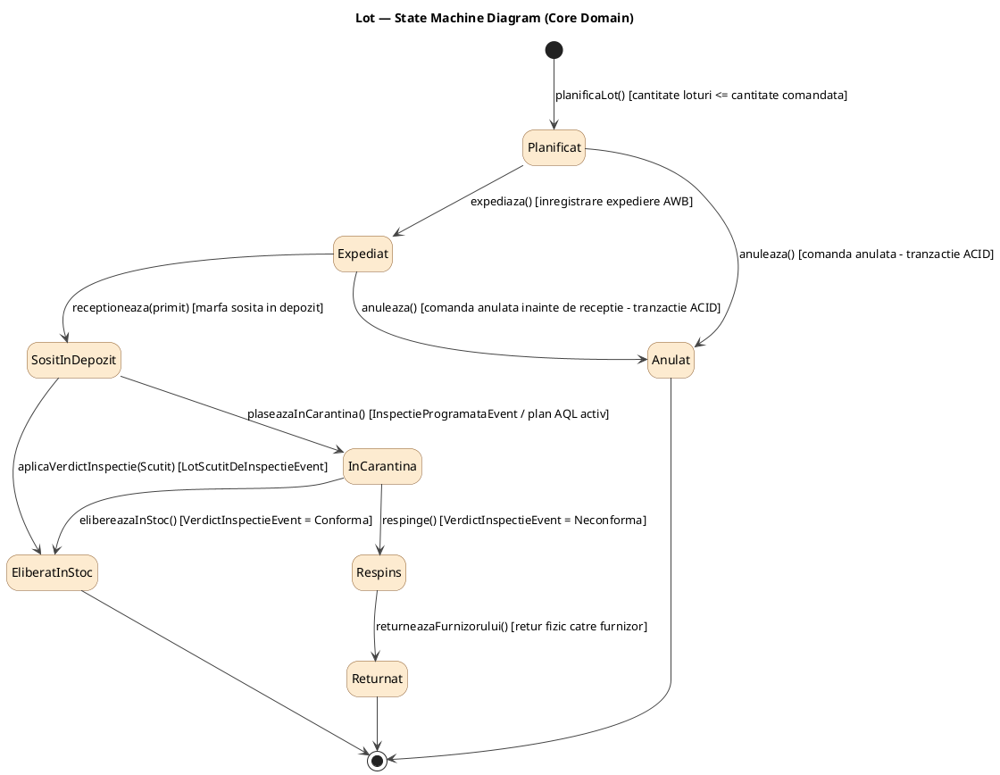
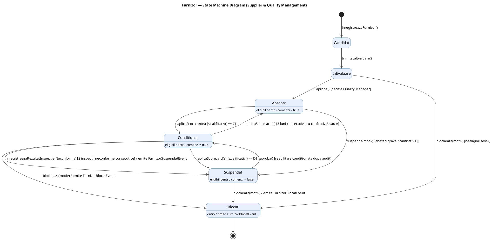
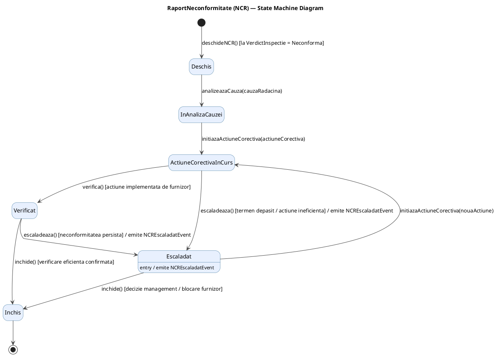
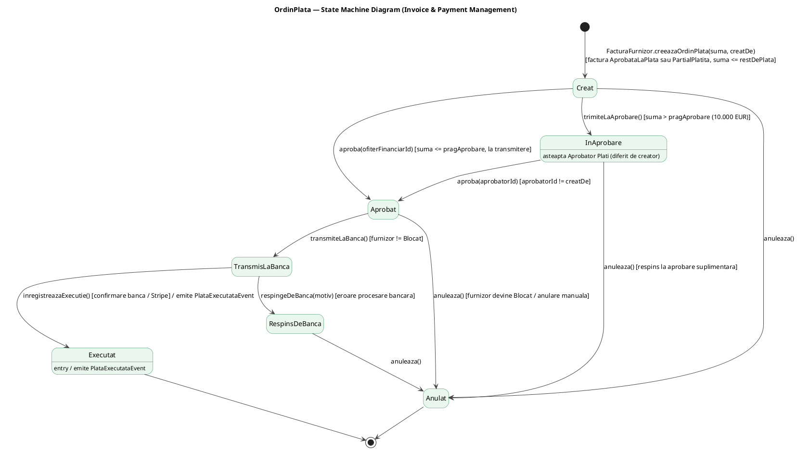
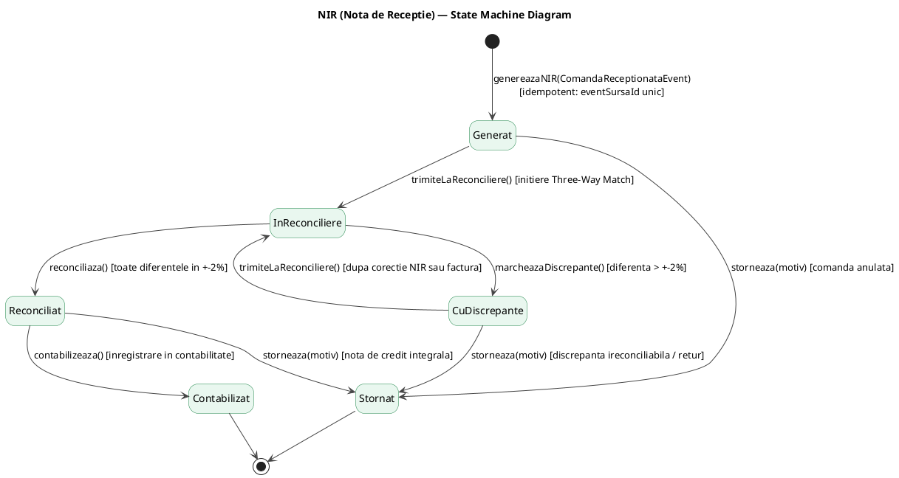
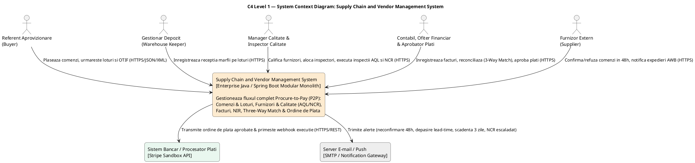
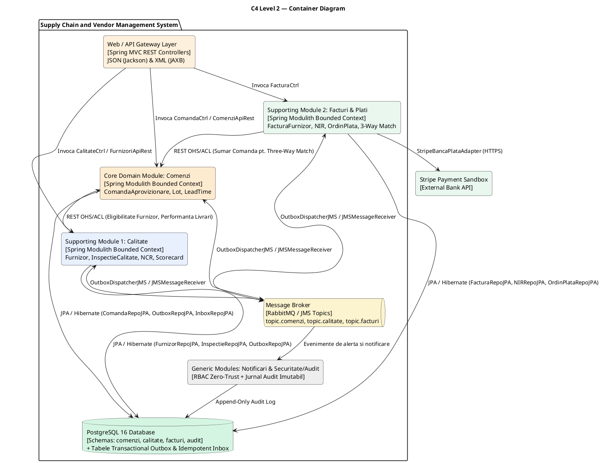

# MASTER BLUEPRINT (PARTEA 2) — COMPLETĂRI CRITICE, ARTEFACTE LIPSĂ ȘI DETALII TEHNICE DE IMPLEMENTARE (SPRINTS 1–4)

Acest document completează **`MASTER_BLUEPRINT_SUPPLY_CHAIN_MSD_OOAD.md`** și acoperă integral toate detaliile care nu erau explicitate în diagramele de clasă finale din `Project_OOAD.docx`, dar care apar în diagramele Use Case, în tabelele de invarianți, în cerințele non-funcționale (SLA) sau în cerințele specifice de laborator de pe portalul MSD (Sprint 1 – Sprint 4).

---

## 1. Maparea Completă a celor 39 de Use Case-uri din Diagramele UML (Figurile 3, 4 și 5) pe Metode Concrete

În `Project_OOAD.docx`, Secțiunea 1.2.4 descrie narativ doar 3 cazuri de utilizare (`CU1 CreeazaComandaAprovizionare`, `CU2 ExecutaInspectieCalitate`, `CU3 ReconcilieazaFactura`), iar diagramele de clasă finale (Figurile 19–21) afișează doar metodele principale. Cu toate acestea, diagramele Use Case (Figurile 3, 4 și 5) definesc **39 de funcționalități** (use cases de bază, relații `<<include>>` și `<<extend>>`).

Pentru o trasabilitate 100% între OOAD și MSD, tabelul de mai jos mapează fiecare bulă Use Case din Figurile 3, 4 și 5 pe metodele exacte din `Controller`, `ApplicationService`, `Domain Service` / `Aggregate Root` și `Query Service (CQRS)`.

### 1.1. Subdomeniul 1: Managementul comenzilor de aprovizionare (`comenzi` — Figura 3, 16 Use Cases)

| Cod UC (Fig. 3) | Nume Use Case în `Project_OOAD.docx` | Tip (`Base` / `Include` / `Extend`) | Actor | Metodă în `ComandaCtrl` / Scheduler | Metodă în `ComandaApplicationService` / Query Service | Metodă în Agregat (`ComandaAprovizionare` / `Lot`) sau Domain Service |
| :--- | :--- | :--- | :--- | :--- | :--- | :--- |
| **UC1** | **Creare Comanda Aprovizionare** | Base (Narativ `CU1`) | Referent Aprovizionare (`Buyer`) | `POST /api/comenzi` $\rightarrow$ `creeazaComanda(req)` | `creeazaComanda(cmd: CreeazaComandaCommand): IdComanda` | Constructor `new ComandaAprovizionare(...)` (stare `Solicitat`) + `trimiteLaFurnizor()` |
| **UC1a** | **Verificare Eligibilitate Furnizor** | `<<include>>` din `UC1` | Secondary: Contextul `calitate` | Apel intern sincron REST | `furnizoriAdapter.esteFurnizorEligibil(cmd.furnizorId())` | Port `IGestiuneFurnizoriAdapter` $\rightarrow$ `FurnizoriApiRest` (`GET /api/furnizori/{id}/eligibil`) |
| **UC2** | **Editare Comanda** | Base | Referent Aprovizionare (`Buyer`) | `PUT /api/comenzi/{id}` $\rightarrow$ `editeazaComanda(id, req)` | `editeazaComanda(cmd: EditeazaComandaCommand): void` | `ComandaAprovizionare.actualizeazaDetalii(dataLivrareCeruta, depozit, linii, observatii)` (permis doar în `Solicitat`) |
| **UC3** | **Stergere Comanda** | Base | Referent Aprovizionare (`Buyer`) | `DELETE /api/comenzi/{id}` $\rightarrow$ `stergeComanda(id)` | `stergeComanda(cmd: StergeComandaCommand): void` | `comandaRepo.delete(comanda)` după validarea că starea este `Solicitat` sau `Refuzat` (fără loturi recepționate) |
| **UC4** | **Anulare Comanda** | Base | Referent Aprovizionare (`Buyer`) | `POST /api/comenzi/{id}/anulare` $\rightarrow$ `anuleazaComanda(id)` | `anuleazaComanda(cmd: AnuleazaComandaCommand): void` | `ComandaAprovizionare.anuleazaComanda(): ComandaAnulataEvent` |
| **UC4a** | **Anulare Loturi Nereceptionate** | `<<include>>` din `UC4` | Sistem (atomic în tranzacție) | Invocat automat în `UC4` | În aceeași tranzacție `@Transactional` a metodei `anuleazaComanda` | `Lot.anuleaza()` (package-private `~`) apelat în buclă pentru loturile cu `lot.esteInainteDeReceptie() == true` (`Planificat`, `Expediat`) |
| **UC5** | **Confirmare / Refuz Comanda** | Base | Furnizor (`Supplier`) | `POST /api/comenzi/{id}/confirmare` $\rightarrow$ `confirmaComanda(id, req)` și `POST /api/comenzi/{id}/refuz` $\rightarrow$ `refuzaComanda(id, req)` | `confirmaComanda(cmd: ConfirmaComandaCommand): void` și `refuzaComanda(cmd: RefuzaComandaCommand): void` | `ComandaAprovizionare.confirma(dataPromisa: LocalDate)` și `ComandaAprovizionare.refuza()` |
| **UC5x** | **Urmarire Furnizor Neconfirmat** | `<<extend>>` la `UC5` `[fara raspuns in 48 h]` | Scheduler (`48h`) + `Buyer` | `ComandaConfirmareTimeoutScheduler.verificaComenziNeconfirmate()` + `POST /api/comenzi/{id}/redirectionare` | `emiteAlertaComenziNeconfirmate(): void` și `redirectioneazaComanda(cmd: RedirectioneazaComandaCommand): IdComanda` | Emite `ComandaNeconfirmataEvent` în `OutboxRepo`; Buyer-ul poate urgenta furnizorul, anula comanda sau recrea comanda la furnizor alternativ |
| **UC6** | **Estimare Data Livrare** | Base + `<<include>>` din `UC1`, `UC5` | Referent Aprovizionare / Sistem | `POST /api/comenzi/{id}/estimare` $\rightarrow$ `estimeazaDataLivrare(id)` | `estimeazaDataLivrare(cmd: EstimeazaDataLivrareCommand): EstimareLivrare` | `ComandaAprovizionare.extrageMetrici()`, `EstimareLeadTimeService.calculeazaDataLivrare(metrici, istoric)`, `ComandaAprovizionare.inregistreazaEstimare(e)` |
| **UC6x** | **Emitere Alerta Depasire Data Ceruta** | `<<extend>>` la `UC6` `[data estimata > data ceruta]` | Sistem $\rightarrow$ Context `notificari` | Declanșat automat în `UC6` | În `creeazaComanda` / `confirmaComanda` / `estimeazaDataLivrare` | Dacă `estimare.depasesteData(dataLivrareCeruta)` este `true`, salvează `EstimareDepasesteCerereaEvent` în `OutboxRepo` |
| **UC6y** | **Reestimare la Intarziere** | `<<extend>>` la `UC6` `[expediere intarziata peste prag]` | Sistem / `Buyer` | `POST /api/comenzi/{id}/reestimare-intarziere` | `reestimeazaLaIntarziere(cmd: ReestimareIntarziereCommand): EstimareLivrare` | Recalculează prin `EstimareLeadTimeService` când întârzierea expedierii depășește pragul configurabil (`pragIntarziereZile`) |
| **UC7** | **Inregistrare Expediere** | Base | Referent Aprovizionare (`Buyer`) / Furnizor | `POST /api/comenzi/{id}/expedieri` $\rightarrow$ `inregistreazaExpediere(id, req)` | `inregistreazaExpediere(cmd: InregistreazaExpediereCommand): void` | `ComandaAprovizionare.planificaLot(...)` + `ComandaAprovizionare.inregistreazaExpediere(transportator, awb, loturi)` + `Lot.expediaza()` (`~`) |
| **UC8** | **Receptie Marfa pe Loturi** | Base | Gestionar Depozit (`Warehouse Keeper`) | `POST /api/comenzi/{id}/receptii` $\rightarrow$ `inregistreazaReceptie(id, req)` | `inregistreazaReceptie(cmd: InregistreazaReceptieCommand): void` | `ComandaAprovizionare.inregistreazaReceptie(lotId, primit): ComandaReceptionataEvent` |
| **UC8a** | **Actualizare Stare Lot** | `<<include>>` din `UC8` | Sistem + Evenimente `calitate` | Invocat în `UC8` + `JMSMessageReceiver.onMessage` | `inregistreazaReceptie(...)`, `plaseazaLotInCarantina(...)`, `aplicaVerdictInspectie(...)` | `Lot.receptioneaza(primit)` (`~`), `Lot.plaseazaInCarantina()` (`~`), `Lot.elibereazaInStoc()` (`~`), `Lot.respinge()` (`~`), `Lot.returneazaFurnizorului()` (`~`) |
| **UC8x** | **Receptie Partiala** | `<<extend>>` la `UC8` `[total primit < total comandat]` | Gestionar Depozit | Ramură automată în `UC8` | În `inregistreazaReceptie(...)` | Dacă `esteAcoperitaIntegral() == false`, starea comenzii devine `StareComanda.ReceptionatPartial` și permite recepții ulterioare |
| **UC9** | **Urmarire Loturi (Trasabilitate)** | Base (Query / CQRS) | `Buyer` / `Warehouse Keeper` | `GET /api/comenzi/loturi/{codLot}/trasabilitate` | `ComandaQueryService.obtineTrasabilitateLot(codLot: String): TrasabilitateLotView` | Folosește `LotRepo` (read-only) pentru a returna arborele `Lot` $\rightarrow$ `ComandaAprovizionare` $\rightarrow$ `IdFurnizor` |
| **UC10** | **Monitorizare Livrari (OTIF)** | Base (Query / CQRS) | Referent Aprovizionare (`Buyer`) | `GET /api/comenzi/rapoarte/otif` | `ComandaQueryService.obtineDashboardLivrari(filtru): DashboardLivrariView` | Calculează rata OTIF, cantitățile comandate/primite/rămase și comparativul datelor (cerută, promisă, estimată, efectivă) |

---

### 1.2. Subdomeniul 2: Gestiunea furnizorilor și a calității (`calitate` — Figura 4, 18 Use Cases)

| Cod UC (Fig. 4) | Nume Use Case în `Project_OOAD.docx` | Tip (`Base` / `Include` / `Extend`) | Actor | Metodă în `CalitateCtrl` / Scheduler / Receiver | Metodă în `CalitateApplicationService` / Query Service | Metodă în Agregat (`Furnizor` / `InspectorCalitate` / `InspectieCalitate` / `RaportNeconformitate`) sau Domain Service |
| :--- | :--- | :--- | :--- | :--- | :--- | :--- |
| **Q1** | **Gestiune Profil Furnizor** | Base | Referent Aprovizionare (`Buyer`) | `POST /api/furnizori`, `PUT /api/furnizori/{id}` | `inregistreazaFurnizor(cmd)`, `actualizeazaProfilFurnizor(cmd)` | Constructor `new Furnizor(...)` (stare `Candidat`) + metode de actualizare date (`Adresa`, `Email`, `Iban`, `ConditiiContractuale`) + audit acces IBAN/prețuri |
| **Q2** | **Decizie Calificare Furnizor** | Base | Manager Calitate (`Quality Manager`) | `POST /api/furnizori/{id}/calificare` | `trimiteFurnizorLaEvaluare(id)`, `aprobaFurnizor(id)`, `suspendaFurnizor(id, motiv)`, `blocheazaFurnizor(id, motiv)` | `Furnizor.trimiteLaEvaluare()`, `Furnizor.aproba()`, `Furnizor.suspenda(motiv)`, `Furnizor.blocheaza(motiv): FurnizorBlocatEvent` |
| **Q3** | **Calcul Calificativ Lunar** | Base | Planificator Lunar (`Timer Actor`) | `CalculCalificativLunarScheduler` + `POST /api/calitate/scorecard/{luna}` | `calculeazaScorecardLunar(cmd: CalculScorecardCommand): void` | Obține `PerformantaLivrariVO` prin `IPerformantaLivrariAdapter`, apelează `CalculScorecardService` și aplică pe `Furnizor.aplicaScorecard(s)` |
| **Q3a** | **Calculare Scor Ponderat** | `<<include>>` din `Q3` | Sistem | Invocat în `Q3` | În `CalculScorecardService.calculeazaScorecard(...)` | `ScorecardLunar.calculeaza(...)` $\rightarrow$ `Scor.ponderat(otif, calitate, pret)` (40% OTIF, 40% calitate, 20% preț) $\rightarrow$ `Scor.calificativ()` (`A`, `B`, `C`, `D`) |
| **Q3b** | **Trecere Furnizor in Conditionat** | `<<extend>>` la `Q3` `[calificativ = C]` | Sistem | Ramură automată în `Q3` | În `Furnizor.aplicaScorecard(s)` | Dacă `s.calificativ() == Calificativ.C`, `this.stareFurnizor = StareFurnizor.Conditionat` |
| **Q3c** | **Revenire Furnizor in Aprobat** | `<<extend>>` la `Q3` `[3 luni consecutive cu calificativ B sau mai bun]` | Sistem | Ramură automată în `Q3` | În `Furnizor.aplicaScorecard(s)` | Dacă `stareFurnizor == Conditionat` și `calculeazaLuniConsecutiveBSauMaiBun() >= 3`, `this.stareFurnizor = StareFurnizor.Aprobat` |
| **Q4** | **Gestiune Inspectori (certificari, disponibilitate)** | Base | Manager Calitate (`Quality Manager`) | `POST /api/inspectori`, `POST /api/inspectori/{id}/certificari`, `POST /api/inspectori/{id}/disponibilitate` | `creeazaInspector(cmd)`, `adaugaCertificareInspector(cmd)`, `declaraDisponibilitateInspector(cmd)` | `InspectorCalitate.adaugaCertificare(c: Certificare)`, `InspectorCalitate.declaraDisponibilitate(p: Perioada)` |
| **Q5** | **Programare Inspectie (plan AQL)** | Base | Sistem Comenzi (`System Actor` prin eveniment) | `JMSMessageReceiver.onMessage(ComandaReceptionataEvent)` | `programeazaInspectie(cmd: ProgrameazaInspectieCommand): void` | Dacă materialul necesită eșantionare AQL, creează `InspectieCalitate` (`Programata`) și emite `InspectieProgramataEvent`; altfel emite `LotScutitDeInspectieEvent` |
| **Q6** | **Alocare Inspector** | Base | Manager Calitate (`Quality Manager`) | `POST /api/inspectii/{id}/alocare` $\rightarrow$ `alocaInspector(id, req)` | `alocaInspector(cmd: AlocaInspectorCommand): void` | `AlocareInspectorService.aloca(inspectie, inspector)` $\rightarrow$ `InspectieCalitate.aloca(inspectorId)` (`InspectorAlocat`) |
| **Q6a** | **Verificare Certificare si Disponibilitate** | `<<include>>` din `Q6` | Sistem | Invocat în `Q6` și la începutul `Q7` | În `AlocareInspectorService.aloca(...)` și `incepeInspectie(...)` | `InspectorCalitate.poateFiAlocat(perioadaPlanificata)` $\rightarrow$ verifică `Certificare.esteValidaPe(p)` și `Perioada.esteInclusaIn(disp)` |
| **Q7** | **Executie Inspectie** | Base (Narativ `CU2`) | Inspector Calitate | `POST /api/inspectii/{id}/start` $\rightarrow$ `incepeInspectie(id)` | `incepeInspectie(cmd: IncepeInspectieCommand): void` | `InspectieCalitate.incepe()` (`InspectorAlocat` / `InReinspectie` $\rightarrow$ `InDesfasurare`) |
| **Q7a** | **Inregistrare Verdict** | `<<include>>` din `Q7` | Inspector Calitate | `POST /api/inspectii/{id}/verdict` $\rightarrow$ `inregistreazaVerdict(id, req)` | `inregistreazaVerdict(cmd: InregistreazaVerdictCommand): void` | `InspectieCalitate.inregistreazaVerdict(defecteGasite): VerdictInspectieEvent` (folosind `PlanAQL.decide(defecteGasite)`) + `InspectieCalitate.inchide()` |
| **Q7b** | **Reinspectie** | `<<extend>>` la `Q7` `[se solicita reinspectie]` | Inspector Calitate / `Quality Manager` | `POST /api/inspectii/{id}/reinspectie` $\rightarrow$ `solicitaReinspectie(id)` | `solicitaReinspectie(cmd: SolicitaReinspectieCommand): void` | `InspectieCalitate.solicitaReinspectie()` (`Neconforma` $\rightarrow$ `InReinspectie`), urmat de `incepe()` |
| **Q7c** | **Deschidere NCR** | `<<extend>>` la `Q7a` `[verdict neconform]` | Sistem | Declanșat automat în `inregistreazaVerdict` | În `CalitateApplicationService.inregistreazaVerdict(...)` | Dacă `verdict == Verdict.Neconforma`, instanțiază `new RaportNeconformitate(...)` în starea `Deschis` și îl salvează prin `NCRRepo.add(ncr)` |
| **Q7d** | **Suspendare Furnizor** | `<<extend>>` la `Q7a` `[a doua inspectie neconforma consecutiva, furnizor conditionat]` | Sistem | Declanșat automat în `inregistreazaVerdict` | În `CalitateApplicationService.inregistreazaVerdict(...)` | `Furnizor.inregistreazaRezultatInspectie(verdict)` incrementează `inspectiiNeconformeConsecutive`; la `2` pentru un furnizor `Conditionat`, apelează `suspenda(motiv)` și emite `FurnizorSuspendatEvent` |
| **Q8** | **Gestiune Neconformitate (NCR)** | Base | Manager Calitate (`Quality Manager`) | `POST /api/ncr/{id}/cauza`, `POST /api/ncr/{id}/actiune`, `POST /api/ncr/{id}/verificare`, `POST /api/ncr/{id}/inchidere` | `analizeazaCauzaNCR(cmd)`, `initiazaActiuneCorectivaNCR(cmd)`, `verificaNCR(cmd)`, `inchideNCR(cmd)` | `RaportNeconformitate.analizeazaCauza(cauza)`, `initiazaActiuneCorectiva(a)`, `verifica()`, `inchide()` |
| **Q8a** | **Escaladare NCR** | `<<extend>>` la `Q8` `[actiune corectiva ineficienta]` | Manager Calitate (`Quality Manager`) | `POST /api/ncr/{id}/escaladare` $\rightarrow$ `escaladeazaNCR(id)` | `escaladeazaNCR(cmd: EscaladeazaNCRCommand): void` | `RaportNeconformitate.escaladeaza(): NCREscaladatEvent` (salvat în `OutboxRepo`) |
| **Q9** | **Monitorizare Furnizori (scorecard, rate, NCR)** | Base (Query / CQRS) | `Buyer` / `Quality Manager` | `GET /api/furnizori/rapoarte/monitorizare` | `CalitateQueryService.obtineMonitorizareFurnizori(filtru): MonitorizareFurnizoriView` | Returnează scorecard-urile lunare, istoricul calificativelor (`A`/`B`/`C`/`D`), ratele de respingere și NCR-urile deschise |

---

### 1.3. Subdomeniul 3: Gestiunea facturilor și plăților (`facturi` — Figura 5, 18 Use Cases)

| Cod UC (Fig. 5) | Nume Use Case în `Project_OOAD.docx` | Tip (`Base` / `Include` / `Extend`) | Actor | Metodă în `FacturaCtrl` / Scheduler / Receiver | Metodă în `FacturaApplicationService` / Query Service | Metodă în Agregat (`FacturaFurnizor` / `NIR` / `OrdinPlata`) sau Domain Service |
| :--- | :--- | :--- | :--- | :--- | :--- | :--- |
| **I1** | **Inregistrare Factura Furnizor** | Base | Contabil (`Accountant`) | `POST /api/facturi` $\rightarrow$ `inregistreazaFactura(req)` | `inregistreazaFactura(cmd: InregistreazaFacturaCommand): UUID` | Constructor `new FacturaFurnizor(...)` (stare `Inregistrata`) + `ValoareFactura.calculeaza(linii)` |
| **I2** | **Generare NIR** | Base | Sistem Comenzi (`System Actor` prin eveniment) | `JMSMessageReceiver.onMessage(ComandaReceptionataEvent)` | `genereazaNIR(cmd: GenereazaNIRCommand): void` | Verifică idempotența `nirRepo.existaNIRPentruEvent(eventId)`, creează `new NIR(...)` în starea `Generat` cu `eventSursaId = eventId` |
| **I3** | **Reconciliere Factura (Three-Way Match)** | Base (Narativ `CU3`) | Contabil (`Accountant`) | `POST /api/facturi/{id}/reconciliere` $\rightarrow$ `reconcilieazaFactura(id)` | `reconcilieazaFactura(cmd: ReconciliereCommand): void` | `FacturaFurnizor.trimiteLaVerificare()`, `NIR.trimiteLaReconciliere()`, `ReconciliereService.reconciliaza(f, nir, comanda, t)`, `FacturaFurnizor.aproba()`, `NIR.reconciliaza()` |
| **I3a** | **Verificare Pret si Cantitate Comandata** | `<<include>>` din `I3` | Secondary: Contextul `comenzi` | Apel sincron REST (înaintea tranzacției DB) | `comenziAdapter.obtineDateComanda(factura.getComandaId())` | Port `IComenziAdapter` $\rightarrow$ `ComenziAdapterRest` (`GET /api/comenzi/{id}/sumar`) $\rightarrow$ traduce `ComandaSummaryDTO` în `ComandaSummaryVO` + compară în `ReconciliereService` |
| **I3b** | **Verificare Cantitate Receptionata (NIR)** | `<<include>>` din `I3` | Sistem | Invocat în `I3` | În `ReconciliereService.reconciliaza(...)` | `NIR.calculeazaCantitateReceptionata(material)` comparată cu `LinieFactura.getCantitate()` folosind `Toleranta.acopera(referinta, valoare)` ($\pm 2\%$) |
| **I3c** | **Blocare Factura (Discrepanta)** | `<<extend>>` la `I3` `[cel putin o abatere in afara tolerantei de +-2%]` | Sistem / Contabil | Ramură automată în `I3` | În `FacturaApplicationService.reconcilieazaFactura(...)` | Dacă `rezultat.isAprobata() == false`, apelează `FacturaFurnizor.blocheaza(motiv)` (`Blocata`) și `NIR.marcheazaDiscrepante()` (`CuDiscrepante`) |
| **I3d** | **Contestare Factura si Cerere Nota de Credit** | `<<extend>>` la `I3` `[discrepanta nerezolvabila]` | Contabil (`Accountant`) | `POST /api/facturi/{id}/contestare` $\rightarrow$ `contestaFactura(id, req)` | `contestaFactura(cmd: ContestaFacturaCommand): void` | `FacturaFurnizor.contesta(motiv)` (`Blocata` $\rightarrow$ `Contestata`); la primirea notei de credit totale sau anularea comenzii $\rightarrow$ `FacturaFurnizor.anuleaza()` |
| **I4** | **Contabilizare NIR** | Base | Contabil (`Accountant`) | `POST /api/nir/{id}/contabilizare` și `POST /api/nir/{id}/stornare` | `contabilizeazaNIR(cmd: ContabilizeazaNIRCommand)` și `storneazaNIR(cmd: StorneazaNIRCommand)` | `NIR.contabilizeaza()` (`Reconciliat` $\rightarrow$ `Contabilizat`) și `NIR.storneaza(motiv)` ($\rightarrow$ `Stornat`) |
| **I5** | **Creare Ordin de Plata** | Base | Ofițer Financiar (`Finance Officer`) | `POST /api/facturi/{id}/ordine-plata` $\rightarrow$ `creeazaOrdinPlata(id, req)` | `creeazaOrdinPlata(cmd: CreeazaOrdinPlataCommand): UUID` | `FacturaFurnizor.creeazaOrdinPlata(suma, creatDe): OrdinPlata`; dacă `ordin.necesitaAprobareSuplimentara(prag)` este `true`, apelează `ordin.trimiteLaAprobare()` (`InAprobare`), altfel rămâne `Creat` |
| **I5a** | **Verificare Eligibilitate Factura pentru Plata** | `<<include>>` din `I5` | Sistem | Invocat în `I5` | În `FacturaFurnizor.creeazaOrdinPlata(...)` | Verifică `FacturaFurnizor.esteAprobataLaPlata()` (`AprobataLaPlata` sau `PartialPlatita`) și `!suma.esteMaiMareDecat(calculeazaRestDePlata())` |
| **I5b** | **Aprobare Suplimentara Ordin** | Base (separat de `I5` pentru sume $>$ prag) | Aprobator Plăți (`Second Approver` $\neq$ creator) | `POST /api/ordine-plata/{id}/aprobare` $\rightarrow$ `aprobaOrdin(id)` | `aprobaOrdin(cmd: AprobaOrdinCommand): void` | `OrdinPlata.aproba(aprobator: UUID)`: verifică starea `InAprobare` și regula *Four-Eyes Principle* (`!aprobator.equals(creatDe)`), trecând ordinul în `Aprobat` |
| **I6** | **Transmitere Ordin la Banca** | Base | Ofițer Financiar (`Finance Officer`) + Secondary: `Banca` | `POST /api/ordine-plata/{id}/transmitere` $\rightarrow$ `transmiteOrdin(id)` | `transmiteOrdin(cmd: TransmiteOrdinCommand): void` | Dacă ordinul este `Creat` ($\le$ prag), îl autorizează (`aproba(ofiterId)`); apoi apelează `OrdinPlata.transmiteLaBanca()` (`TransmisLaBanca`) și trimite prin `IBancaPlataProvider` (Stripe Adapter) |
| **I6a** | **Verificare Furnizor Neblocat** | `<<include>>` din `I6` | Sistem | Invocat în `I6` | În `FacturaApplicationService.transmiteOrdin(...)` | Verifică `furnizoriBlocatiRepo.esteBlocat(factura.getFurnizorId()) == false`; dacă furnizorul este `Blocat`, respinge transmiterea la bancă |
| **I7** | **Inregistrare Rezultat Procesare Ordin** | Base | Bancă (`External System` / Stripe Webhook) | `POST /api/plati/webhook-banca` $\rightarrow$ `inregistreazaRezultatBanca(req)` | `inregistreazaExecutiePlata(cmd)` / `inregistreazaRespingereBanca(cmd)` | `OrdinPlata.inregistreazaExecutie(): PlataExecutataEvent` (`Executat`) + `FacturaFurnizor.inregistreazaPlata(suma)` |
| **I7a** | **Tratare Respingere Banca** | `<<extend>>` la `I7` `[ordin respins de banca]` | Bancă / Ofițer Financiar | Ramură în `I7` (`POST /api/ordine-plata/{id}/respingere-banca`) | `inregistreazaRespingereBanca(cmd: RespingereBancaCommand): void` | `OrdinPlata.respingeDeBanca(motiv)` (`TransmisLaBanca` $\rightarrow$ `RespinsDeBanca`); soldul facturii rămâne nemodificat |
| **I7b** | **Inregistrare Plata Partiala** | `<<extend>>` la `I7` `[ordin executat si 0 < total achitat cumulat < total factura]` | Sistem | Ramură automată în `I7` | În `FacturaFurnizor.inregistreazaPlata(suma)` | Adună `suma` la `sumaPlatita`; dacă `calculeazaRestDePlata() > 0`, starea facturii devine `PartialPlatita`, altfel devine `Platita` |
| **I8** | **Verificare Scadente** | Base | Ofițer Financiar / Scheduler zilnic | `VerificareScadenteFacturiScheduler` + `GET /api/facturi/scadente` | `verificaScadenteFacturi(): void` + `FacturaQueryService.obtineScadentar(): List<ScadentarFacturiView>` | Identifică facturile în `AprobataLaPlata` sau `PartialPlatita` neachitate integral |
| **I8a** | **Emitere Notificare Scadenta** | `<<extend>>` la `I8` `[factura aprobata si neplatita, 3 zile pana la scadenta]` | Sistem $\rightarrow$ Context `notificari` | Declanșat automat în `I8` | În `verificaScadenteFacturi()` | Pentru facturile cu `dataScadenta.equals(LocalDate.now().plusDays(3))`, creează și salvează `ScadentaApropiataEvent` în `OutboxRepo` |

---

## 2. Specificațiile Complete pentru `EntityView Computations` (CQRS Read Models — Cerința Sprint 2)

În `sprint2_cerinte_portal.md` se cere implementarea **`Entity View Computations` (dashboard views, report views, summary views, aggregate views)**, iar `Project_OOAD.docx` (Capitolul 2) specifică utilizarea **CQRS Light** (modele de interogare dedicate pentru dashboard-uri și rapoarte). Aceste clase se plasează în pachetul `application.query` al fiecărui Bounded Context și sunt populate prin servicii de calcul/interogare dedicate:

### 2.1. În Contextul `comenzi` (`ComandaQueryService` & `ComandaComputationService`)
1. **`DashboardLivrariView` (pentru `UC10 Monitorizare Livrari (OTIF)`):**
   ```java
   public record DashboardLivrariView(
       UUID comandaId,
       String numarComanda,
       UUID furnizorId,
       StareComanda stareComanda,
       LocalDate dataComanda,
       LocalDate dataLivrareCeruta,
       LocalDate dataLivrarePromisa,
       LocalDate dataLivrareEstimata,
       LocalDate dataReceptieEfectiva,
       BigDecimal totalCantitateComandata,
       BigDecimal totalCantitateReceptionata,
       BigDecimal totalCantitateRamasa,
       int zileIntarziere,
       boolean livrataLaTimpSiIntegral // OTIF per comandă
   ) {}
   ```
2. **`IndicatoriOTIFFurnizorView` (Aggregate View pentru raportare și `PerformantaLivrariDTO`):**
   ```java
   public record IndicatoriOTIFFurnizorView(
       UUID furnizorId,
       Perioada perioada,
       int totalComenziInchise,
       int comenziOTIF,
       BigDecimal rataOTIFProcent,          // (comenziOTIF / totalComenziInchise) * 100
       BigDecimal conformitatePretProcent,  // % linii fără depășiri de preț contractual
       BigDecimal leadTimeMediuZile
   ) {}
   ```
3. **`TrasabilitateLotView` (pentru `UC9 Urmarire Loturi`):**
   ```java
   public record TrasabilitateLotView(
       UUID idLot,
       String codLot,
       String codMaterial,
       BigDecimal cantitateLot,
       BigDecimal cantitatePrimita,
       LocalDate dataProductie,
       LocalDate dataExpirare,
       StareLot stareLot,
       UUID comandaId,
       String numarComanda,
       UUID furnizorId,
       String depozitDestinatie,
       String transportatorAWB
   ) {}
   ```

### 2.2. În Contextul `calitate` (`CalitateQueryService` & `ScorecardComputationService`)
4. **`MonitorizareFurnizoriView` (pentru `Q9 Monitorizare Furnizori`):**
   ```java
   public record MonitorizareFurnizoriView(
       UUID idFurnizor,
       String codFiscal,
       String denumire,
       StareFurnizor stareCurenta,
       BigDecimal ultimulScorLunar,
       Calificativ ultimulCalificativ,
       int luniConsecutiveBSauMaiBun,
       BigDecimal rataRespingereCumulata,
       int numarNCRDeschise,
       int numarNCREscaladate,
       List<IstoricCalificativItemView> istoricCalificative
   ) {}
   ```

### 2.3. În Contextul `facturi` (`FacturaQueryService` & `FinanciarComputationService`)
5. **`ScadentarFacturiView` (pentru `I8 Verificare Scadente`):**
   ```java
   public record ScadentarFacturiView(
       UUID idFactura,
       String serieNumar,
       UUID furnizorId,
       UUID comandaId,
       LocalDate dataEmitere,
       LocalDate dataScadenta,
       long zilePanaLaScadenta,
       BigDecimal valoareTotala,
       BigDecimal sumaPlatita,
       BigDecimal restDePlata,
       StareFactura stareFactura,
       boolean furnizorBlocat,
       boolean alertaScadentaActiva // true dacă zilePanaLaScadenta <= 3 și restDePlata > 0
   ) {}
   ```

---

## 3. Catalogul Complet de Reguli de Business Numerotate (`BR-PO`, `BR-SQ`, `BR-IP`)

Conform cerințelor din `context.md`, `sprint1_cerinte_portal.md` și `sprint2_cerinte_portal.md`, toate regulile din `Project_OOAD.docx` sunt centralizate mai jos și clasificate în: **Validation Rules**, **Computation Rules** și **Workflow / Invariant Rules**.

### 3.1. Procurement Order Rules (`BR-PO-01` .. `BR-PO-08`)
* **`BR-PO-01` (Validation & Cross-Context Rule — Eligibilitate Furnizor):** O comandă de aprovizionare (`ComandaAprovizionare`) poate fi plasată **exclusiv** către un furnizor a cărui stare în subdomeniul `calitate` este `Aprobat` sau `Conditionat` (verificat sincron prin `IGestiuneFurnizoriAdapter.esteFurnizorEligibil(IdFurnizor)`). Orice încercare pentru `Candidat`, `InEvaluare`, `Suspendat` sau `Blocat` este respinsă.
* **`BR-PO-02` (Validation Rule — Integritate Date Comandă și Linii):** La crearea comenzii, `numarComanda` trebuie să fie unic (`ComandaRepo.existaNumarComanda`), `dataLivrareCeruta >= dataComanda`, comanda trebuie să conțină cel puțin o `LinieComanda`, iar pentru fiecare linie `cantitate.valoare > 0` și `pretUnitar.valoare > 0`.
* **`BR-PO-03` (Workflow & Invariant Rule — Gardă Ciclu de Viață Comandă):** Operațiile pe loturi (planificare, expediere, recepție) sunt permise doar dacă `stareComanda` este în stările permise (`Confirmat`, `InTranzit`, `ReceptionatPartial`), verificate prin `ComandaAprovizionare.validaStarePermiteOperatia(...)`.
* **`BR-PO-04` (Validation & Invariant Rule — Plafon Cantitate Loturi):** Suma cantităților loturilor planificate pentru un anumit `CodMaterial` nu poate depăși niciodată cantitatea comandată pe `LinieComanda` aferentă (`validaCantitateLot(material, cantitate)`).
* **`BR-PO-05` (Computation & Invariant Rule — Derivarea Stării Comenzii din Recepții):** Cantitatea primită pe un material (`calculeazaCantitatePrimita(material)`) și cantitatea rămasă (`calculeazaCantitateRamasa(material)`) sunt **calculate dinamic** ca sumă a `lot.cantitatePrimita`, niciodată stocate redundant. Dacă după o recepție `esteAcoperitaIntegral()` este `false`, comanda devine `ReceptionatPartial`; când toate liniile sunt acoperite integral, comanda devine `Receptionat`.
* **`BR-PO-06` (Transactional Invariant Rule — Anulare Atomică în Cascadă):** O comandă poate fi anulată (`anuleazaComanda()`) din stările `Solicitat`, `Confirmat`, `InTranzit` sau `ReceptionatPartial` (niciodată din `Receptionat`, `Refuzat` sau `Anulat`). Trecerea comenzii în `Anulat` mută **atomic, în aceeași tranzacție ACID**, toate loturile nerecepționate (`Planificat`, `Expediat`) în starea `Anulat`, lăsând neschimbate loturile deja sosite (`SositInDepozit`, `InCarantina`, `EliberatInStoc`).
* **`BR-PO-07` (Workflow Rule — Termen Confirmare 48h):** Furnizorul are la dispoziție 48 de ore pentru a confirma (cu `dataLivrarePromisa`) sau refuza comanda. Dacă după 48h comanda este tot în starea `Solicitat`, sistemul emite `ComandaNeconfirmataEvent` pentru alertarea Buyer-ului.
* **`BR-PO-08` (Computation Rule — Estimare Lead Time și Alertă Depășire):** La creare, la confirmare și la întârzierea expedierii peste pragul configurat, `EstimareLeadTimeService` calculează `EstimareLivrare` (folosind strategia activă: Moving Average, Exponential Smoothing sau P90) în $< 300\text{ ms}$. Dacă `estimare.depasesteData(dataLivrareCeruta)`, se emite `EstimareDepasesteCerereaEvent`.

### 3.2. Supplier & Quality Rules (`BR-SQ-01` .. `BR-SQ-10`)
* **`BR-SQ-01` (Validation Rule — Date Profil Furnizor):** Un `Furnizor` trebuie să aibă `codFiscal` valid și unic, `denumire` nevidă, un `Iban` validat sintactic (`Iban.esteValid(v)`), cel puțin un `Email` valid (`Email.isValidEmail(e)`) și `ConditiiContractuale` cu `termenPlataZile > 0`.
* **`BR-SQ-02` (Computation Rule — Formula Scorecard Lunar 40/40/20):** La finalul fiecărei luni, pentru fiecare furnizor activ se calculează un singur `ScorecardLunar` (`validaScorecardUnicPeLuna(luna)`). Scorul (0–100) se calculează în `Scor.ponderat(otif, calitate, pret)` după formula:
  $$\text{Scor} = 0.40 \times \text{OTIF} + 0.40 \times (100 - \text{RataRespingere}) + 0.20 \times \text{ConformitatePreț}$$
* **`BR-SQ-03` (Computation Rule — Maparea Scorului în Calificativ):** În `Scor.calificativ()`, scorul se mapează astfel: $\ge 90 \rightarrow \text{A}$, $80\text{–}89.9 \rightarrow \text{B}$, $60\text{–}79.9 \rightarrow \text{C}$, $< 60 \rightarrow \text{D}$.
* **`BR-SQ-04` (Workflow Rule — Degradare în Condiționat și Reabilitare după 3 Luni):** Un furnizor `Aprobat` care obține calificativul `C` trece automat în starea `Conditionat`. Un furnizor `Conditionat` revine în starea `Aprobat` **doar dacă** înregistrează **3 luni consecutive** cu calificativul `B` sau `A` (`calculeazaLuniConsecutiveBSauMaiBun() >= 3`). Orice lună cu calificativ `C` sau `D` resetează seria.
* **`BR-SQ-05` (Validation & Invariant Rule — Invariantul ISO 2859-1 pentru PlanAQL):** Obiectul valoare `PlanAQL` garantează în constructor că `dimensiuneEsantion > 0`, `numarAcceptare >= 0` și **obligatoriu** `numarRespingere == numarAcceptare + 1`. Metoda `decide(defecteGasite)` returnează `Verdict.Conforma` dacă `defecteGasite <= numarAcceptare` și `Verdict.Neconforma` dacă `defecteGasite >= numarRespingere`.
* **`BR-SQ-06` (Workflow Rule — Carantinare Automată la Recepție):** La recepția unui lot (`ComandaReceptionataEvent`), dacă materialul are un plan de eșantionare AQL activ, se programează automat o `InspectieCalitate` în starea `Programata` și se emite `InspectieProgramataEvent`, care plasează lotul `InCarantina` până la pronunțarea verdictului.
* **`BR-SQ-07` (Validation & Invariant Rule — Alocare și Execuție Inspector Certificat și Disponibil):** Un `InspectorCalitate` poate fi alocat unei inspecții (`AlocareInspectorService.aloca`) și poate începe inspecția (`incepe()`) **doar dacă** deține o `Certificare` neexpirată pe întreaga `Perioada` a inspecției (`Certificare.esteValidaPe(p)`) și are o perioadă de disponibilitate declarată care include perioada inspecției (`Perioada.esteInclusaIn`).
* **`BR-SQ-08` (Validation Rule — Dimensiune Minimă Eșantion Inspectat):** La înregistrarea verdictului, mărimea eșantionului inspectat de către inspector nu poate fi mai mică decât `PlanAQL.dimensiuneEsantion`.
* **`BR-SQ-09` (Workflow Rule — Deschidere Automată NCR și Respingere Lot):** Orice verdict `Neconforma` determină: (a) deschiderea automată a unui `RaportNeconformitate` (NCR) în starea `Deschis`, și (b) emiterea `VerdictInspectieEvent(Neconforma)` care trece lotul în starea `Respins` în contextul `comenzi`.
* **`BR-SQ-10` (Workflow & Invariant Rule — Suspendarea la 2 Inspecții Neconforme Consecutive):** Agregatul `Furnizor` menține contorul `inspectiiNeconformeConsecutive` (resetat la `0` la fiecare verdict `Conforma`). Dacă un furnizor aflat în starea `Conditionat` înregistrează **2 inspecții neconforme consecutive**, acesta trece automat în starea `Suspendat` și se emite `FurnizorSuspendatEvent`.

### 3.3. Invoice & Payment Rules (`BR-IP-01` .. `BR-IP-09`)
* **`BR-IP-01` (Idempotency & Invariant Rule — Unicitatea NIR per Eveniment de Recepție):** Fiecare `ComandaReceptionataEvent` generează exact un `NIR` în starea `Generat`. Cmpul `NIR.eventSursaId` are constrângere `UNIQUE` în baza de date și este verificat prin `NIRRepo.existaNIRPentruEvent(eventId)`: relivrarea aceluiași eveniment este ignorată fără efecte secundare.
* **`BR-IP-02` (Computation Rule — Calculul Valorii Facturii și al Toleranței de $\pm 2\%$):** `ValoareFactura.calculeaza(linii)` determină `valoareFaraTVA`, `valoareTVA` și `valoareTotala`. În `ReconciliereService`, `Toleranta.acopera(referinta, valoare)` verifică dacă abaterea relativă a prețului unitar (față de comandă) și a cantității facturate (față de comandă și față de `NIR`) se încadrează în pragul configurat de $\pm 2\%$ ($0.02$):
  $$\frac{|\text{Valoare} - \text{Referință}|}{\text{Referință}} \le 0.02$$
* **`BR-IP-03` (Workflow Rule — Rezultatul Reconcilierii în 3 Căi):** Dacă toate diferențele sunt în limita a $\pm 2\%$, `FacturaFurnizor` devine `AprobataLaPlata` și `NIR` devine `Reconciliat`. Dacă cel puțin o diferență depășește $\pm 2\%$, `FacturaFurnizor` devine `Blocata` și `NIR` devine `CuDiscrepante`.
* **`BR-IP-04` (Financial Control Invariant Rule — Interdicția Plății fără Reconciliere):** Constructorul clasei `OrdinPlata` este **package-private (`~`)**; un ordin de plată poate fi instanțiat **exclusiv** prin metoda `FacturaFurnizor.creeazaOrdinPlata(suma, creatDe)`, care aruncă `IllegalStateException` dacă `esteAprobataLaPlata()` este `false` (adică factura nu este în `AprobataLaPlata` sau `PartialPlatita`).
* **`BR-IP-05` (Validation & Invariant Rule — Plafonul Soldului Rămas de Plată):** Suma unui `OrdinPlata` nu poate depăși niciodată soldul rămas de achitat al facturii (`calculeazaRestDePlata() = valoareTotala - sumaPlatita`).
* **`BR-IP-06` (Workflow & Security Rule — Pragul de Aprobare de 10.000 EUR și Principiul celor 4 Ochi):** Ordinele de plată cu `suma <= 10000 EUR` se creează în starea `Creat` și pot fi autorizate direct de către Ofițerul Financiar la transmitere. Ordinele cu `suma > 10000 EUR` (`necesitaAprobareSuplimentara(prag) == true`) intră în starea `InAprobare` și necesită aprobarea unei a doua persoane autorizate (`Second Approver`), diferită de creator (`aproba(aprobator)` verifică `!aprobator.equals(creatDe)`), înainte de a putea fi transmise la bancă.
* **`BR-IP-07` (Computation & Workflow Rule — Plăți în Tranșe / Rate):** La execuția bancară a unui ordin (`OrdinPlata.inregistreazaExecutie()`), metoda `FacturaFurnizor.inregistreazaPlata(suma)` cumulează suma plătită. Cât timp $0 < \text{sumaPlatita} < \text{valoareTotala}$, factura este în starea `PartialPlatita`; când $\text{sumaPlatita} == \text{valoareTotala}$, factura devine `Platita`.
* **`BR-IP-08` (Cross-Context Workflow Rule — Blocarea Plăților pentru Furnizor Blocat sau Comandă Anulată):** La recepția `FurnizorBlocatEvent`, furnizorul este înregistrat în `FurnizoriBlocatiRepo`, iar orice apel `transmiteOrdin()` pentru facturile acelui furnizor este respins. La recepția `ComandaAnulataEvent`, facturile neplătite aferente comenzii anulate sunt blocate/anulate.
* **`BR-IP-09` (Workflow & Security Rule — Alertă Scadență 3 Zile și Audit Imutabil GDPR):** Cu 3 zile înainte de `dataScadenta` a unei facturi aprobate dar neplătite integral, se emite `ScadentaApropiataEvent`. Orice acces sau modificare asupra `Iban`, prețurilor negociate din `ConditiiContractuale`, deciziilor de reconciliere și ordinelor de plată se înregistrează sincron în `IJurnalAudit`.

---

## 4. Cele 5 Diagrame de Stare (State Machine) Lipsă din Tabelul 1.1 (PlantUML)

În `Project_OOAD.docx`, Secțiunea 6.1 include diagramele State Machine pentru `ComandaAprovizionare` (Fig. 22), `InspectieCalitate` (Fig. 23) și `FacturaFurnizor` (Fig. 24). Mai jos sunt diagramele PlantUML exacte pentru celelalte **5 obiecte din Tabelul 1.1**, obligatorii pentru implementarea completă a metodelor de tranziție în Sprint 2.

### 4.1. Diagrama de Stare pentru `Lot` (Core Domain — `comenzi`)


### 4.2. Diagrama de Stare pentru `Furnizor` (Supporting 1 — `calitate`)


### 4.3. Diagrama de Stare pentru `RaportNeconformitate` / NCR (Supporting 1 — `calitate`)


### 4.4. Diagrama de Stare pentru `OrdinPlata` (Supporting 2 — `facturi`)


### 4.5. Diagrama de Stare pentru `NIR` (Supporting 2 — `facturi`)


---

## 5. Rezolvarea Conflictului Arhitectural: *Pure Domain (ArchUnit)* vs. *Cerințele JPA/Validation din Sprint 2 & 3 (ADR-011)*

### 5.1. Problema Identificată
* În **`sprint2_cerinte_portal.md`** și **`sprint3.md`**, profesorul cere explicit ca clasele de entități din `domain` (`ComandaAprovizionare`, `Lot`, `Furnizor` etc.) să fie adnotate cu:
  * Java Bean Validation: `@NotNull`, `@NotBlank`, `@Size`, `@Min`, `@Max` (Sprint 2);
  * JPA Persistence: `@Entity`, `@OneToMany(mappedBy = ..., cascade = CascadeType.ALL, orphanRemoval = true)`, `@Enumerated`, `@Convert`, `@EntityListeners`, `@PrePersist`, `@PreUpdate`, `@PreRemove` (Sprint 3).
* În **`ANTIGRAVITY_AI_DEVELOPMENT_CONFIGURATION.md`** (Rule 3) și **`context_complet.md`**, regula de izolare spune: `Domain never depends on Spring / JPA`.

### 5.2. Soluția Oficială pentru Proiect (`ADR-011: Pragmatic DDD Persistence & Validation Annotations`)
Pentru a obține punctajul maxim atât la verificarea de laborator (Sprint 2 & 3), cât și la validarea automată `ArchUnit`, aplicăm **Pragmatic DDD cu Izolare Strictă de Framework**:
1. **Permis în `domain`:** Pachetele pur declarative de specificație standard Java EE / Jakarta EE:
   * `jakarta.persistence.*` (doar adnotările de mapare `@Entity`, `@Table`, `@Id`, `@EmbeddedId`, `@Embedded`, `@Embeddable`, `@OneToMany`, `@ManyToOne`, `@ElementCollection`, `@Enumerated`, `@Convert`, `@AttributeConverter`, `@EntityListeners`, `@PrePersist`, `@PreUpdate`, `@PreRemove`);
   * `jakarta.validation.*` (`@NotNull`, `@NotBlank`, `@Min`, `@Max`, `@Positive`, `@Valid`).
2. **Strict Interzis în `domain` (Blocat prin `DomainIsolationTest` în ArchUnit):**
   * Orice import din `org.springframework.*` (fără `@Service`, `@Component`, `@Autowired`, `@Transactional` în `domain`! Bean-urile de `DomainService` precum `EstimareLeadTimeService` sau `ReconciliereService` sunt înregistrate în clasele `@Configuration` din `infrastructure`);
   * Orice import din implementări concrete de ORM (`org.hibernate.*`), serializare web (`com.fasterxml.jackson.*`, `jakarta.xml.bind.*`), mesagerie (`jakarta.jms.*`, `org.springframework.amqp.*`) sau plăți (`com.stripe.*`).

### 5.3. Codul Exact pentru `DomainIsolationTest.java` (ArchUnit)
```java
package ro.uaic.feaa.sdbis.supplychain.architecture;

import com.tngtech.archunit.core.importer.ImportOption;
import com.tngtech.archunit.junit.AnalyzeClasses;
import com.tngtech.archunit.junit.ArchTest;
import com.tngtech.archunit.lang.ArchRule;

import static com.tngtech.archunit.lang.syntax.ArchRuleDefinition.noClasses;

@AnalyzeClasses(
    packages = "ro.uaic.feaa.sdbis.supplychain",
    importOptions = ImportOption.DoNotIncludeTests.class
)
public class DomainIsolationTest {

    @ArchTest
    static final ArchRule domain_must_not_depend_on_spring_or_infrastructure_frameworks =
        noClasses()
            .that().resideInAPackage("..domain..")
            .should().dependOnClassesThat()
            .resideInAnyPackage(
                "org.springframework..",
                "org.hibernate..",
                "com.fasterxml.jackson..",
                "jakarta.xml.bind..",
                "jakarta.jms..",
                "com.stripe..",
                "..infrastructure..",
                "..presentation..",
                "..application.."
            )
            .because("Domain Layer must remain agnostic of Spring, Hibernate internals, REST/JSON/XML, JMS, Stripe, and outer layers (ADR-011).");
}
```

---

## 6. Detalierea Tehnică pentru Sprint 3: Cele 3 Strategii de Repository, `persistence.xml`, `@Convert` și `@EntityListeners`

Pentru a bifa **toate** cerințele obligatorii și bonus din `sprint3.md` / `sprint3_detalii.md` și a păstra 100% diagrama din **Figura 10 (`Repository Class Hierarchy`)** din `Project_OOAD.docx`, stratul de persistență se implementează astfel:

### 6.1. Configurarea Contextului de Persistență (`persistence.xml` & Excluderea Auto-Configurării)
Conform constrângerii din `sprint3.md` Secțiunea 5:
1. Clasa principală Spring Boot dezactivează autoconfigurarea implicită atunci când rulează pe profilul de laborator JPA sau configurează explicit `EntityManagerFactory`:
   ```java
   @SpringBootApplication(exclude = {DataSourceAutoConfiguration.class})
   @EnableScheduling
   public class SupplyChainApplication {
       public static void main(String[] args) {
           SpringApplication.run(SupplyChainApplication.class, args);
       }
   }
   ```
2. În `src/main/resources/META-INF/persistence.xml` se definește unitatea de persistență `SupplyChainPU`, injectată în `AbstractRepositoryJPA` prin `@PersistenceContext(unitName = "SupplyChainPU")`.

### 6.2. Cele 3 Strategii de Repository (Mandatory + Bonus în Sprint 3)
În `Project_OOAD.docx` (Figura 10), toate repository-urile concrete moștenesc `AbstractRepositoryJPA`. Îmbinăm această diagramă cu cele 3 strategii din `sprint3.md`:
* **Strategia 1 (Inheritance-Based Repository — `EntityRepositoryBase<T, ID>` / `AbstractRepositoryJPA<T, ID>`):**
  ```java
  public abstract class AbstractRepositoryJPA<T, ID> {
      @PersistenceContext
      protected EntityManager em;

      private final Class<T> entityClass;

      protected AbstractRepositoryJPA(Class<T> entityClass) {
          this.entityClass = entityClass;
      }

      public void add(T entity) { em.persist(entity); }
      public T save(T entity) { return em.merge(entity); }
      public void delete(T entity) { em.remove(em.contains(entity) ? entity : em.merge(entity)); }
      public Optional<T> findById(ID id) { return Optional.ofNullable(em.find(entityClass, id)); }
      public List<T> findAll() {
          return em.createQuery("SELECT e FROM " + entityClass.getSimpleName() + " e", entityClass)
                   .getResultList();
      }
  }
  ```
* **Strategia 2 (Plain JPA Repository cu `EntityManager` — Bonus Deliverable în `sprint3.md`):**
  * Clasele `ComandaRepoJPA`, `LotRepoJPA`, `IstoricLivrariRepoJPA`, `FurnizorRepoJPA`, `InspectorRepoJPA`, `InspectieRepoJPA`, `NCRRepoJPA`, `FacturaRepoJPA`, `NIRRepoJPA`, `OrdinPlataRepoJPA`, `FurnizoriBlocatiRepoJPA`, `OutboxRepoJPA` și `InboxRepoJPA` extind `AbstractRepositoryJPA` și implementează interfețele din `domain` (`ComandaRepo`, `FurnizorRepo` etc.) folosind interogări JPQL explicite pe `em`.
* **Strategia 3 (Spring Data JPA `JpaRepository` cu `@Query`):**
  * În pachetul `infrastructure.persistence.springdata` definim și interfețele `SpringDataComandaRepository extends JpaRepository<ComandaAprovizionare, IdComanda>` cu metode derivate (`findByStareComanda(...)`) și interogări `@Query` custom pentru filtre complexe (bifând astfel și punctul 3 din `sprint3.md`).

### 6.3. Persistența Value Objects (`@Embeddable`, `@Enumerated` și `@Convert`)
Conform `sprint3.md` Secțiunea 1:
* **Enum-uri (`@Enumerated(EnumType.STRING)`):** `StareComanda`, `StareLot`, `RezultatCalitateLot`, `StareFurnizor`, `StareInspectie`, `StareNCR`, `Calificativ`, `Verdict`, `StareFactura`, `StareNIR`, `StareOrdinPlata`.
* **Convertoare JPA (`@Converter(autoApply = true)` + `@Convert`):**
  1. `IdComandaConverter implements AttributeConverter<IdComanda, UUID>`
  2. `IdFurnizorConverter implements AttributeConverter<IdFurnizor, UUID>`
  3. `IdLotConverter implements AttributeConverter<IdLot, UUID>`
  4. `CodMaterialConverter implements AttributeConverter<CodMaterial, String>`
  5. `IbanConverter implements AttributeConverter<Iban, String>`
  6. `EmailConverter implements AttributeConverter<Email, String>`
  7. `CurrencyConverter implements AttributeConverter<Currency, String>`
* **Value Objects Compuse (`@Embeddable` / `@Embedded` / `@ElementCollection`):** `Perioada`, `Cantitate`, `PretUnitar`, `LinieComanda`, `Expediere`, `EstimareLivrare`, `Scor`, `PlanAQL`, `Certificare`, `ActiuneCorectiva`, `ConditiiContractuale`, `Adresa`, `FullName`, `Suma`, `ValoareFactura`, `LinieFactura`, `LinieNIR`, `Toleranta`.

### 6.4. Entity Lifecycle Listeners (`@EntityListeners`, `@PrePersist`, `@PreUpdate`, `@PreRemove`)
Conform `sprint3.md` Secțiunea 7, atașăm pe toate Aggregate Roots (`@EntityListeners(AggregateAuditAndComputationListener.class)`):
* **`@PrePersist`:** setează automat `createdAt = Instant.now()`, inițializează versiunea de optimistic locking și verifică invarianții de creare; pe `FacturaFurnizor` recalculează automat `ValoareFactura.calculeaza(linii)`.
* **`@PreUpdate`:** actualizează `updatedAt = Instant.now()`, recalculează câmpurile derivate și notifică jurnalul de audit la schimbarea stării.
* **`@PreRemove`:** blochează ștergerea fizică a comenzilor care nu sunt în `Solicitat`/`Refuzat` sau a facturilor reconciliate/plătite, înregistrând tentativa în audit.

---

## 7. Detalierea Tehnică pentru Sprint 4: SOA, Content Negotiation (JSON + XML / JAXB), WebConfig și Testare Dublă

Pentru a respecta 100% atât `sprint4_cerinte.md`, cât și `sprint4_constrangeri.md` și `sprint4_soa.md`:

### 7.1. Arhitectura DTO cu Suport Dublu JSON (Jackson) + XML (JAXB) și Prevenirea Ciclurilor
Toate DTO-urile expuse de `ComandaCtrl`, `CalitateCtrl` și `FacturaCtrl` sunt adnotate atât pentru Jackson, cât și pentru JAXB:
```java
@XmlRootElement(name = "comandaAprovizionare")
@XmlAccessorType(XmlAccessType.FIELD)
@JsonRootName(value = "comandaAprovizionare")
@JsonIgnoreProperties(ignoreUnknown = true)
public class ComandaAprovizionareDTO {

    @XmlAttribute(name = "id")
    @JsonProperty("id")
    private UUID id;

    @XmlElement(name = "numarComanda")
    @JsonProperty("numarComanda")
    private String numarComanda;

    @XmlElementWrapper(name = "loturi")
    @XmlElement(name = "lot")
    @JsonProperty("loturi")
    @JsonManagedReference("comanda-loturi")
    private List<LotDTO> loturi;
    // ...
}

@XmlRootElement(name = "lot")
@XmlAccessorType(XmlAccessType.FIELD)
public class LotDTO {
    @XmlTransient
    @JsonBackReference("comanda-loturi")
    private ComandaAprovizionareDTO comanda;
    // ...
}
```

### 7.2. Configurarea `WebConfig` și `WebInitializer` (Content Negotiation JSON + XML)
În `infrastructure.configuration`:
1. **`WebConfig implements WebMvcConfigurer`:**
   * Configurează `configureMessageConverters(...)` înregistrând atât `MappingJackson2HttpMessageConverter` (pentru `application/json`), cât și `MappingJackson2XmlHttpMessageConverter` cu `JaxbAnnotationModule` (pentru `application/xml` și `text/xml`).
   * Configurează `configureContentNegotiation(...)` pentru a răspunde dinamic în funcție de headerul `Accept: application/json` sau `Accept: application/xml`.
   * Configurează CORS (`Access-Control-Allow-Origin`).
2. **`WebInitializer extends AbstractAnnotationConfigDispatcherServletInitializer`:**
   * Permite rularea aplicației și ca pachet deployabil pe **Apache Tomcat 9/10+**, conform cerinței din `sprint4_constrangeri.md` Secțiunea 4 & 14.

### 7.3. Clasificarea Serviciilor conform Principiilor SOA (`sprint4_soa.md`)
Documentația din `docs/07-architecture/soa-service-inventory.md` va prezenta clasificarea exactă cerută în `ADR-009`:
1. **Orchestration (Workflow) Services:** `ComandaApplicationService`, `CalitateApplicationService`, `FacturaApplicationService`.
2. **Task (Domain Computation & Validation) Services:** `EstimareLeadTimeService`, `CalculScorecardService`, `AlocareInspectorService`, `ReconciliereService`.
3. **Entity (Repository) Services:** `ComandaRepo`, `LotRepo`, `IstoricLivrariRepo`, `FurnizorRepo`, `InspectorRepo`, `InspectieRepo`, `NCRRepo`, `FacturaRepo`, `NIRRepo`, `OrdinPlataRepo`, `FurnizoriBlocatiRepo`.
4. **Utility (Cross-Cutting) Services:** `IJurnalAudit` (`JurnalAuditService`), `OutboxDispatcherJMS`, `NotificariDispatcherService`.

### 7.4. Suita Dublă de Teste REST (JUnit 5 cu `RestTemplate` + `Apache HttpClient`)
* În `sprint4_cerinte.md` se cere testarea endpoint-urilor cu **`RestTemplate`**.
* În `sprint4_constrangeri.md` se cere testarea endpoint-urilor cu **`Apache HttpClient`** (`HttpGet`, `HttpPost`, `HttpPut`, `HttpDelete`, `HttpClientBuilder`, `HttpResponse`, `ObjectMapper`).
* **Soluție:** În `src/test/java/.../api/` vom include ambele clase de test pentru fiecare controller (ex. `ComandaRestTemplateIT` și `ComandaApacheHttpClientIT`), testând statusurile `200 OK`, `201 Created`, `204 No Content`, `400 Bad Request`, `401 Unauthorized`, `403 Forbidden`, `404 Not Found`, `409 Conflict` și `422 Unprocessable Entity`, atât pe `application/json`, cât și pe `application/xml`.

---

## 8. Specificația Celor 4 Schedulere (`Timer Actors`) și a Integrării Plăților (Stripe Adapter)

### 8.1. Cele 4 Schedulere de Business (Pachetul `infrastructure.scheduler`)
1. **`ComandaConfirmareTimeoutScheduler` (`comenzi`):**
   * Rulează la fiecare oră (`@Scheduled(cron = "0 0 * * * *")`).
   * Caută comenzile în starea `Solicitat` create acum mai mult de 48 de ore și salvează `ComandaNeconfirmataEvent` în `OutboxRepo`.
2. **`CalculCalificativLunarScheduler` (`calitate`):**
   * Rulează în ultima zi a lunii la ora 23:00 (`@Scheduled(cron = "0 0 23 L * *")`).
   * Iterează prin toți furnizorii activi și apelează `CalitateApplicationService.calculeazaScorecardLunar(new CalculScorecardCommand(furnizorId, lunaCurenta))`.
3. **`ExpirareCertificariInspectoriScheduler` (`calitate`):**
   * Rulează zilnic la ora 08:00 (`@Scheduled(cron = "0 0 8 * * *")`).
   * Verifică certificările din `InspectorCalitate` care expiră în următoarele 15 zile și emite `CertificareInspectorExpiraEvent` în `OutboxRepo`.
4. **`VerificareScadenteFacturiScheduler` (`facturi`):**
   * Rulează zilnic la ora 08:30 (`@Scheduled(cron = "0 30 8 * * *")`).
   * Identifică facturile în `AprobataLaPlata` sau `PartialPlatita` cu `dataScadenta == LocalDate.now().plusDays(3)` și emite `ScadentaApropiataEvent` în `OutboxRepo`.

### 8.2. Integrarea Stripe Sandbox ca Adapter pentru `Banca` (`facturi`)
În `Project_OOAD.docx` (Figura 5), actorul secundar la plata ordinului este **`Banca (External System)`**, iar profesorul a cerut integrarea unui serviciu de payment (Stripe Sandbox) prin **Adapter Pattern**:
* **În `facturi.domain.port`:** definim interfața port `IBancaPlataProvider`:
  ```java
  public interface IBancaPlataProvider {
      RezultatTransmitereBanca transmiteOrdinPlata(OrdinPlata ordin, Iban ibanFurnizor);
  }
  ```
* **În `facturi.infrastructure.stripe`:** clasa `StripeBancaPlataAdapter implements IBancaPlataProvider` utilizează SDK-ul oficial `com.stripe:stripe-java` (în modul Test/Sandbox) pentru a crea un `PaymentIntent` / `Transfer` și un endpoint `StripeWebhookController` (`POST /api/plati/webhook-banca`) care validează semnătura webhook-ului Stripe și apelează `FacturaApplicationService.inregistreazaExecutiePlata(...)` sau `inregistreazaRespingereBanca(...)`. Astfel, domeniul rămâne 100% fidel documentului `.docx` (`Banca` / `OrdinPlata`), iar cerința tehnică de Stripe este îndeplinită fără a polua Domain Layer-ul!

---

## 9. Diagramele Arhitecturale C4 (Level 1, 2, 3) și Deployment în PlantUML (`c4.md`)

Conform `ADR-002 (c4.md)`, mai jos sunt diagramele C4 gata de salvat în directorul `diagrams/c4/`.

### 9.1. C4 Level 1 — System Context Diagram


### 9.2. C4 Level 2 — Container Diagram


---

## 10. Împărțirea Exactă a Muncii în Echipa de 3 Studenți (RACI & Ownership pe Sprinturi)

Pentru ca toți cei 3 membri ai echipei (**Balan Mugurel-Ionuț**, **Durnea Andrei-Sebastian**, **Gurzu Teodor**) să aibă contribuții egale în Git (commits, Pull Requests, code reviews) și să stăpânească un subdomeniu complet de la un capăt la altul:

| Membru Echipă | Bounded Context Principal (1:1 cu `.docx`) | Responsabilități Transversale (DevSecOps / Arhitectură) | Livrabile Specifice pe Sprinturi (S1 $\rightarrow$ S4) |
| :--- | :--- | :--- | :--- |
| **1. Balan Mugurel-Ionuț** | **Subdomeniul 1 (Core Domain): `comenzi`** (*Managementul comenzilor de aprovizionare*) + **`shared` (Shared Kernel)** | Configurare Maven/Spring Boot, `AbstractRepositoryJPA`, Flyway Migrations, CI/CD GitHub Actions (`build.yml`, `unit-tests.yml`) | **S1:** Use Cases `UC1–UC10`, State Diagram `ComandaAprovizionare` & `Lot`.<br>**S2:** `ComandaAprovizionare`, `Lot`, `LinieComanda`, `Expediere`, `Cantitate`, `PretUnitar`, `EstimareLivrare`, `EstimareLeadTimeService` (3 strategii), `ComandaApplicationService` + JUnit.<br>**S3:** `ComandaRepoJPA`, `LotRepoJPA`, `IstoricLivrariRepoJPA`, `IdComandaConverter`, `IdLotConverter`.<br>**S4:** `ComandaCtrl`, `ComenziApiRest`, `GestiuneFurnizoriAdapterRest`, DTO-uri JSON/XML + Teste REST. |
| **2. Durnea Andrei-Sebastian** | **Subdomeniul 2 (Supporting 1): `calitate`** (*Gestiunea furnizorilor și a calității*) + **`notificari`** | Configurare **RabbitMQ / JMS** (`OutboxDispatcherJMS`, `JMSMessageReceiver`), Teste **ArchUnit** (`LayerArchitectureTest`, `DomainIsolationTest`) | **S1:** Use Cases `Q1–Q9`, State Diagrams `Furnizor`, `InspectieCalitate`, `RaportNeconformitate`.<br>**S2:** `Furnizor`, `ScorecardLunar`, `InspectorCalitate`, `InspectieCalitate`, `RaportNeconformitate`, `Scor`, `PlanAQL`, `CalculScorecardService`, `AlocareInspectorService`, `CalitateApplicationService` + JUnit.<br>**S3:** `FurnizorRepoJPA`, `InspectorRepoJPA`, `InspectieRepoJPA`, `NCRRepoJPA`, `IbanConverter`, `EmailConverter`.<br>**S4:** `CalitateCtrl`, `FurnizoriApiRest`, `PerformantaLivrariAdapterRest`, DTO-uri JSON/XML + Teste REST. |
| **3. Gurzu Teodor** | **Subdomeniul 3 (Supporting 2): `facturi`** (*Gestiunea facturilor și plăților*) + **`securitate` (RBAC & Audit GDPR)** | Integrare **Stripe Sandbox** (`StripeBancaPlataAdapter`), Securitate **Zero-Trust / OWASP / NIS2** (`IJurnalAudit`, `RbacSecurityFilter`), Docker Compose | **S1:** Use Cases `I1–I8`, State Diagrams `FacturaFurnizor`, `OrdinPlata`, `NIR`.<br>**S2:** `FacturaFurnizor`, `NIR`, `OrdinPlata`, `LinieFactura`, `LinieNIR`, `ValoareFactura`, `Suma`, `Toleranta`, `ReconciliereService`, `FacturaApplicationService` + JUnit.<br>**S3:** `FacturaRepoJPA`, `NIRRepoJPA`, `OrdinPlataRepoJPA`, `FurnizoriBlocatiRepoJPA`, `@EntityListeners`.<br>**S4:** `FacturaCtrl`, `ComenziAdapterRest`, `StripeWebhookController`, DTO-uri JSON/XML + Teste REST. |